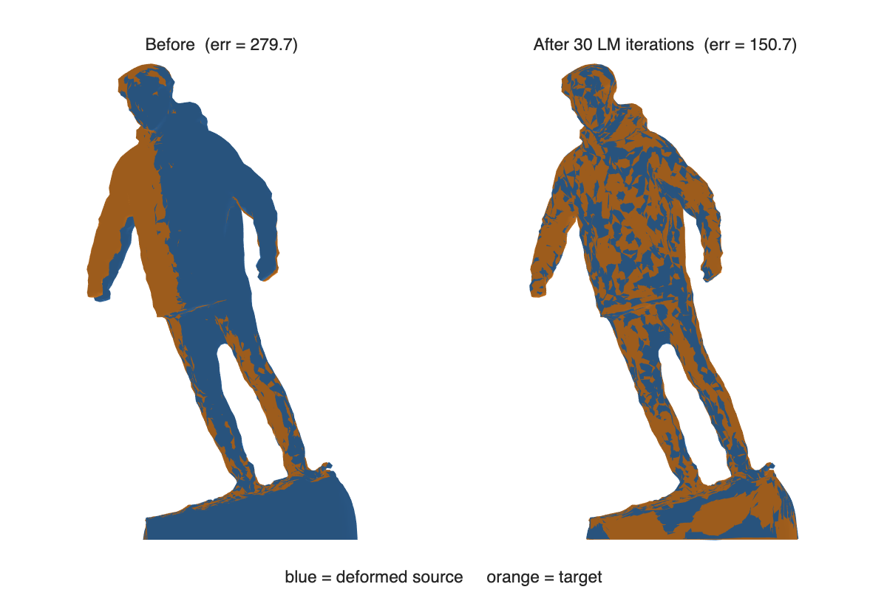
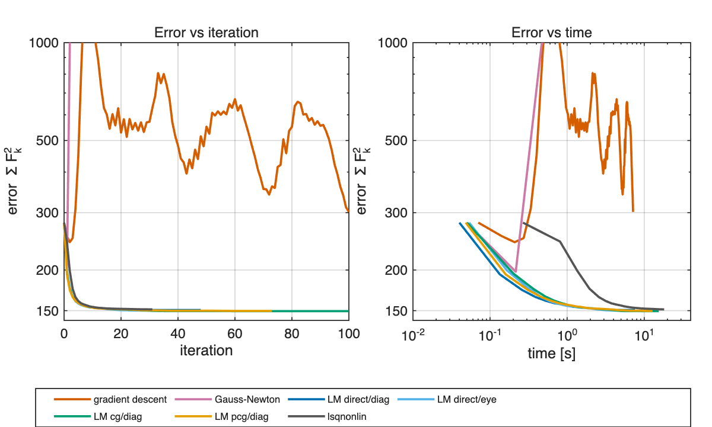

# EDSM

[한국어](README.md) | **English**

This MATLAB repository registers one mesh onto another with Embedded Deformation. Along the way it implements gradient descent, Gauss–Newton, Levenberg–Marquardt and CG/PCG, one after another, on a real problem and shows where each of them fails.

The problem is to fit a source mesh (5027 vertices) to a target mesh (5033 vertices). There are 606 variables: 600 affine-transform parameters for the 50 ED nodes plus 6 global rotation and translation parameters. The objective is `err = sum(F.^2)`, and the default LM reduces it from 279.6781 to 150.7190 in 30 iterations. The 9 tutorials explain the model, the energy, the Jacobian and each optimizer with logs and figures.



*Before and after 30 LM iterations (blue: deformed source, orange: target). Where the two surfaces appear mixed together like a mosaic in the right panel, they overlap. See [docs/00_quickstart.en.md](docs/00_quickstart.en.md) for details.*



*Error of seven solvers from the same starting point (iterations on the left, time on the right). Gradient descent oscillates, Gauss–Newton diverges (it leaves the plot), and the LM variants and `lsqnonlin` come down to about 150. [docs/08_compare.en.md](docs/08_compare.en.md) explains how to read the numbers.*

## Requirements

- MATLAB R2020b or newer. Development and testing were done only on R2026b (Apple Silicon Mac); earlier releases have not been tested.
- The core of `+edsm` runs on base MATLAB alone (no toolboxes needed).
- The Optimization Toolbox is needed only for `edsm.solvers.lsqnonlinBaseline`, tutorial 08 and the regression test. The Parallel Computing Toolbox is used only by the `parfor` option of `edsm.numericJacobian` and is optional.

## Quick start

```
git clone https://github.com/JuheonHwang/EDSM.git
cd EDSM
```

Then run the following in MATLAB.

```matlab
setup
run('tutorials/t00_quickstart.m')
```

`setup` adds the repository root to the path and checks the requirements. The script finishes within a few seconds (about 4 seconds for the solver on an Apple Silicon Mac) and prints the following line at the end.

```
err: 279.6781 -> 150.7190  (53.9% of the start value)
```

The run record is saved to `tutorials/output/t00_quickstart.log` and the figures to `docs/img/`.

## Tutorials

Each script is in `tutorials/` and its documentation is in `docs/`. The console output of every script is saved as `tutorials/output/<script>.log`, so you can see the results without running anything.

| Page | Script | What you learn |
|---|---|---|
| [00. Quickstart](docs/00_quickstart.en.md) | `t00_quickstart.m` | Run the whole pipeline once and watch `err` fall from 279.6781 to 150.7190. |
| [01. ED model](docs/01_ed_model.en.md) | `t01_ed_model.m` | Understand what the 606 parameters are and how the nodes and weights move the vertices. |
| [02. Energy terms](docs/02_energy.en.md) | `t02_energy.m` | Look at the four terms of the residual vector $F$, their normalization, and where the code differs from the textbook. |
| [03. Jacobian](docs/03_jacobian.en.md) | `t03_jacobian.m` | See the structure of the analytic Jacobian, its finite-difference verification, and the rank deficiency at the starting point (a 6-dimensional null space). |
| [04. Gradient descent](docs/04_gradient_descent.en.md) | `t04_gradient_descent.m` | See a fixed step size oscillate once it exceeds the stability limit. |
| [05. Gauss–Newton](docs/05_gauss_newton.en.md) | `t05_gauss_newton.m` | See a good first step followed by divergence caused by directions with small singular values. |
| [06. Levenberg–Marquardt](docs/06_levenberg_marquardt.en.md) | `t06_levenberg_marquardt.m` | See how the damping $\lambda$ bridges GN and gradient descent, and what the legacy Jacobian changes. |
| [07. CG and PCG](docs/07_cg_pcg.en.md) | `t07_cg_pcg.m` | See why the condition number matters when LM's linear system is solved iteratively. |
| [08. Solver comparison](docs/08_compare.en.md) | `t08_compare.m` | Put all solvers in one table and see why the numbers must not be read as a ranking. |

The documentation index is in [docs/README.en.md](docs/README.en.md).

## Repository layout

```
+edsm/                 library (package)
  loadMesh, buildModel, initParam, deform, residual, numericJacobian, ...
  +solvers/            gradientDescent, gaussNewton, levenbergMarquardt, conjGrad, lsqnonlinBaseline
tutorials/             tutorial scripts t00 ~ t08, helpers/, output/ (run logs)
docs/                  documentation (00 ~ 08, legacy_changes.md) and docs/img/ (34 figures)
data/                  input meshes simple_poisson_mesh_020.ply (source), ..._022.ply (target)
tests/                 test_core.m, test_solvers.m, test_regression.m, baseline/ (legacy numerical records)
setup.m                path setup and requirements check
```

## API at a glance

```matlab
setup
src   = edsm.loadMesh('data/simple_poisson_mesh_020.ply');   % V, F, N
tar   = edsm.loadMesh('data/simple_poisson_mesh_022.ply');
model = edsm.buildModel(src, tar);                           % settings: edsm.defaultConfig()
P0    = edsm.initParam(model);                               % identity deformation, 606 x 1

[P, hist] = edsm.solvers.levenbergMarquardt(P0, model, struct('maxIter', 30));

V = edsm.deform(P, model);                                   % deformed source vertices (nVerts x 3)
```

- Every solver has the form `[P, hist] = solver(P0, model, opts)`, where `opts` is a struct. Options and defaults are documented in the help text, for example `help edsm.solvers.levenbergMarquardt`.
- Get the residual and the Jacobian with `[F, J] = edsm.residual(P, model)`.
- Solvers do not draw figures. Receive per-iteration information through `opts.verbose` or `opts.callback`.

## Tests

Run these from the repository root.

```matlab
setup
run('tests/test_core.m')         % shared package (Jacobian vs. finite differences, etc.)
run('tests/test_solvers.m')      % solver unit tests
run('tests/test_regression.m')   % compare with the numerical records of the original scripts (needs the Optimization Toolbox)
```

When they pass, the scripts print `==== all asserted checks passed ====`, `All solver unit tests passed.` and `All regression assertions passed.` at the end. The regression test reproduces the legacy numbers with `legacyJacobian = true` ([changes relative to the original code](docs/legacy_changes.en.md)).

## Differences from the original code

This repository is a cleanup of the 8 original scripts `EDRegisterSparse_Show_iter_*.m` (now only in the git history) into a library and tutorials. The dependencies (mexopencv, the Statistics Toolbox, GPU, and the private `jwutils`) were removed, and three errors in the analytic Jacobian and a bug that left the damping fixed in CG/PCG were fixed. The legacy Jacobian can be reproduced with `cfg.legacyJacobian = true`. The script-by-script correspondence table, every behavioral difference and the verification method are in [docs/legacy_changes.en.md](docs/legacy_changes.en.md).

## References

- R. W. Sumner, J. Schmid, M. Pauly, "Embedded Deformation for Shape Manipulation", ACM Transactions on Graphics, 2007. [doi.org/10.1145/1276377.1276478](https://doi.org/10.1145/1276377.1276478)
- An explanation of function optimization methods (in Korean): [darkpgmr.tistory.com/142](https://darkpgmr.tistory.com/142)
- The conjugate gradient method (CG) and its convergence properties: [Wikipedia, Conjugate gradient method](https://en.wikipedia.org/wiki/Conjugate_gradient_method#Convergence_properties)
