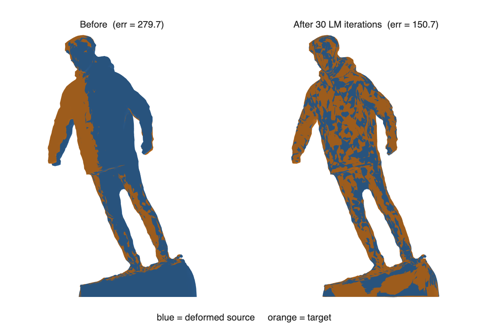
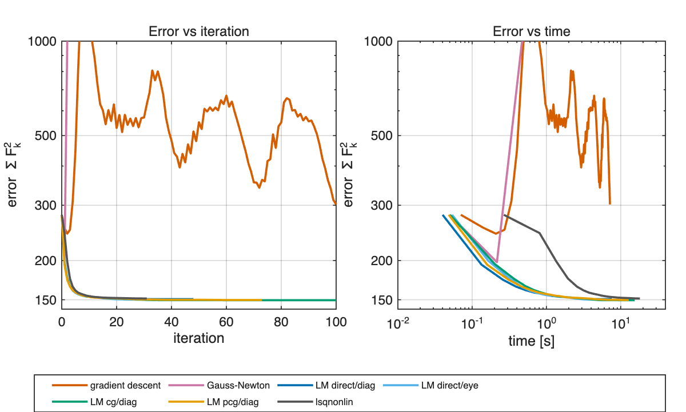

# EDSM

**한국어** | [English](README.en.md)

Embedded Deformation으로 한 메쉬를 다른 메쉬에 정합(registration)하면서, 경사하강법 → Gauss–Newton → Levenberg–Marquardt → CG/PCG를 실제 문제에서 차례로 구현하고 각각이 어디서 실패하는지 확인하는 MATLAB 저장소입니다.

소스 메쉬(5027개 정점)를 타깃 메쉬(5033개 정점)에 맞추는 문제를 풉니다. 변수는 ED 노드 50개의 아핀 변환 600개와 전역 회전·이동 6개를 합한 606개입니다. 목적함수는 `err = sum(F.^2)`이고 기본 LM으로 279.6781에서 150.7190(30회 반복)까지 줄어듭니다. 튜토리얼 9편이 모델, 에너지, Jacobian, 각 최적화기를 로그와 그림으로 설명합니다.



*LM 30회 반복 전과 후(파랑: 변형된 소스, 주황: 타깃). 오른쪽에서 두 표면이 조각처럼 섞여 있으면 겹친 것입니다. 자세한 설명은 [docs/00_quickstart.md](docs/00_quickstart.md)에 있습니다.*



*같은 시작점에서 일곱 솔버의 오차(왼쪽은 반복, 오른쪽은 시간). 경사하강법은 진동하고 Gauss–Newton은 발산하며(그림 밖으로 벗어남) LM 계열과 `lsqnonlin`은 150 근처로 내려갑니다. [docs/08_compare.md](docs/08_compare.md)에서 숫자를 읽는 법을 설명합니다.*

## 요구 사항

- MATLAB R2020b 이상. 개발과 테스트는 R2026b(Apple Silicon Mac)에서만 했으며 이전 릴리스는 시험하지 않았습니다.
- `+edsm` 핵심은 기본 MATLAB만으로 동작합니다(툴박스 불필요).
- Optimization Toolbox는 `edsm.solvers.lsqnonlinBaseline`, 튜토리얼 08, 회귀 테스트에서만 필요합니다. Parallel Computing Toolbox는 `edsm.numericJacobian`의 `parfor` 옵션에만 쓰이며 선택 사항입니다.

## 빠른 시작

```
git clone https://github.com/JuheonHwang/EDSM.git
cd EDSM
```

MATLAB에서 다음을 실행합니다.

```matlab
setup
run('tutorials/t00_quickstart.m')
```

`setup`은 저장소 루트를 경로에 추가하고 요구 사항을 점검합니다. 스크립트는 몇 초 안에 끝나며(Apple Silicon Mac에서 솔버 약 4초) 마지막에 다음 줄을 출력합니다.

```
err: 279.6781 -> 150.7190  (53.9% of the start value)
```

실행 기록은 `tutorials/output/t00_quickstart.log`에, 그림은 `docs/img/`에 저장됩니다.

## 튜토리얼

각 스크립트는 `tutorials/`에 있고, 문서는 `docs/`에 있습니다. 스크립트마다 콘솔 출력이 `tutorials/output/<스크립트>.log`로 저장되어 있어 실행하지 않고도 결과를 볼 수 있습니다.

| 문서 | 스크립트 | 배우는 것 |
|---|---|---|
| [00. 퀵스타트](docs/00_quickstart.md) | `t00_quickstart.m` | 전체 흐름을 한 번 실행하고 `err`이 279.6781에서 150.7190으로 줄어드는 것을 봅니다. |
| [01. ED 모델](docs/01_ed_model.md) | `t01_ed_model.m` | 606개 파라미터가 무엇이고 노드와 가중치가 정점을 어떻게 움직이는지 이해합니다. |
| [02. 에너지 항](docs/02_energy.md) | `t02_energy.m` | 잔차 벡터 $F$의 네 항과 정규화, 코드가 교과서와 다른 점을 확인합니다. |
| [03. Jacobian](docs/03_jacobian.md) | `t03_jacobian.m` | 해석적 Jacobian의 구조, 유한 차분 검증, 시작점의 랭크 부족(6개 영공간)을 봅니다. |
| [04. 경사하강법](docs/04_gradient_descent.md) | `t04_gradient_descent.m` | 고정 스텝이 안정 한계를 넘으면 진동하는 것을 확인합니다. |
| [05. Gauss–Newton](docs/05_gauss_newton.md) | `t05_gauss_newton.m` | 첫 단계는 좋지만 작은 특이값 방향 때문에 발산하는 것을 봅니다. |
| [06. Levenberg–Marquardt](docs/06_levenberg_marquardt.md) | `t06_levenberg_marquardt.m` | 감쇠 $\lambda$가 GN과 경사하강법을 잇는 방식과 원본 Jacobian의 영향을 봅니다. |
| [07. CG와 PCG](docs/07_cg_pcg.md) | `t07_cg_pcg.m` | LM의 선형 시스템을 반복법으로 풀 때 조건수가 왜 문제인지 봅니다. |
| [08. 솔버 비교](docs/08_compare.md) | `t08_compare.m` | 모든 솔버를 한 표에 놓고 숫자를 순위로 읽으면 안 되는 이유를 봅니다. |

문서 색인은 [docs/README.md](docs/README.md)에 있습니다.

## 저장소 구성

```
+edsm/                 라이브러리 (패키지)
  loadMesh, buildModel, initParam, deform, residual, numericJacobian, ...
  +solvers/            gradientDescent, gaussNewton, levenbergMarquardt, conjGrad, lsqnonlinBaseline
tutorials/             튜토리얼 스크립트 t00 ~ t08, helpers/, output/ (실행 로그)
docs/                  문서(00 ~ 08, legacy_changes.md)와 docs/img/ (그림 34장)
data/                  입력 메쉬 simple_poisson_mesh_020.ply (소스), ..._022.ply (타깃)
tests/                 test_core.m, test_solvers.m, test_regression.m, baseline/ (원본 수치 기록)
setup.m                경로 설정과 요구 사항 점검
```

## API 한눈에 보기

```matlab
setup
src   = edsm.loadMesh('data/simple_poisson_mesh_020.ply');   % V, F, N
tar   = edsm.loadMesh('data/simple_poisson_mesh_022.ply');
model = edsm.buildModel(src, tar);                           % 설정은 edsm.defaultConfig()
P0    = edsm.initParam(model);                               % 항등 변형, 606 x 1

[P, hist] = edsm.solvers.levenbergMarquardt(P0, model, struct('maxIter', 30));

V = edsm.deform(P, model);                                   % 변형된 소스 정점 (nVerts x 3)
```

- 솔버는 모두 `[P, hist] = solver(P0, model, opts)` 형태이고 `opts`는 구조체입니다. 옵션과 기본값은 `help edsm.solvers.levenbergMarquardt` 같은 도움말에 있습니다.
- 잔차와 Jacobian은 `[F, J] = edsm.residual(P, model)`으로 얻습니다.
- 솔버는 그림을 그리지 않습니다. 반복 정보는 `opts.verbose`나 `opts.callback`으로 받습니다.

## 테스트

저장소 루트에서 실행합니다.

```matlab
setup
run('tests/test_core.m')         % 공용 패키지 (Jacobian 대 유한 차분 등)
run('tests/test_solvers.m')      % 솔버 단위 테스트
run('tests/test_regression.m')   % 원본 스크립트의 수치 기록과 비교 (Optimization Toolbox 필요)
```

통과하면 각 스크립트가 마지막에 `==== all asserted checks passed ====`, `All solver unit tests passed.`, `All regression assertions passed.`를 출력합니다. 회귀 테스트는 `legacyJacobian = true`로 원본 수치를 재현합니다([원본 코드 대비 달라진 점](docs/legacy_changes.md)).

## 원본 코드 대비 달라진 점

이 저장소는 원본 스크립트 `EDRegisterSparse_Show_iter_*.m` 8개(현재는 git 이력에만 남아 있습니다)를 라이브러리와 튜토리얼로 정리한 것입니다. 의존성(mexopencv, Statistics Toolbox, GPU, 비공개 `jwutils`)을 제거했고, 해석적 Jacobian의 오류 세 가지와 CG/PCG의 감쇠 고정 버그를 고쳤습니다. 원본 Jacobian은 `cfg.legacyJacobian = true`로 재현할 수 있습니다. 스크립트별 대응표, 모든 동작 차이, 검증 방법은 [docs/legacy_changes.md](docs/legacy_changes.md)에 있습니다.

## 참고 자료

- R. W. Sumner, J. Schmid, M. Pauly, "Embedded Deformation for Shape Manipulation", ACM Transactions on Graphics, 2007. [doi.org/10.1145/1276377.1276478](https://doi.org/10.1145/1276377.1276478)
- 함수 최적화 기법 설명: [darkpgmr.tistory.com/142](https://darkpgmr.tistory.com/142)
- 켤레기울기법(CG)과 수렴 특성: [Wikipedia, Conjugate gradient method](https://en.wikipedia.org/wiki/Conjugate_gradient_method#Convergence_properties)
