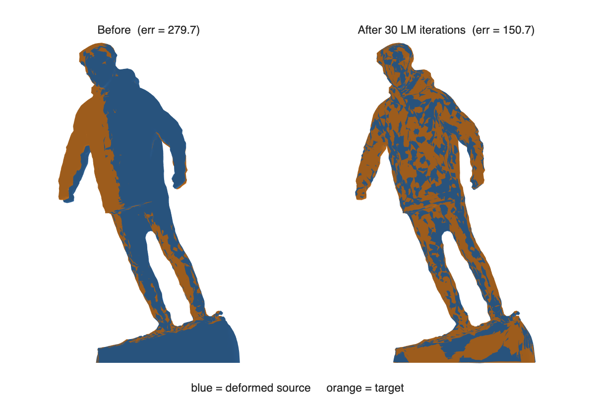
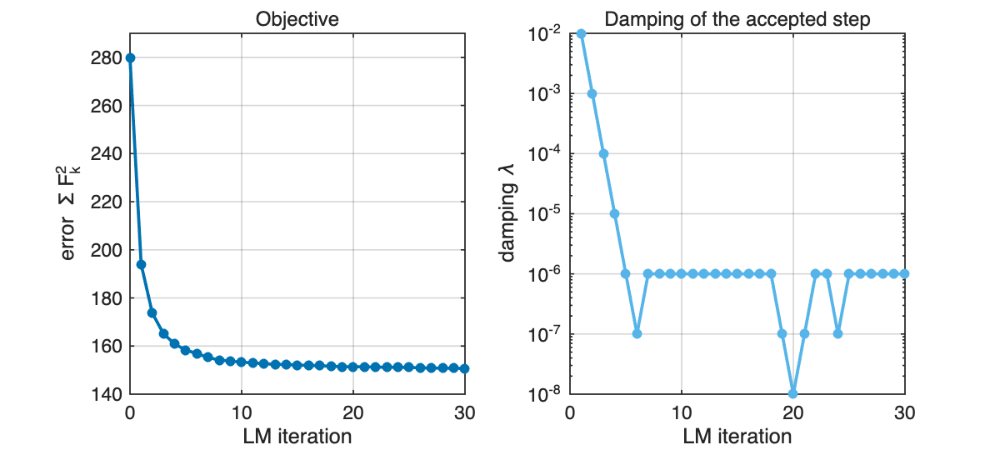

# 00. Quickstart: registering one mesh onto another

[한국어](00_quickstart.md) | **English**

## What you will learn

- Run the whole pipeline of this repository once: `loadMesh` → `buildModel` → `initParam` → solver → `deform`.
- Fitting the source mesh (5027 vertices) to the target mesh (5033 vertices) reduces the objective `err = sum(F.^2)` from 279.6781 to 150.7190. The mean distance from a target vertex to the nearest deformed source vertex goes from 13.70 to 9.52 (mesh units).
- The solver that produced this result is Levenberg–Marquardt (LM). In the following pages the series solves the problem with gradient descent, Gauss–Newton, LM and CG/PCG in turn and shows where each of them fails.

Script: [`tutorials/t00_quickstart.m`](../tutorials/t00_quickstart.m), log: [`tutorials/output/t00_quickstart.log`](../tutorials/output/t00_quickstart.log)

## How to run

In MATLAB, go to the repository root and run the following.

```matlab
setup
run('tutorials/t00_quickstart.m')
```

`setup` adds the repository root to the MATLAB path and checks that the release is R2020b or newer and that the required base functions (`pagemtimes`, `mink`, `graph`, and others) exist. From a terminal you can run it like this.

```
matlab -batch "cd('<repo path>'); setup; run('tutorials/t00_quickstart.m')"
```

When the run finishes, the console shows the following line (copied from the log). The same output is saved in `tutorials/output/t00_quickstart.log`, and two figures are generated in `docs/img/`.

```
err: 279.6781 -> 150.7190  (53.9% of the start value)
```

On the development machine (Apple Silicon Mac, MATLAB R2026b), building the model took about 0.4 seconds and the solver took a few seconds (the `LM finished` line in the log says 3.8 s). Timings vary with machine load, so treat them as rough values only.

## Walkthrough

### Problem setup

The problem is to move the vertices $v_j$ ($j=1,\dots,N$, $N=5027$) of the source mesh `data/simple_poisson_mesh_020.ply` so that they overlap the vertices $\tau_m$ ($m=1,\dots,M$, $M=5033$) of the target mesh `data/simple_poisson_mesh_022.ply`. The two meshes are a pair of meshes of the same human body, and no one-to-one correspondence between their vertices is given. The correspondence is found anew at every evaluation as "for each target vertex, the nearest deformed source vertex" (the same approach as ICP, [tutorial 02](02_energy.en.md)).

Moving each of the 5027 vertices freely would give too many variables, and the shape would easily be destroyed. So Embedded Deformation (ED) picks 1% of the source vertices (50 here) as **ED nodes** and keeps only one affine transform ($A_i$, $t_i$) per node as variables. The remaining vertices follow a weighted average of the transforms of their 4 nearest nodes. The variables are the 6 global rotation and translation parameters plus 12 per node, $6+12\cdot 50=606$ in total. Details are in [tutorial 01](01_ed_model.en.md).

### Code flow

The core of the script (copied from `tutorials/t00_quickstart.m`).

```matlab
[model, P0] = loadTutorialModel(ctx);
```

`loadTutorialModel` (`tutorials/helpers/loadTutorialModel.m`) is a helper shared by the tutorials, and internally it calls the library functions in order.

```matlab
cfg = edsm.defaultConfig();
src = edsm.loadMesh(fullfile(ctx.repoRoot, 'data', 'simple_poisson_mesh_020.ply'));
tar = edsm.loadMesh(fullfile(ctx.repoRoot, 'data', 'simple_poisson_mesh_022.ply'));
model = edsm.buildModel(src, tar, cfg);
P0 = edsm.initParam(model);
```

| Function | What it does |
|---|---|
| `edsm.loadMesh` (`+edsm/loadMesh.m`) | Reads a PLY file and returns a struct with `V` (vertices), `F` (faces) and `N` (normals). |
| `edsm.defaultConfig` (`+edsm/defaultConfig.m`) | Returns the settings (node ratio `sampleRate = 0.01`, weights `wRot = 1.0`, `wSmooth = 0.1`, `wLap = 0.01`, and so on). |
| `edsm.buildModel` (`+edsm/buildModel.m`) | Precomputes everything that does not depend on the parameters $P$ (node selection, vertex-to-node weights, node neighbors, the mesh Laplacian). |
| `edsm.initParam` (`+edsm/initParam.m`) | Builds the starting point `P0`, which corresponds to the identity deformation $R=I,\ T=0,\ A_i=I,\ t_i=0$. |

Next, check the starting value of the objective and run LM.

```matlab
F0 = edsm.residual(P0, model);
fprintf('Residual vector: %d entries, err(P0) = sum(F.^2) = %.4f\n', numel(F0), sum(F0.^2));
```

`edsm.residual` (`+edsm/residual.m`) returns the residual vector $F(P)$. The objective is $\mathrm{err}(P)=\sum_k F_k(P)^2=\|F(P)\|_2^2$, written `err` in the log. At the starting point $F$ has 30830 entries and `err(P0) = 279.6781`. What $F$ consists of is explained in [tutorial 02](02_energy.en.md).

```matlab
opts = struct('maxIter', 30, 'verbose', true);
[P, hist] = edsm.solvers.levenbergMarquardt(P0, model, opts);
```

`edsm.solvers.levenbergMarquardt` (`+edsm/+solvers/levenbergMarquardt.m`) runs LM. `maxIter` is the maximum number of **accepted** iterations, and `verbose` prints one line per iteration. The returned `hist` holds the per-iteration error (`hist.err`), damping (`hist.lambda`), step length (`hist.stepNorm`), time (`hist.time`), stop reason (`hist.stopReason`) and more. What LM solves is covered in [tutorial 06](06_levenberg_marquardt.en.md).

Finally, apply the parameters to the source vertices.

```matlab
Vdef = edsm.deform(P, model);
d0 = fitDistance(model.src.V, model.tar.V);
d1 = fitDistance(Vdef, model.tar.V);
```

`edsm.deform` (`+edsm/deform.m`) returns the source vertices deformed by `P` (`nVerts x 3`). `fitDistance` (`tutorials/helpers/fitDistance.m`) is a helper that computes, for each target vertex, the distance to the nearest deformed source vertex. This distance is the same quantity that the `Efit` term squares.

### On the default stopping criteria

This script limits the run with `maxIter = 30`, so the stop reason is `"maxIter"`. If you set `maxIter` to 100 and use the default stopping criteria (`gradTol`, `funTol`), the run stops by `funTol` after 48 iterations, as in the run in [tutorial 06](06_levenberg_marquardt.en.md), and `err` becomes 150.6621.

## Results

The last part of the log.

```
LM finished: 30 iterations, stop reason "maxIter", 3.8 s
err: 279.6781 -> 150.7190  (53.9% of the start value)
Distance target vertex -> nearest source vertex (mesh units):
  before: mean 13.70  median 12.67  95% 26.42  max 57.63
  after : mean 9.52  median 9.06  95% 17.47  max 37.23
```

`53.9%` is $150.7190/279.6781$.



*Figure 1. The left panel is the starting point (`err = 279.7`) and the right panel is after 30 LM iterations (`err = 150.7`). Blue is the (deformed) source and orange is the target; both are opaque, so you see whichever surface is in front. Where blue and orange are mixed together in pieces, the two surfaces nearly coincide, and where one color covers a wide area, the surfaces are apart there. At the starting point a wide orange region is visible on the arm and torso on the left side of the figure, and after 30 iterations most of it turns into the mosaic pattern.*

As the figure shows, the fit is not a "perfect match". The mean final distance is 9.52 and the maximum is still 37.23, and `err` is 150.7190, not 0. According to the log of tutorial 02, most of the remaining error is in the `Efit` term (109.709), while the `Elap` term (40.3429) is almost unchanged from its starting value (40.8951).



*Figure 2. The left panel shows the objective at each accepted iteration, and the right panel shows the damping $\lambda$ (log axis) that produced that iteration's step. The error drops to 193.962082 at the first iteration, 160.8770209 at the 4th and 153.2269417 at the 10th, then decreases slowly and reaches 150.7189838 at the 30th. $\lambda$ starts at 0.01, falls by a factor of 10 per iteration down to `1e-07` at iteration 6, then fluctuates around `1e-06` and goes down to `1e-08` at iteration 20.*

The large decrease at the start followed by slow decrease is typical for this problem. Even in the range where the error decreases only a little, the step length (`|step|`) swings between 9.537 and 207.9 (`iter 6` in the log is 2.079e+02 and `iter 30` is 9.537e+00). In other words, the parameters keep moving a lot while the error decreases only slightly. The reason is covered from tutorial 4 onward.

## Summary / Next

- The library's flow is model construction (`buildModel`) → starting point (`initParam`) → solver → apply (`deform`). Every solver has the form `[P, hist] = solver(P0, model, opts)`, where `opts` is a struct.
- With the default LM, `err` falls from 279.6781 to 150.7190 (30 iterations).

Next page: [01. The ED model and its parameters](01_ed_model.en.md) looks at what these 606 numbers mean.
