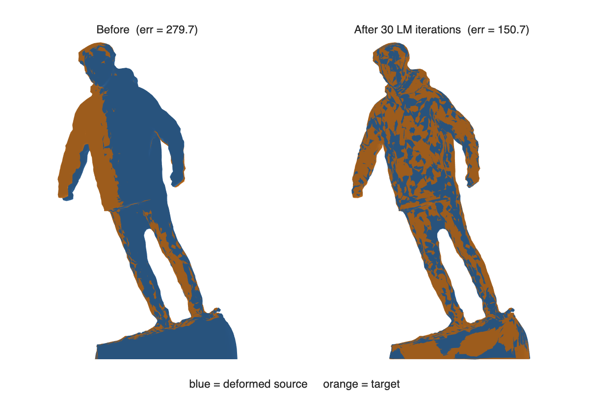
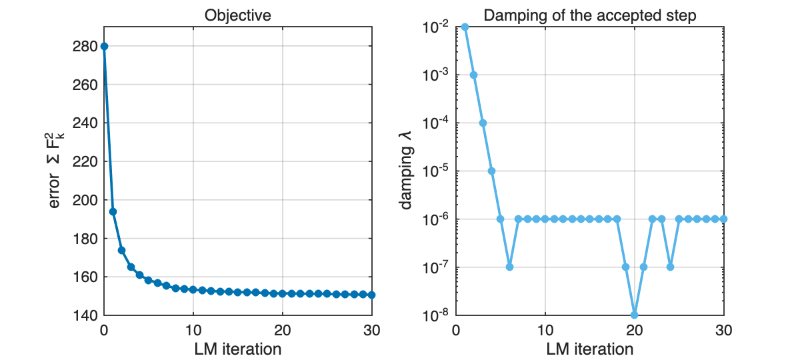

# 00. 퀵스타트: 메쉬 하나를 다른 메쉬에 정합하기

**한국어** | [English](00_quickstart.en.md)

## 이 문서에서 배우는 것

- 이 저장소의 전체 흐름인 `loadMesh` → `buildModel` → `initParam` → 솔버 → `deform`을 한 번 실행해 봅니다.
- 소스 메쉬(5027개 정점)를 타깃 메쉬(5033개 정점)에 맞추면 목적함수 `err = sum(F.^2)`가 279.6781에서 150.7190으로 줄어듭니다. 타깃 정점에서 가장 가까운 변형된 소스 정점까지의 평균 거리는 13.70에서 9.52(메쉬 단위)가 됩니다.
- 이 결과를 만든 솔버는 Levenberg–Marquardt(LM)입니다. 이 시리즈는 이후 문서에서 경사하강법, Gauss–Newton, LM, CG/PCG를 차례로 풀어 보며 각각이 어디서 실패하는지 확인합니다.

스크립트: [`tutorials/t00_quickstart.m`](../tutorials/t00_quickstart.m), 로그: [`tutorials/output/t00_quickstart.log`](../tutorials/output/t00_quickstart.log)

## 실행 방법

MATLAB에서 저장소 루트로 이동한 뒤 다음을 실행합니다.

```matlab
setup
run('tutorials/t00_quickstart.m')
```

`setup`은 저장소 루트를 MATLAB 경로에 추가하고 R2020b 이상인지, 필요한 기본 함수(`pagemtimes`, `mink`, `graph` 등)가 있는지 확인합니다. 터미널에서는 다음과 같이 실행할 수 있습니다.

```
matlab -batch "cd('<저장소 경로>'); setup; run('tutorials/t00_quickstart.m')"
```

실행이 끝나면 콘솔에 다음 줄이 나옵니다(로그에서 복사). 같은 내용이 `tutorials/output/t00_quickstart.log`에 저장되고, 그림 두 장이 `docs/img/`에 생성됩니다.

```
err: 279.6781 -> 150.7190  (53.9% of the start value)
```

실행 시간은 개발 환경(Apple Silicon Mac, MATLAB R2026b)에서 모델 구성에 약 0.4초, 솔버에 몇 초(로그의 `LM finished` 줄은 3.8 s)였습니다. 시간은 기계 부하에 따라 달라지므로 대략적인 값으로만 보십시오.

## 본문

### 문제 설정

소스 메쉬 `data/simple_poisson_mesh_020.ply`의 정점 $v_j$ ($j=1,\dots,N$, $N=5027$)를 움직여 타깃 메쉬 `data/simple_poisson_mesh_022.ply`의 정점 $\tau_m$ ($m=1,\dots,M$, $M=5033$)에 겹치게 만드는 문제입니다. 두 메쉬는 같은 인체를 담은 메쉬 쌍이며, 정점 사이의 일대일 대응은 주어지지 않습니다. 대응은 "타깃 정점마다 가장 가까운 변형된 소스 정점"으로 매 평가마다 새로 찾습니다(ICP와 같은 방식, [02장](02_energy.md)).

정점 5027개를 각각 자유롭게 움직이면 변수가 너무 많고 모양이 쉽게 망가집니다. 그래서 Embedded Deformation(ED)은 소스 정점의 1%(여기서는 50개)를 **ED 노드**로 뽑고, 노드마다 아핀 변환 하나($A_i$, $t_i$)만 변수로 둡니다. 나머지 정점은 가까운 노드 4개의 변환을 가중 평균해서 따라갑니다. 변수는 전역 회전·이동 6개와 노드당 12개를 합쳐 $6+12\cdot 50=606$개입니다. 자세한 내용은 [01장](01_ed_model.md)에 있습니다.

### 코드 흐름

스크립트의 핵심 부분입니다(`tutorials/t00_quickstart.m`에서 복사).

```matlab
[model, P0] = loadTutorialModel(ctx);
```

`loadTutorialModel`(`tutorials/helpers/loadTutorialModel.m`)은 튜토리얼 공용 도우미이며 내부에서 라이브러리 함수를 순서대로 부릅니다.

```matlab
cfg = edsm.defaultConfig();
src = edsm.loadMesh(fullfile(ctx.repoRoot, 'data', 'simple_poisson_mesh_020.ply'));
tar = edsm.loadMesh(fullfile(ctx.repoRoot, 'data', 'simple_poisson_mesh_022.ply'));
model = edsm.buildModel(src, tar, cfg);
P0 = edsm.initParam(model);
```

| 함수 | 하는 일 |
|---|---|
| `edsm.loadMesh` (`+edsm/loadMesh.m`) | PLY 파일을 읽어 `V`(정점), `F`(면), `N`(법선)을 가진 구조체를 돌려줍니다. |
| `edsm.defaultConfig` (`+edsm/defaultConfig.m`) | 설정값(노드 비율 `sampleRate = 0.01`, 가중치 `wRot = 1.0`, `wSmooth = 0.1`, `wLap = 0.01` 등)을 돌려줍니다. |
| `edsm.buildModel` (`+edsm/buildModel.m`) | 파라미터 $P$에 의존하지 않는 모든 것(노드 선택, 정점-노드 가중치, 노드 이웃, 메쉬 Laplacian)을 미리 계산합니다. |
| `edsm.initParam` (`+edsm/initParam.m`) | 항등 변형 $R=I,\ T=0,\ A_i=I,\ t_i=0$에 해당하는 시작점 `P0`를 만듭니다. |

그다음 목적함수의 시작값을 확인하고 LM을 실행합니다.

```matlab
F0 = edsm.residual(P0, model);
fprintf('Residual vector: %d entries, err(P0) = sum(F.^2) = %.4f\n', numel(F0), sum(F0.^2));
```

`edsm.residual`(`+edsm/residual.m`)은 잔차 벡터 $F(P)$를 돌려줍니다. 목적함수는 $\mathrm{err}(P)=\sum_k F_k(P)^2=\|F(P)\|_2^2$이고, 로그에서는 `err`로 표기됩니다. 시작점에서 $F$는 30830개 원소를 가지며 `err(P0) = 279.6781`입니다. $F$가 무엇으로 이루어졌는지는 [02장](02_energy.md)에서 설명합니다.

```matlab
opts = struct('maxIter', 30, 'verbose', true);
[P, hist] = edsm.solvers.levenbergMarquardt(P0, model, opts);
```

`edsm.solvers.levenbergMarquardt`(`+edsm/+solvers/levenbergMarquardt.m`)는 LM을 실행합니다. `maxIter`는 **받아들여진(accepted) 반복**의 최대 횟수이고, `verbose`는 반복마다 한 줄을 출력합니다. 돌려주는 `hist`에는 반복별 오차(`hist.err`), 감쇠(`hist.lambda`), 단계 길이(`hist.stepNorm`), 시간(`hist.time`), 종료 이유(`hist.stopReason`) 등이 들어 있습니다. LM이 무엇을 푸는지는 [06장](06_levenberg_marquardt.md)에서 다룹니다.

마지막으로 파라미터를 소스 정점에 적용합니다.

```matlab
Vdef = edsm.deform(P, model);
d0 = fitDistance(model.src.V, model.tar.V);
d1 = fitDistance(Vdef, model.tar.V);
```

`edsm.deform`(`+edsm/deform.m`)은 `P`로 변형한 소스 정점(`nVerts x 3`)을 돌려줍니다. `fitDistance`(`tutorials/helpers/fitDistance.m`)는 타깃 정점마다 가장 가까운 변형된 소스 정점까지의 거리를 계산하는 도우미입니다. 이 거리가 `Efit` 항이 제곱하는 양과 같습니다.

### 기본 종료 조건에 대해

이 스크립트는 `maxIter = 30`으로 제한했기 때문에 종료 이유가 `"maxIter"`입니다. `maxIter`를 100으로 두고 기본 종료 조건(`gradTol`, `funTol`)을 쓰면 [06장](06_levenberg_marquardt.md)의 실행처럼 48번 반복에서 `funTol`로 멈추고 `err`은 150.6621이 됩니다.

## 결과

로그의 마지막 부분입니다.

```
LM finished: 30 iterations, stop reason "maxIter", 3.8 s
err: 279.6781 -> 150.7190  (53.9% of the start value)
Distance target vertex -> nearest source vertex (mesh units):
  before: mean 13.70  median 12.67  95% 26.42  max 57.63
  after : mean 9.52  median 9.06  95% 17.47  max 37.23
```

`53.9%`는 $150.7190/279.6781$입니다.



*그림 1. 왼쪽은 시작점(`err = 279.7`), 오른쪽은 LM 30회 후(`err = 150.7`)입니다. 파란색이 (변형된) 소스, 주황색이 타깃이며 둘 다 불투명하므로 앞에 있는 표면이 보입니다. 파란색과 주황색이 조각조각 섞여 있으면 두 표면이 거의 겹친 것이고, 한 색이 넓게 보이면 그 부분에서 두 표면이 떨어져 있다는 뜻입니다. 시작점에서는 몸통 왼쪽(그림 기준) 팔과 몸통에 주황색 영역이 넓게 보이고, 30회 후에는 대부분이 조각무늬로 바뀝니다.*

그림에서 보이듯 "완전히 일치"하지는 않습니다. 최종 거리의 평균이 9.52, 최댓값이 37.23으로 남아 있고, `err`은 0이 아니라 150.7190입니다. 02장의 로그에 따르면 남은 오차 대부분은 `Efit` 항(109.709)이고, `Elap` 항(40.3429)은 시작점(40.8951)에서 거의 변하지 않습니다.



*그림 2. 왼쪽은 받아들여진 반복마다의 목적함수, 오른쪽은 그 반복의 단계를 만든 감쇠 $\lambda$(로그 축)입니다. 오차는 첫 반복에서 193.962082, 4번째 반복에서 160.8770209, 10번째 반복에서 153.2269417로 줄고 이후에는 천천히 줄어 30번째에 150.7189838이 됩니다. $\lambda$는 0.01에서 시작해 반복 6까지 10배씩 줄어 `1e-07`이 되고, 이후 `1e-06`을 중심으로 오르내리며 반복 20에서는 `1e-08`까지 내려갑니다.*

앞쪽의 큰 폭 감소와 이후의 느린 감소가 이 문제의 전형적인 모습입니다. 오차가 줄어드는 정도가 작아지는 구간에서도 단계 길이(`|step|`)는 9.537에서 207.9 사이를 오갑니다(로그의 `iter 6`이 2.079e+02, `iter 30`이 9.537e+00). 즉 파라미터는 계속 크게 움직이지만 오차는 조금씩만 줄어듭니다. 그 이유는 4장 이후 문서에서 다룹니다.

## 정리 / 다음 단계

- 라이브러리의 흐름은 모델 구성(`buildModel`) → 시작점(`initParam`) → 솔버 → 적용(`deform`)입니다. 솔버는 모두 `[P, hist] = solver(P0, model, opts)` 형태이고 `opts`는 구조체입니다.
- 기본값의 LM으로 `err`이 279.6781에서 150.7190(30회 반복)까지 내려갑니다.

다음 문서: [01. ED 모델과 파라미터](01_ed_model.md)에서 이 606개 숫자가 무엇을 뜻하는지 봅니다.
