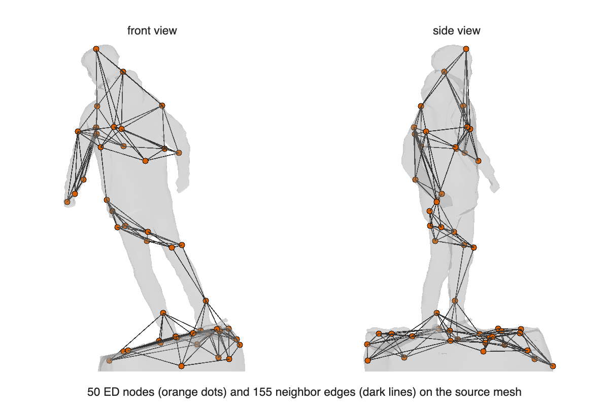
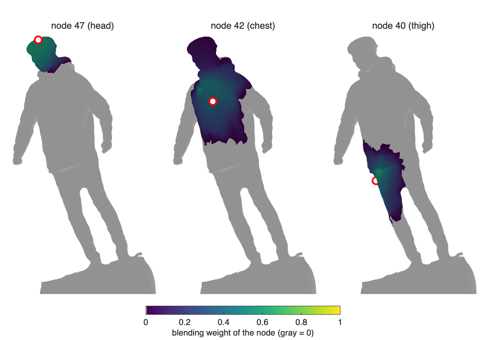
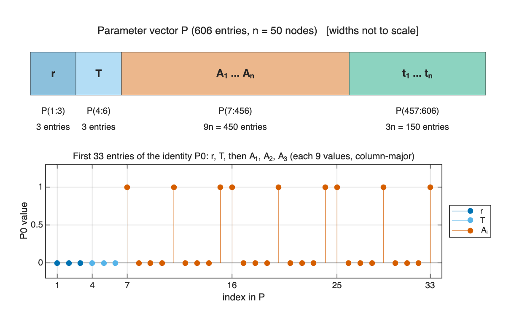
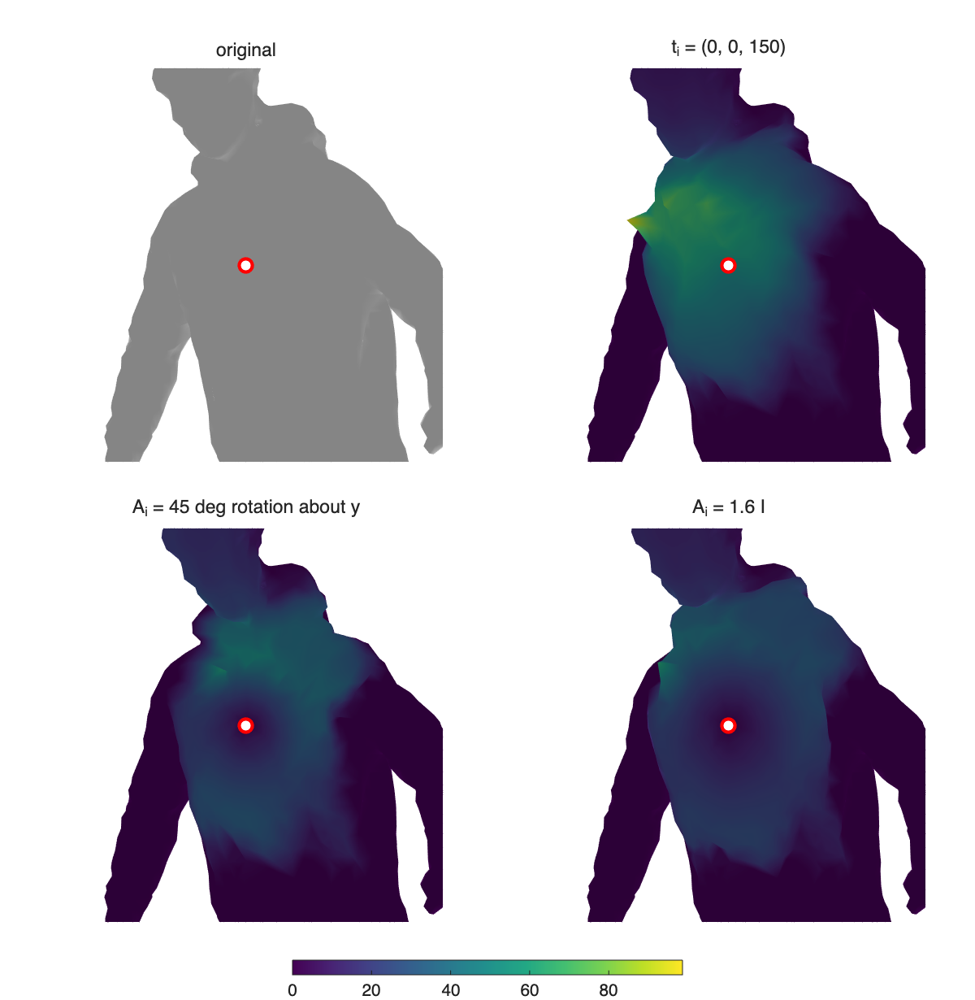
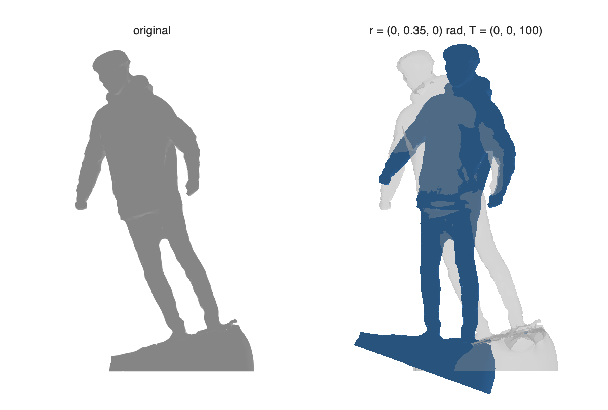

# 01. The ED model and its parameters

[한국어](01_ed_model.md) | **English**

## What you will learn

- Understand what the 606 numbers that the optimization searches for are, and how they move the 5027 vertices of the source mesh.
- The key result is `numel(P0) = 606 = 6 + 12*50`. Each of the 50 nodes has a 3x3 matrix $A_i$ (9 numbers) and a 3-dimensional translation $t_i$ (3 numbers), and on top of that come the global rotation $r$ (3 numbers) and the global translation $T$ (3 numbers).
- Check, together with the code, the vertex deformation formula, how the weights are computed, and the layout (ordering) of the parameter vector $P$. Every later page assumes this layout.

Script: [`tutorials/t01_ed_model.m`](../tutorials/t01_ed_model.m), log: [`tutorials/output/t01_ed_model.log`](../tutorials/output/t01_ed_model.log)

## How to run

```matlab
setup
run('tutorials/t01_ed_model.m')
```

No optimization is run, so it finishes in a few seconds. Five figures are generated in `docs/img/`.

## Walkthrough

### Notation

| Symbol | Meaning | Code (`model` field or segment of `P`) |
|---|---|---|
| $N=5027$ | Number of source vertices | `model.nVerts` |
| $M=5033$ | Number of target vertices | `size(model.tar.V, 1)` |
| $n=50$ | Number of ED nodes, `round(nVerts * sampleRate)` | `model.nNodes` |
| $v_j\in\mathbb R^3$ | Source vertex $j$ | `model.src.V(j,:)` |
| $g_i\in\mathbb R^3$ | Position of node $i$ (the source vertex chosen as a node) | `model.g0(:,i)` |
| $G_0$ | Centroid of the source vertices | `model.G0` |
| $A_i\in\mathbb R^{3\times 3}$ | Affine matrix of node $i$ | inside `P` |
| $t_i\in\mathbb R^3$ | Translation of node $i$ | inside `P` |
| $r\in\mathbb R^3$, $R$ | Global rotation vector and rotation matrix $R=\mathrm{rodrigues}(r)$ | `P(1:3)` |
| $T\in\mathbb R^3$ | Global translation | `P(4:6)` |

### 1. The nodes are drawn at random from the source vertices

The nodes are 1% of the source vertices. `edsm.buildModel` (`+edsm/buildModel.m`) fixes the random number generator with seed 1 and draws them.

```matlab
nNodes = round(nVerts * cfg.sampleRate);

% ---- node sampling (same as the originals) -------------------------------
rngState = rng;
rng(cfg.seed, 'twister');
nodeIdx = randperm(nVerts, nNodes);
rng(rngState);
```

The same `cfg.seed` gives the same nodes. The random state from before the call is restored. A node position $g_i$ is simply the position of that vertex (the log shows `g0 equals src.V(nodeIdx,:)': 1`). The first five nodes in the log are as follows.

```
nNodes = 50 (= round(5027 * sampleRate 0.01))
  node  1  vertex 2097  g = [  -545.1    237.0   1283.8]
  node  2  vertex 3621  g = [   467.4     51.7   1513.0]
  node  3  vertex    1  g = [  -718.9   -138.0    862.7]
```

Because node selection is random, the nodes are not spread evenly over the body. According to the log, 18 of the 50 nodes lie on the base plate under the feet (`x < -650`, a rough threshold).

### 2. The node graph: 6 neighbors per node

The smoothness term (`Esmooth`, [tutorial 02](02_energy.en.md)) makes neighboring nodes move consistently. The neighbors are the 6 nearest nodes by the **geodesic distance** measured along the mesh surface (`distanceOnMesh = true`), and the first neighbor is the node itself. `model.idxNodeNeighbor` is a `6 x 50` matrix, and the log confirms `first column is the node itself: 1`. Excluding self, there are 250 directed links (50 x 5), and 155 edges when direction is ignored.



*Figure 1. The 50 ED nodes (orange dots) and 155 neighbor edges (black lines) on the source mesh (translucent gray). The left panel is the front view and the right panel is the side view. The nodes are scattered over the arms, torso, legs and base plate, and nearby nodes are joined by lines. The lines and dots are drawn shifted slightly toward the viewpoint so that they do not hide the mesh.*

The geodesic distance is computed with `distances` on a graph whose weights are the mesh edge lengths (`buildModel.m`). With `cfg.distanceOnMesh = false`, the Euclidean distance is used.

### 3. Each vertex blends the transforms of its 4 nearest nodes

The nodes that influence vertex $v_j$ are the 4 nearest ones ($K=$ `nVertexNeighbor`); call this set $\mathcal N(j)$. The weights are built as follows (copied from `buildModel.m`).

```matlab
% Weight = 1 - d/d_max, d_max = distance to the (K+1)-th nearest node.
distNeighbor = 1.0 - (distNeighbor ./ distNeighbor(nVertexNeighbor + 1, :));
...
distNeighbor = distNeighbor ./ sum(distNeighbor, 1);   % Normalize Dist Weights
```

As a formula, with $d_{jk}$ the distance from vertex $j$ to node $k$ and $d_{j,K+1}$ the distance to the $(K+1)$-th nearest node,

$$
\hat w_{jk} = 1-\frac{d_{jk}}{d_{j,K+1}},\qquad
w_{jk}=\frac{\hat w_{jk}}{\sum_{l\in\mathcal N(j)}\hat w_{jl}},\qquad k\in\mathcal N(j).
$$

The weights are linear in the distance and are not squared. Their form may differ from the weight formula in the ED paper, so when you compare with the paper, use this formula as the reference.

The facts confirmed by the log are as follows.

- The 5018 vertices that have weights (out of 5027) all sum to 1 (`min 1.000000 max 1.000000`) and have 4 nonzero-weight nodes.
- The number of vertices that a single node influences is 147 at minimum, 372 at median and 711 at maximum.
- **9 invalid vertices.** Of the 5027 vertices, 9 have no valid ED neighbor. These vertices belong to a small disconnected component that contains no node, so their geodesic distance to the nodes is `Inf` and the weight formula above gives `Inf/Inf = NaN`. `buildModel.m` marks the `idxNeighbor` of these vertices as `NaN`, and `deform`/`residual` leave them undeformed at their source positions. This handling is the same as in the original code; the legacy Jacobian ignoring this fact was one of the bugs ([differences from the original code](legacy_changes.en.md)).



*Figure 2. For three nodes (node 47 on the head, node 42 on the chest and node 40 on the thigh), the weight of that node is shown as vertex color. The white circle with a red outline is the node position, and a weight of 0 is shown in gray. The weight is largest at the node position and falls to 0 with distance. Node 42 influences 701 vertices, node 47 influences 371 and node 40 influences 414.*

### 4. The deformation formula

The deformed position of vertex $j$ is

$$
\tilde v_j = R\Bigl(\sum_{k\in\mathcal N(j)} w_{jk}\bigl(A_k(v_j-g_k)+g_k+t_k\bigr) - G_0\Bigr) + G_0 + T .
$$

The inner sum is the weighted average of the results of each node "applying $A_k$ about $g_k$ and translating by $t_k$" (the local transform), and the outer $R$ and $T$ are the global transform about the centroid $G_0$. The code is the following three lines of `+edsm/private/deformCore.m`.

```matlab
v1_trans = squeeze(pagemtimes(A1, v1)) + g1 + t1;                                    % 3 x n x K
```
```matlab
deformedV_local = squeeze(sum(distNeighbor_ .* v1_trans, 3))' - G0(:)';   % Local Transform, n x 3
deformedV = deformedV_local * R0' + T0(:)' + G0(:)';                      % Global Transform, n x 3
```

Vertices are stored as row vectors, so $R$ is multiplied from the right as `R0'`. After this, invalid vertices are overwritten with their source positions by `deformedV(any(invalidNeibor, 1), :) = v0(:, any(invalidNeibor, 1))'`.

If $A_i=I$ and $t_i=0$, then $A_k(v_j-g_k)+g_k+t_k=v_j$ and the weights sum to 1, so the local transform becomes $v_j-G_0$, and with $R=I$ and $T=0$ the deformation is the identity. The log line `deform(P0) vs source vertices: max |diff| = 6.82e-13 (identity)` confirms this.

$A_i$ is a general 3x3 matrix and is not forced to be a rotation matrix. Keeping it "close to a rotation" is the job of the rotation term (`Erot`) of the objective.

### 5. The layout of the parameter vector $P$

$$
P = \bigl[\,r\ (3);\ T\ (3);\ A_1(:),\dots,A_n(:)\ (9n);\ t_1,\dots,t_n\ (3n)\,\bigr]^\top ,\qquad \dim P = 6+12n .
$$

Here $A_i(:)$ is MATLAB's column-major vectorization, that is, the first column, the second column and the third column of $A_i$ in that order. The encoding is in `+edsm/encodeParam.m`.

```matlab
P = [rotationMatrixToVectorLocal(R), T(:)', A(:)', t(:)']';
```

For `n = 50` the indices are as follows (from the log).

```
numel(P0) = 606 = 6 + 12*50
r = P(1:3), T = P(4:6), A = P(7:456), t = P(457:606)
A_3 occupies P(25:33); t_3 occupies P(463:465)
```

$A_i$ is `P(6+9*(i-1)+(1:9))` and $t_i$ is `P(6+9n+3*(i-1)+(1:3))`. At the identity starting point `P0`, the only nonzero entries are the diagonal slots of each $A_i$ (log: `nonzero entries of P0(1:33): [7 11 15 16 20 24 25 29 33]`).



*Figure 3. Top: the four segments of $P$ (widths are not to scale). Bottom: the first 33 entries of the identity starting point `P0`. Blue is $r$, light blue is $T$, and orange is $A_1, A_2, A_3$. Within each $A_i$, the entries equal to 1 appear at the diagonal positions in column-major order (the first, fifth and ninth entries).*

The global rotation is stored as a rotation vector $r$ (the direction is the axis, the magnitude is the angle, right-hand rule), and `edsm.rodrigues` (`+edsm/rodrigues.m`) converts it to $R$. `edsm.decodeParam` unpacks $P$ into $R, T, A, t$ and also returns $\partial R/\partial r$ (3x9). The original script used MATLAB's `rotationMatrixToVector`, whose rotation-vector convention is the transpose of that of `cv.Rodrigues`, so the two agree only when $R=I$. The inverse transform in `encodeParam` was newly written to be consistent with `edsm.rodrigues`. The round-trip check in the log (`round trip max error: R 0.0e+00 T 0.0e+00 A 0.0e+00 t 0.0e+00`) shows that `encodeParam`→`decodeParam` preserves the values.

### 6. Hand-made deformations

Changing the values of only one node with `edsm.deform` shows the role of each parameter. For node 42 near the chest, the log is as follows.

```
original                        :    0 vertices move (>1e-6), max displacement 0.0, influence region of node 42 has 701 vertices
t_i = (0, 0, 150)               :  701 vertices move (>1e-6), max displacement 98.7, influence region of node 42 has 701 vertices
A_i = 45 deg rotation about y   :  700 vertices move (>1e-6), max displacement 66.0, influence region of node 42 has 701 vertices
A_i = 1.6 I                     :  700 vertices move (>1e-6), max displacement 64.3, influence region of node 42 has 701 vertices
```

When only $t_i$ is changed, the displacement of vertex $j$ is $w_{ji}\cdot 150$, so because the weights are at most 1, the maximum displacement (98.7, that is, $0.658\times150$) is smaller than the node's displacement of 150. The influence region has 701 vertices, but only 700 move when $A_i$ is changed; this appears to be because the node's own vertex has $v-g_i=0$, so $A_i$ cannot affect it (the log shows only these numbers, and the cause was not verified).



*Figure 4. A close-up of the result of changing only the values of node 42 (white circle with a red outline). Color is the vertex displacement (mesh units). Top left is the original, top right is $t_i=(0,0,150)$, bottom left is $A_i$ rotated 45 degrees about the y axis, and bottom right is $A_i=1.6I$. The change is confined to the region around the node, and vertices outside the region stay as they were. Changing $t_i$ moves the whole influence region together, while changing $A_i$ barely moves the area around the node position (the circle) and the displacement grows with distance from the node (the area around the circle looks dark).*

The global parameters act on the whole body after blending.

```
global: r = [0 0.35 0], T = [0 0 100] -> max displacement 401.5, centroid moves by [0.1493 -1.38e-15 99.47]
```



*Figure 5. The left panel is the original, and the right panel is the source (blue) after applying $r=(0,0.35,0)$ rad and $T=(0,0,100)$, drawn over the original (translucent gray). The whole body rotates and translates as a single rigid body.*

## Summary / Next

- $P$ is ordered $[r; T; A_1(:)\dots A_n(:); t_1\dots t_n]$ and has $6+12n=606$ entries in total. $A_i$ is column-major.
- A vertex deformation blends the affine transforms of the 4 nearest nodes with linear weights (linear in distance, summing to 1) and then applies the global rotation and translation about the centroid.
- The 9 vertices with no valid ED neighbor do not respond to any parameter and stay at their source positions.
- The nodes are drawn at random, so only the same `cfg.seed` gives the same problem.

Next page: [02. The objective and its energy terms](02_energy.en.md) looks at which terms make up $F(P)$.
