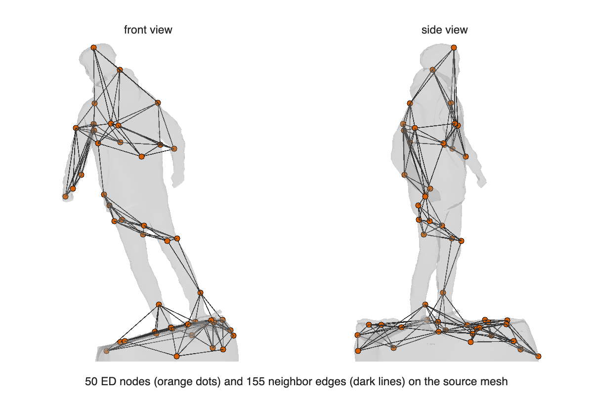
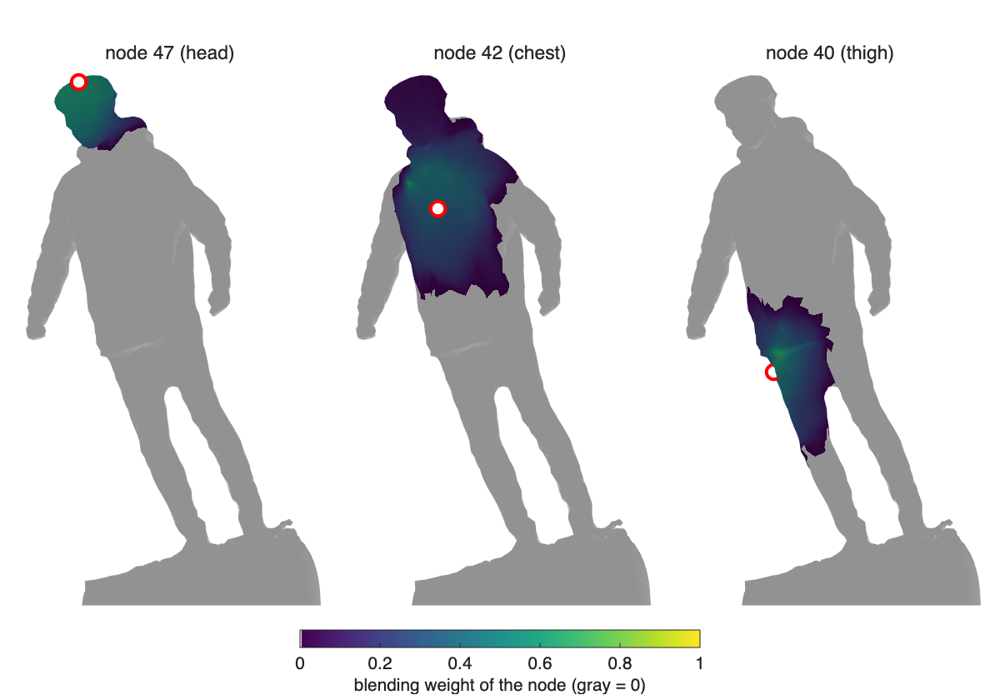
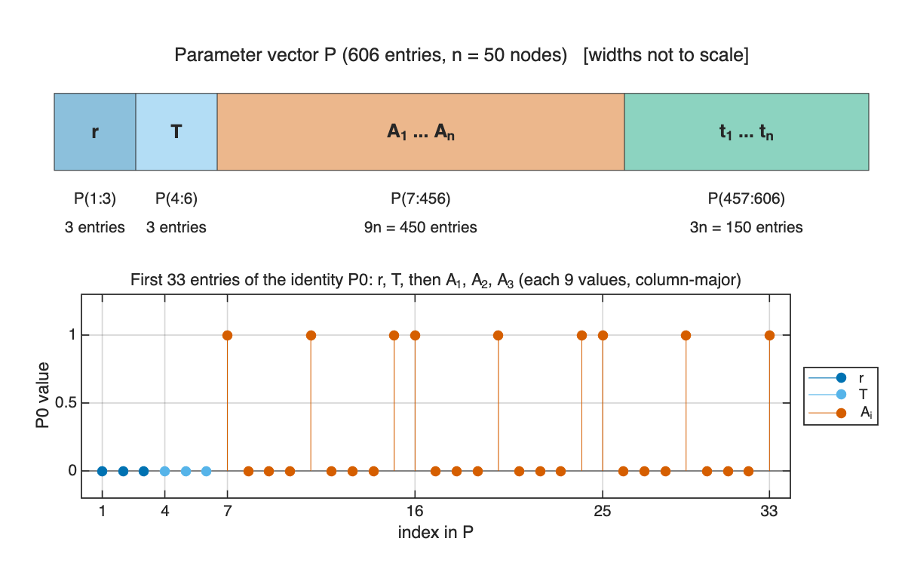
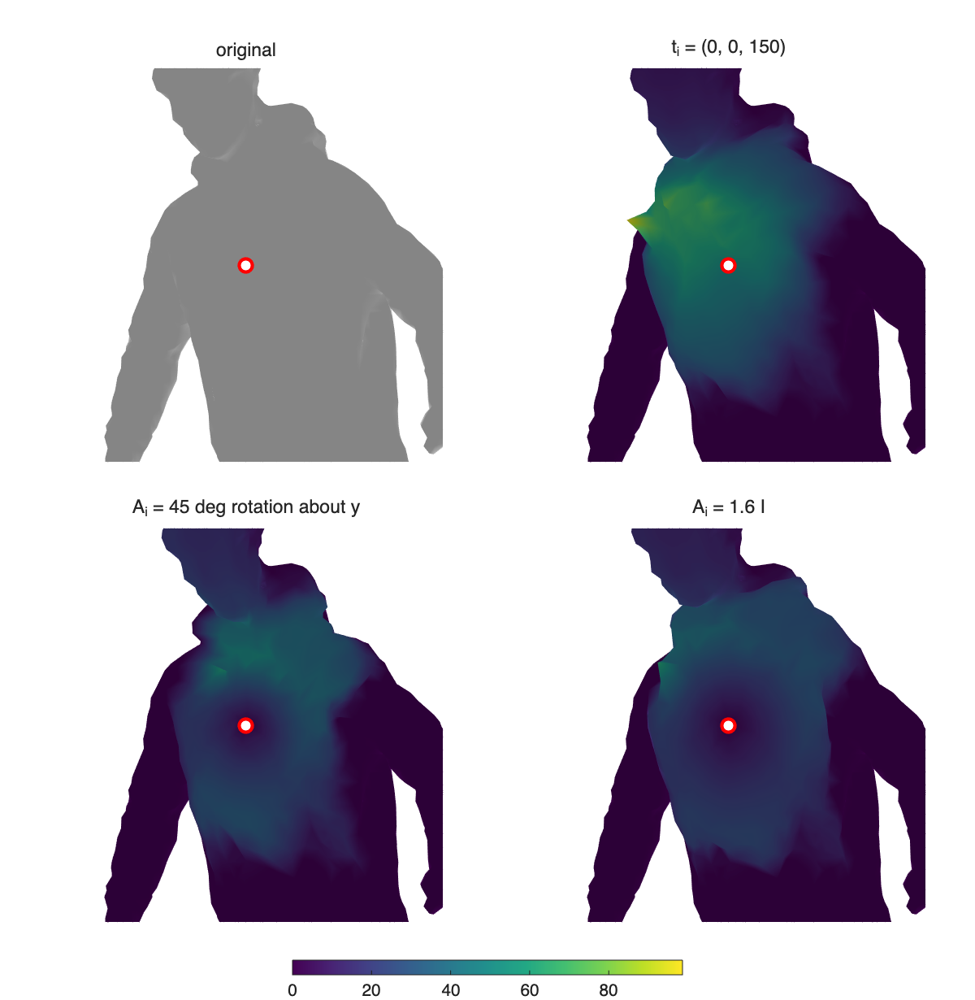
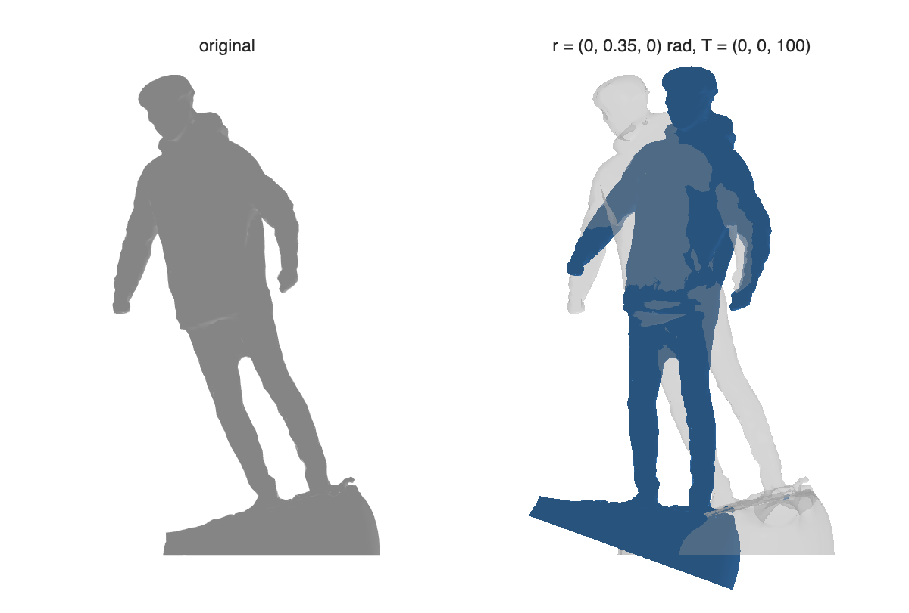

# 01. ED 모델과 파라미터

**한국어** | [English](01_ed_model.en.md)

## 이 문서에서 배우는 것

- 최적화가 찾는 606개 숫자가 무엇인지, 그리고 이 숫자들이 소스 메쉬의 5027개 정점을 어떻게 움직이는지 이해합니다.
- 핵심 결과는 `numel(P0) = 606 = 6 + 12*50`입니다. 노드 50개가 각각 3x3 행렬 $A_i$(9개)와 3차원 이동 $t_i$(3개)를 가지고, 여기에 전역 회전 $r$(3개)과 전역 이동 $T$(3개)가 더해집니다.
- 정점 변형식, 가중치 계산, 파라미터 벡터 $P$의 배치(순서)를 코드와 함께 확인합니다. 이후 모든 문서가 이 배치를 전제로 합니다.

스크립트: [`tutorials/t01_ed_model.m`](../tutorials/t01_ed_model.m), 로그: [`tutorials/output/t01_ed_model.log`](../tutorials/output/t01_ed_model.log)

## 실행 방법

```matlab
setup
run('tutorials/t01_ed_model.m')
```

최적화는 실행하지 않으므로 몇 초면 끝납니다. 그림 5장이 `docs/img/`에 생성됩니다.

## 본문

### 기호

| 기호 | 뜻 | 코드(`model` 필드 또는 `P`의 구간) |
|---|---|---|
| $N=5027$ | 소스 정점 수 | `model.nVerts` |
| $M=5033$ | 타깃 정점 수 | `size(model.tar.V, 1)` |
| $n=50$ | ED 노드 수, `round(nVerts * sampleRate)` | `model.nNodes` |
| $v_j\in\mathbb R^3$ | 소스 정점 $j$ | `model.src.V(j,:)` |
| $g_i\in\mathbb R^3$ | 노드 $i$의 위치 (노드로 뽑힌 소스 정점) | `model.g0(:,i)` |
| $G_0$ | 소스 정점들의 무게중심 | `model.G0` |
| $A_i\in\mathbb R^{3\times 3}$ | 노드 $i$의 아핀 행렬 | `P` 안 |
| $t_i\in\mathbb R^3$ | 노드 $i$의 이동 | `P` 안 |
| $r\in\mathbb R^3$, $R$ | 전역 회전 벡터와 회전 행렬 $R=\mathrm{rodrigues}(r)$ | `P(1:3)` |
| $T\in\mathbb R^3$ | 전역 이동 | `P(4:6)` |

### 1. 노드는 소스 정점에서 무작위로 뽑습니다

노드는 소스 정점의 1%입니다. `edsm.buildModel`(`+edsm/buildModel.m`)이 시드 1로 난수 생성기를 고정하고 뽑습니다.

```matlab
nNodes = round(nVerts * cfg.sampleRate);

% ---- node sampling (same as the originals) -------------------------------
rngState = rng;
rng(cfg.seed, 'twister');
nodeIdx = randperm(nVerts, nNodes);
rng(rngState);
```

`cfg.seed`가 같으면 노드가 같습니다. 호출 전의 난수 상태는 복원됩니다. 노드 위치 $g_i$는 단순히 그 정점의 위치입니다(로그의 `g0 equals src.V(nodeIdx,:)': 1`). 로그의 처음 다섯 노드는 다음과 같습니다.

```
nNodes = 50 (= round(5027 * sampleRate 0.01))
  node  1  vertex 2097  g = [  -545.1    237.0   1283.8]
  node  2  vertex 3621  g = [   467.4     51.7   1513.0]
  node  3  vertex    1  g = [  -718.9   -138.0    862.7]
```

노드 선택은 무작위이므로 몸 전체에 고르게 퍼지지는 않습니다. 로그에 따르면 50개 노드 중 18개가 발 아래의 바닥 판(`x < -650`, 대략적인 문턱값)에 있습니다.

### 2. 노드 그래프: 노드마다 이웃 6개

스무딩 항(`Esmooth`, [02장](02_energy.md))은 이웃한 노드끼리 일관되게 움직이도록 만듭니다. 이웃은 메쉬 표면을 따라 잰 **측지 거리**(geodesic distance, `distanceOnMesh = true`)로 가장 가까운 노드 6개이고, 첫 번째 이웃은 자기 자신입니다. `model.idxNodeNeighbor`는 `6 x 50` 행렬이며 로그는 `first column is the node itself: 1`을 확인합니다. 자기 자신을 뺀 방향 있는 링크는 250개(50 x 5), 방향을 무시한 간선은 155개입니다.



*그림 1. 소스 메쉬(회색 반투명) 위의 ED 노드 50개(주황색 점)와 이웃 간선 155개(검은 선). 왼쪽이 정면, 오른쪽이 측면입니다. 노드는 팔, 몸통, 다리, 바닥 판에 흩어져 있고, 가까운 노드끼리 선으로 이어져 있습니다. 선과 점은 메쉬가 가려지지 않도록 시점 방향으로 약간 옮겨 그렸습니다.*

측지 거리는 메쉬의 간선 길이를 가중치로 하는 그래프에서 `distances`로 계산합니다(`buildModel.m`). `cfg.distanceOnMesh = false`로 두면 유클리드 거리를 씁니다.

### 3. 정점마다 가까운 노드 4개의 변환을 섞습니다

정점 $v_j$에 영향을 주는 노드는 가장 가까운 4개($K=$ `nVertexNeighbor`)이며, 그 집합을 $\mathcal N(j)$라 하겠습니다. 가중치는 다음과 같이 만듭니다(`buildModel.m`에서 복사).

```matlab
% Weight = 1 - d/d_max, d_max = distance to the (K+1)-th nearest node.
distNeighbor = 1.0 - (distNeighbor ./ distNeighbor(nVertexNeighbor + 1, :));
...
distNeighbor = distNeighbor ./ sum(distNeighbor, 1);   % Normalize Dist Weights
```

수식으로는 정점 $j$에서 노드 $k$까지의 거리를 $d_{jk}$, $(K+1)$번째로 가까운 노드까지의 거리를 $d_{j,K+1}$이라 할 때

$$
\hat w_{jk} = 1-\frac{d_{jk}}{d_{j,K+1}},\qquad
w_{jk}=\frac{\hat w_{jk}}{\sum_{l\in\mathcal N(j)}\hat w_{jl}},\qquad k\in\mathcal N(j).
$$

가중치는 거리에 선형이며 제곱하지 않습니다. ED 논문의 가중치 식과 형태가 다를 수 있으므로 논문과 비교할 때는 이 식을 기준으로 확인하십시오.

로그에서 확인되는 사실은 다음과 같습니다.

- 가중치가 있는 5018개 정점(전체 5027개 중)은 모두 합이 1이고(`min 1.000000 max 1.000000`) 가중치가 0이 아닌 노드가 4개입니다.
- 노드 하나가 영향을 주는 정점 수는 최소 147, 중앙값 372, 최대 711입니다.
- **무효 정점 9개.** 5027개 중 9개 정점은 유효한 ED 이웃이 없습니다. 이 정점들은 노드가 하나도 없는 작은 분리 성분에 속해 있어 노드까지의 측지 거리가 `Inf`이고, 위 가중치 식이 `Inf/Inf = NaN`이 되기 때문입니다. `buildModel.m`은 이 정점들의 `idxNeighbor`를 `NaN`으로 표시하고, `deform`/`residual`은 이 정점을 변형하지 않고 소스 위치에 둡니다. 이 처리는 원본 코드와 같고, 원본 Jacobian이 이 사실을 무시했던 것이 버그 중 하나였습니다([원본 코드 대비 달라진 점](legacy_changes.md)).



*그림 2. 노드 3개(머리 47번, 가슴 42번, 허벅지 40번)에 대해, 그 노드의 가중치를 정점 색으로 표시한 것입니다. 빨간 테두리의 흰 원이 노드 위치이고, 색이 0이면 회색입니다. 가중치는 노드 위치에서 가장 크고 멀어질수록 0으로 줄어듭니다. 노드 42는 701개 정점에, 노드 47은 371개, 노드 40은 414개 정점에 영향을 줍니다.*

### 4. 변형식

정점 $j$의 변형된 위치는 다음과 같습니다.

$$
\tilde v_j = R\Bigl(\sum_{k\in\mathcal N(j)} w_{jk}\bigl(A_k(v_j-g_k)+g_k+t_k\bigr) - G_0\Bigr) + G_0 + T .
$$

안쪽 합은 각 노드가 "$g_k$를 중심으로 $A_k$를 적용하고 $t_k$만큼 이동"한 결과를 가중 평균한 것(지역 변환)이고, 바깥의 $R$, $T$는 무게중심 $G_0$ 기준의 전역 변환입니다. 코드는 `+edsm/private/deformCore.m`의 다음 세 줄입니다.

```matlab
v1_trans = squeeze(pagemtimes(A1, v1)) + g1 + t1;                                    % 3 x n x K
```
```matlab
deformedV_local = squeeze(sum(distNeighbor_ .* v1_trans, 3))' - G0(:)';   % Local Transform, n x 3
deformedV = deformedV_local * R0' + T0(:)' + G0(:)';                      % Global Transform, n x 3
```

정점은 행 벡터로 저장되므로 $R$이 `R0'`로 오른쪽에 곱해집니다. 무효 정점은 이 뒤에 `deformedV(any(invalidNeibor, 1), :) = v0(:, any(invalidNeibor, 1))'`로 소스 위치로 덮어씁니다.

$A_i=I$, $t_i=0$이면 $A_k(v_j-g_k)+g_k+t_k=v_j$이고 가중치 합이 1이므로 지역 변환은 $v_j-G_0$가 되어, $R=I$, $T=0$일 때 변형은 항등입니다. 로그의 `deform(P0) vs source vertices: max |diff| = 6.82e-13 (identity)`가 이를 확인합니다.

$A_i$는 일반 3x3 행렬이며 회전 행렬로 강제되지 않습니다. "회전에 가깝게" 유지하는 일은 목적함수의 회전 항(`Erot`)이 합니다.

### 5. 파라미터 벡터 $P$의 배치

$$
P = \bigl[\,r\ (3);\ T\ (3);\ A_1(:),\dots,A_n(:)\ (9n);\ t_1,\dots,t_n\ (3n)\,\bigr]^\top ,\qquad \dim P = 6+12n .
$$

여기서 $A_i(:)$는 MATLAB의 열 우선(column-major) 벡터화입니다. 즉 $A_i$의 첫 번째 열, 두 번째 열, 세 번째 열 순서입니다. 인코딩은 `+edsm/encodeParam.m`에 있습니다.

```matlab
P = [rotationMatrixToVectorLocal(R), T(:)', A(:)', t(:)']';
```

`n = 50`일 때 인덱스는 다음과 같습니다(로그).

```
numel(P0) = 606 = 6 + 12*50
r = P(1:3), T = P(4:6), A = P(7:456), t = P(457:606)
A_3 occupies P(25:33); t_3 occupies P(463:465)
```

$A_i$는 `P(6+9*(i-1)+(1:9))`, $t_i$는 `P(6+9n+3*(i-1)+(1:3))`입니다. 항등 시작점 `P0`에서 0이 아닌 원소는 각 $A_i$의 대각 슬롯뿐입니다(로그: `nonzero entries of P0(1:33): [7 11 15 16 20 24 25 29 33]`).



*그림 3. 위: $P$의 네 구간(폭은 비례하지 않음). 아래: 항등 시작점 `P0`의 처음 33개 원소. 파란색은 $r$, 연한 파란색은 $T$, 주황색은 $A_1, A_2, A_3$입니다. 각 $A_i$ 안에서 1인 원소가 열 우선 순서의 대각 위치(첫 원소, 다섯 번째, 아홉 번째)에 나타납니다.*

전역 회전은 회전 벡터 $r$로 저장하고(방향이 축, 크기가 각도, 오른손 법칙) `edsm.rodrigues`(`+edsm/rodrigues.m`)가 $R$로 바꿉니다. `edsm.decodeParam`은 $P$를 $R, T, A, t$로 풀고 $\partial R/\partial r$(3x9)도 돌려줍니다. 원본 스크립트는 MATLAB의 `rotationMatrixToVector`를 썼는데, 그 함수의 회전 벡터 규약은 `cv.Rodrigues`와 전치 관계여서 $R=I$일 때만 일치합니다. `encodeParam`의 역변환은 `edsm.rodrigues`와 일관되게 새로 만든 것입니다. 로그의 왕복 검사(`round trip max error: R 0.0e+00 T 0.0e+00 A 0.0e+00 t 0.0e+00`)는 `encodeParam`→`decodeParam`이 값을 보존함을 보여 줍니다.

### 6. 손으로 만든 변형

`edsm.deform`으로 한 노드의 값만 바꿔 보면 각 파라미터의 역할이 보입니다. 가슴 근처 노드 42에 대해 로그는 다음과 같습니다.

```
original                        :    0 vertices move (>1e-6), max displacement 0.0, influence region of node 42 has 701 vertices
t_i = (0, 0, 150)               :  701 vertices move (>1e-6), max displacement 98.7, influence region of node 42 has 701 vertices
A_i = 45 deg rotation about y   :  700 vertices move (>1e-6), max displacement 66.0, influence region of node 42 has 701 vertices
A_i = 1.6 I                     :  700 vertices move (>1e-6), max displacement 64.3, influence region of node 42 has 701 vertices
```

$t_i$만 바꾸면 정점 $j$의 이동량은 $w_{ji}\cdot 150$이므로, 가중치가 1 이하인 만큼 최대 이동량(98.7, 즉 $0.658\times150$)이 노드의 이동량 150보다 작습니다. 영향 영역이 701개인데 $A_i$를 바꾼 경우 700개만 움직이는 것은, 노드 정점 자신은 $v-g_i=0$이라 $A_i$가 그 정점에 영향을 주지 못하기 때문으로 보입니다(로그는 이 숫자만 보여 주며 원인은 확인하지 않았습니다).



*그림 4. 노드 42(빨간 테두리의 흰 원)의 값만 바꾼 결과를 확대한 것입니다. 색은 정점의 이동량(메쉬 단위)입니다. 왼쪽 위가 원본, 오른쪽 위가 $t_i=(0,0,150)$, 왼쪽 아래가 $A_i$를 y축으로 45도 회전, 오른쪽 아래가 $A_i=1.6I$입니다. 변화는 노드 주변 영역에 한정되고 영역 밖의 정점은 그대로입니다. $t_i$를 바꾸면 영향 영역 전체가 함께 움직이고, $A_i$를 바꾸면 노드 위치(원) 주변은 거의 움직이지 않고 노드에서 멀어질수록 이동량이 커집니다(원 주위가 어둡게 보입니다).*

전역 파라미터는 블렌딩 후의 몸 전체에 작용합니다.

```
global: r = [0 0.35 0], T = [0 0 100] -> max displacement 401.5, centroid moves by [0.1493 -1.38e-15 99.47]
```



*그림 5. 왼쪽은 원본, 오른쪽은 원본(회색 반투명) 위에 $r=(0,0.35,0)$ rad, $T=(0,0,100)$을 적용한 소스(파란색)입니다. 몸 전체가 하나의 강체처럼 회전하고 이동합니다.*

## 정리 / 다음 단계

- $P$는 $[r; T; A_1(:)\dots A_n(:); t_1\dots t_n]$ 순서이며 총 $6+12n=606$개입니다. $A_i$는 열 우선입니다.
- 정점 변형은 가까운 노드 4개의 아핀 변환을 선형 가중(거리에 선형, 합 1)으로 섞은 뒤 무게중심 기준 전역 회전·이동을 적용한 것입니다.
- 유효한 ED 이웃이 없는 정점 9개는 어떤 파라미터에도 반응하지 않고 소스 위치에 남습니다.
- 노드는 무작위로 뽑으므로 `cfg.seed`가 같아야 같은 문제입니다.

다음 문서: [02. 목적함수와 에너지 항](02_energy.md)에서 $F(P)$가 어떤 항으로 이루어지는지 봅니다.
