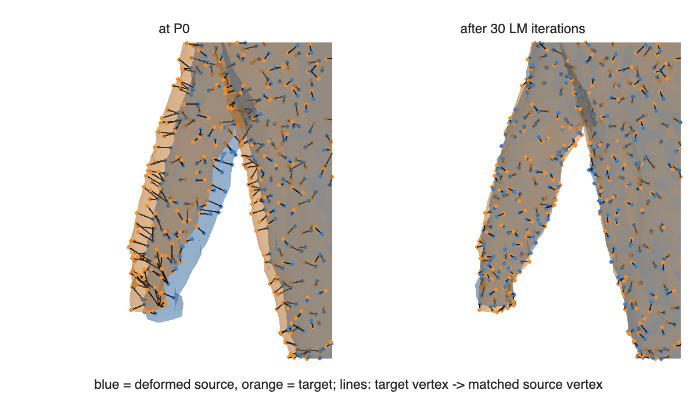
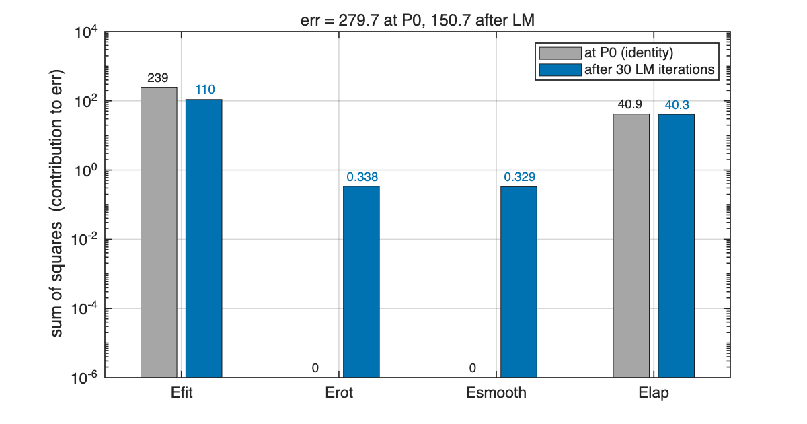
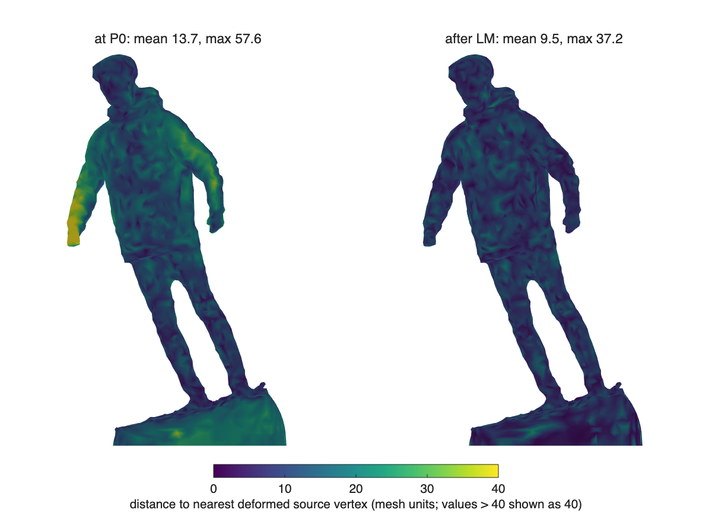
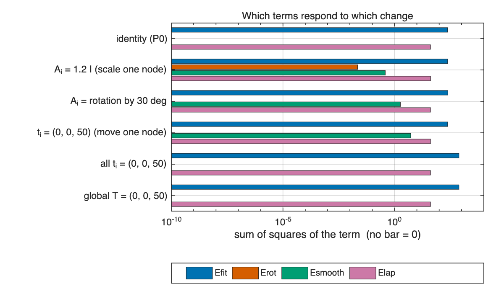

# 02. The objective and its energy terms

[한국어](02_energy.md) | **English**

## What you will learn

- Understand which residual vector $F$ the quantity that the optimization minimizes, `err(P) = sum(F.^2)`, is built from, and what each of the four energy terms (`Efit`, `Erot`, `Esmooth`, `Elap`) prevents.
- The key result is that of the starting value `err(P0) = 279.678134`, `Efit` is 238.783 (85.3778%), `Elap` is 40.8951 (14.6222%), and the other two terms are 0. After 30 LM iterations `Efit` drops to 109.709, but `Elap` stays almost the same at 40.3429.
- Check where the code differs from the textbook or the paper. The smoothness term is a sum over the neighbors without per-edge weights, the Laplacian term is the Laplacian of the deformed mesh itself, and the correspondences are found again at every evaluation.

Script: [`tutorials/t02_energy.m`](../tutorials/t02_energy.m), log: [`tutorials/output/t02_energy.log`](../tutorials/output/t02_energy.log)

## How to run

```matlab
setup
run('tutorials/t02_energy.m')
```

It runs 30 LM iterations once, so it takes a dozen or so seconds. Four figures are generated in `docs/img/`.

## Walkthrough

### The residual vector $F$

`edsm.residual` (`+edsm/residual.m`) returns the residual vector $F(P)$ for the parameters $P$, and the objective is $\mathrm{err}(P)=\|F(P)\|_2^2=\sum_k F_k^2$. $F$ is a column vector that stacks five blocks vertically (copied from the code).

```matlab
F = [Efit(:); w_rot*Erot1(:); w_rot*Erot2(:); w_smooth*Esmooth(:); w_lap* Elap(:)];
```

`Erot1` and `Erot2` together make up the `Erot` term, so there are four energy terms. The default weights are `wRot = 1.0`, `wSmooth = 0.1` and `wLap = 0.01`, and they live in `edsm.defaultConfig`. The row range of each block within $F$ is available from `info.rows` in `[F, J, info] = edsm.residual(P, model)`, and the values in the log are as follows.

```
Row ranges of F (numel(F) = 30830):
  fit     rows     1 : 15099   (15099 entries)
  rot1    rows 15100 : 15549   (  450 entries)
  rot2    rows 15550 : 15599   (   50 entries)
  smooth  rows 15600 : 15749   (  150 entries)
  lap     rows 15750 : 30830   (15081 entries)
```

The sizes are $3M$, $9n$, $n$, $3n$ and $3N$ respectively ($M=5033$ target vertices, $n=50$ nodes, $N=5027$ source vertices).

### Term 1: `Efit` (fit term)

For each target vertex $\tau_m$, find the nearest of the deformed source vertices, $\tilde v_{c(m)}$, and take the difference as the residual.

$$
c(m)=\arg\min_j \|\tilde v_j-\tau_m\|,\qquad
E_{\text{fit},m}=\frac{\tilde v_{c(m)}-\tau_m}{\sqrt{M}}\in\mathbb R^3 .
$$

```matlab
Efit = (deformedV(indices, :) - model.tar.V) ./ sqrt(n_target);               % nTar x 3
```

Therefore $\sum \|E_{\text{fit},m}\|^2$ is the **mean of the squared distances**. The check in the log: `sum(Efit.^2) = sum(d.^2)/nTar = 238.783004 vs 238.783004`.

Correspondences are found **from target to source** (`edsm.nearestIdx(deformedV, model.tar.V)`). One source vertex can correspond to several target vertices, and some source vertices correspond to no target at all. In the log, at the starting point the 5033 target vertices correspond to only 3617 of the 5027 source vertices (72.0%), and after 30 LM iterations they correspond to 3869.

The correspondences are recomputed every time $P$ changes (the same approach as ICP). So $F$ is not a smooth function of $P$ but a **piecewise smooth** one. $F$ is discontinuous where the correspondences change, and the analytic Jacobian differentiates with the correspondences held constant ([tutorial 03](03_jacobian.en.md)). This is why, in the later pages, the word "converged" has to be used carefully whatever value a solver stops at.



*Figure 1. A close-up near target vertex 5019 (`d0 = 57.6`), the one farthest away at the starting point. Blue is the deformed source and orange is the target, and the black lines connect a target vertex (orange dot) to the source vertex it corresponds to (blue dot) (every second one of the 656 target vertices in the window, 328 in all). In the left panel (starting point) the lines are long, and in the right panel (after 30 LM iterations) they become short. A correspondence is only the nearest point, not an anatomical correspondence.*

### Term 2: `Erot` (rotation term)

This term holds $A_i$ close to a rotation matrix. It consists of two parts.

$$
E_{\text{rot1},i}=\frac{A_i^\top A_i-I}{\sqrt n}\in\mathbb R^{3\times3},\qquad
E_{\text{rot2},i}=\frac{\det A_i-1}{\sqrt n}.
$$

```matlab
Erot1 = (pagemtimes(A0, 'transpose', A0, 'none') - reshape(eye(3), 3, 3, 1)) ./ sqrt(n_nodes);   % 3 x 3 x n
Erot2 = (pagedet(A0) - 1.0) ./ sqrt(n_nodes);                                                    % 1 x 1 x n
```

$A_i^\top A_i=I$ means the columns are orthonormal, and adding $\det A_i=1$ makes it a rotation rather than a reflection. $E_{\text{rot1}}$ is a symmetric matrix, so the off-diagonal entries enter twice. In $F$, both blocks are multiplied by `wRot`. At the starting point, where $A_i=I$, both are 0.

### Term 3: `Esmooth` (smoothness term)

For the neighbor set $\mathcal N_s(i)$ of node $i$ (6 nodes including itself, tutorial 01), the residual is

$$
E_{\text{smooth},i}=\frac{1}{\sqrt{3n}}\sum_{j\in\mathcal N_s(i)}\Bigl(A_i(g_j-g_i)+g_i+t_i-g_j-t_j\Bigr)\in\mathbb R^3 .
$$

The expression in parentheses is "the difference between where node $i$'s transform sends the position $g_j$ of neighbor $j$ ($A_i(g_j-g_i)+g_i+t_i$) and where node $j$ goes by itself ($g_j+t_j$)". It is 0 if the neighbors do not disagree with each other.

```matlab
Esmooth = sum(squeeze(pagemtimes(A0, v_node1)) + g0 + t0 - g_node1 - t_node1, 3) ./ sqrt(3 * n_nodes);   % 3 x n
```

(`v_node1` is $g_j-g_i$.) The smoothness energy of textbook ED multiplies each edge by a weight and adds the **squared norm per edge**. This code is different.

- The sum over the neighbors is taken **before squaring**. Vectors coming from different neighbors of the same node can cancel each other.
- There are no per-edge weights (all are 1), and the normalization is $\sqrt{3n}$ rather than the number of edges.
- The self ($j=i$) term is always 0 and contributes nothing.

This is a direct transcription of the definition in the original script.

### Term 4: `Elap` (Laplacian term)

This term makes the Laplacian of the deformed mesh vertices small.

$$
E_{\text{lap}}=\mathrm{diag}(L)^{-1}\,L\,\tilde V\in\mathbb R^{N\times 3},
$$

where $\tilde V$ is the $N\times 3$ matrix stacking the deformed vertices as rows and $L$ is the graph Laplacian of the source mesh. The edge weight is the edge length (`graph(s, t, w)` and `laplacian(G)` in `buildModel.m`), and each row is divided by the diagonal entry of $L$ (the sum of edge lengths).

```matlab
Elap = (Lap * deformedV) ./ model.lapDiag;                                    % nVerts x 3
```

This term has no $1/\sqrt{\cdot}$ normalization and is multiplied only by `wLap = 0.01`. There are two points to note.

1. **It is the Laplacian of the deformed mesh itself, not the difference from the original shape.** Even at the undeformed starting point it is the Laplacian of the source mesh, so it is not 0 (`Elap`: 40.8951 at the starting point). So this term does not "preserve the original roughness"; it makes the "Laplacian small". In the log it barely decreases even after LM, to 40.3429. This seems to be because the ED deformation can hardly change the fine roughness of the mesh, but the log shows only the values, and the cause was not verified.
2. For the 9 invalid vertices (tutorial 01), even though they stay at their source positions, the Laplacian changes if their neighboring vertices move.

### Magnitudes at the starting point

At the starting point $P_0$, $A_i=I$, so `Erot` and `Esmooth` are exactly 0 (log: `max |Erot| = 0.00e+00, max |Esmooth| = 0.00e+00 at P0`).

```
Contribution to err(P0) = sum(F.^2) = 279.678134
  term     sum of squares      share
  Efit            238.783   85.3778%
  Erot                  0    0.0000%
  Esmooth               0    0.0000%
  Elap            40.8951   14.6222%
```

The per-vertex residual of `Elap` has a mean of 0.08087 and a maximum of 0.3973 (values with `wLap = 0.01` already multiplied in, the residual norms of the 5027 vertices).

## Results

### Per-term contributions before and after optimization

The values after 30 LM iterations (tutorial 06) (from the log).

```
After 30 LM iterations, err = 150.718984
  term              at P0         after LM
  Efit            238.783          109.709
  Erot                  0         0.337724
  Esmooth               0         0.329217
  Elap            40.8951          40.3429
```



*Figure 2. The sum of squares per term (log axis). Gray is the starting point and blue is after 30 LM iterations. `Efit` falls from 238.783 to 109.709, `Erot` and `Esmooth` rise from 0 to 0.337724 and 0.329217 respectively (because a deformation now exists), and `Elap` barely changes from 40.8951 to 40.3429. A value of 0 has no bar on the log axis, and only the number 0 is shown.*

The decrease in `Efit` is $238.783-109.709$, and this accounts for most of the decrease in `err` ($279.678134-150.718984$). The increase in the regularization terms (`Erot`, `Esmooth`) is small, less than 1 in total.

### Fit error in terms of distance

Statistics of the distance $d_m=\|\tilde v_{c(m)}-\tau_m\|$ that `Efit` squares (from the log, mesh units).

| | Mean | Median | Maximum |
|---|---|---|---|
| Starting point | 13.70 | 12.67 | 57.63 |
| After 30 LM iterations | 9.52 | 9.06 | 37.23 |

The fraction of target vertices with a distance greater than 40 is 0.8% at the starting point and 0.0% after LM.



*Figure 3. The vertices of the target mesh colored by the distance to the nearest deformed source vertex (values above 40 are shown as 40). The left panel is the starting point (mean 13.7, maximum 57.6) and the right panel is after 30 LM iterations (mean 9.5, maximum 37.2). At the starting point the lower part of the left arm in the figure is the brightest (the largest distance), and after LM the picture becomes darker overall.*

### How the terms respond to parameter changes

Looking at which terms respond when only one thing is changed makes the role of each term clear. This is the log for node 42 (chest).

```
  perturbation                                 Efit         Erot      Esmooth         Elap        total
  identity (P0)                               238.8            0            0         40.9   279.678134
  A_i = 1.2 I (scale one node)                239.6      0.02222       0.3841         41.1   281.112585
  A_i = rotation by 30 deg                    243.8            0        1.824        40.98   286.645075
  t_i = (0, 0, 50) (move one node)            239.5            0        5.333        41.01   285.836738
  all t_i = (0, 0, 50)                        767.1            0            0         40.9   808.017231
  global T = (0, 0, 50)                       767.1            0            0         40.9   808.017231
```

- Scaling $A_i$ of one node by 1.2 makes all four terms respond. `Erot` is nonzero (0.02222) because $A_i$ is not a rotation, and `Esmooth` rises (0.3841) because the node disagrees with its neighbors.
- Rotating $A_i$ by 30 degrees leaves `Erot` at 0. A rotation preserves $A^\top A=I$ and $\det A=1$. Instead `Esmooth` is 1.824 because the node disagrees with its neighbors.
- Moving just one node makes `Esmooth` respond the most, at 5.333.
- **Moving all $t_i$ equally** and **moving the global $T$** are exactly the same, with `Efit` 767.1 and `total` 808.017231, and `Esmooth` is 0. This is because when all nodes move together there is no disagreement between neighbors, and because the weights sum to 1, the vertices move by the same amount. The fact that these two directions have the same effect is the null space of the Jacobian that we will see in [tutorial 03](03_jacobian.en.md).



*Figure 4. The sum of squares of the four terms when the parameters are changed one at a time (horizontal bars, log axis). A term with no bar has the value 0. In the last two rows (moving all $t_i$ and moving the global $T$), the bars for `Efit` and `Elap` have the same length, and `Erot` and `Esmooth` are 0.*

## Summary / Next

- $F$ is the vector that stacks [`Efit` (3M entries), `wRot*Erot1` (9n entries), `wRot*Erot2` (n entries), `wSmooth*Esmooth` (3n entries), `wLap*Elap` (3N entries)], and the terms are normalized by $1/\sqrt M$, $1/\sqrt n$, $1/\sqrt{3n}$ and $1/\mathrm{diag}(L)$. `Elap` has no $1/\sqrt{\cdot}$ normalization.
- `Efit` is the mean squared distance from each target vertex to its nearest deformed source vertex, and because the correspondences are recomputed at every evaluation, the objective is piecewise smooth.
- `Esmooth` is a simple form that squares the sum over the neighbors, and `Elap` is the Laplacian of the deformed mesh itself, so it is not 0 even at the starting point.
- The starting value `err(P0) = 279.678134` is `Efit` 85.3778% and `Elap` 14.6222%.

Next page: [03. The analytic Jacobian](03_jacobian.en.md) looks at the structure and verification of the matrix $J$, the derivative of $F$ with respect to $P$.
