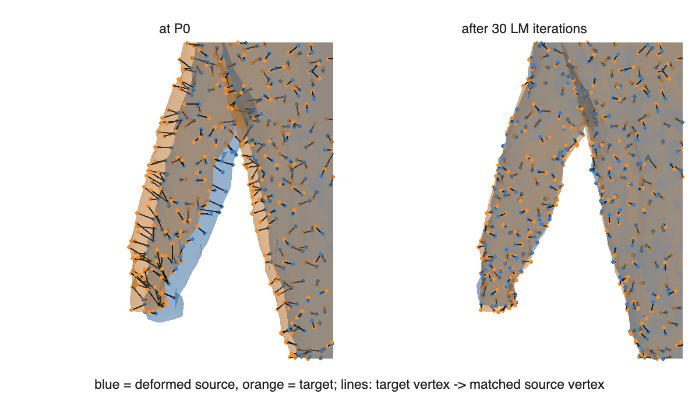
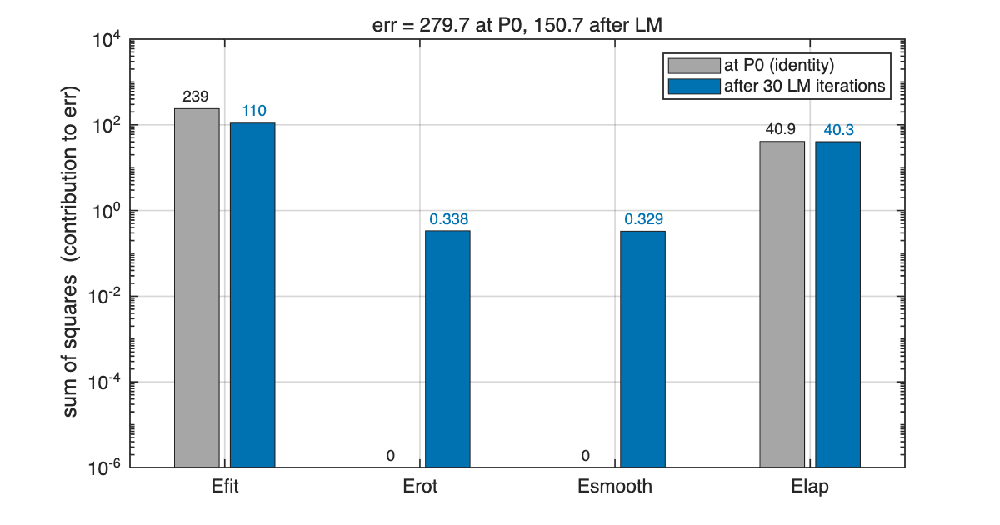
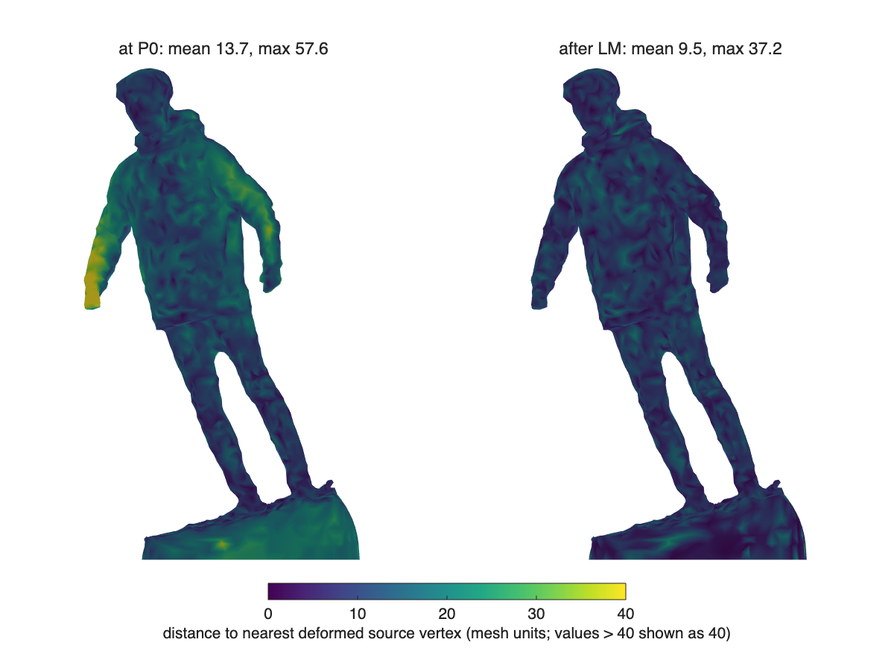
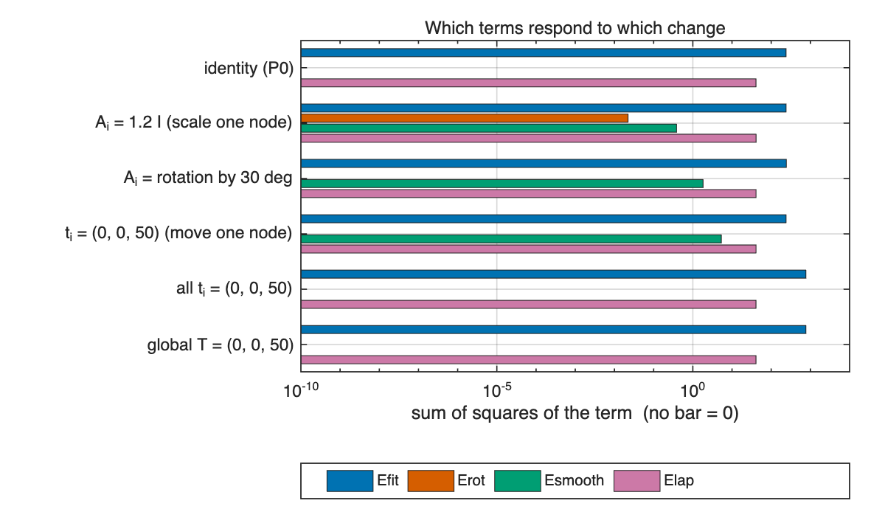

# 02. 목적함수와 에너지 항

**한국어** | [English](02_energy.en.md)

## 이 문서에서 배우는 것

- 최적화가 줄이는 값 `err(P) = sum(F.^2)`가 어떤 잔차 벡터 $F$로 만들어지는지, 네 개의 에너지 항(`Efit`, `Erot`, `Esmooth`, `Elap`)이 각각 무엇을 막는지 이해합니다.
- 핵심 결과는 시작점 `err(P0) = 279.678134` 가운데 `Efit`가 238.783(85.3778%), `Elap`가 40.8951(14.6222%)이고 나머지 두 항은 0이라는 것입니다. LM 30회 후에는 `Efit`가 109.709로 줄지만 `Elap`는 40.3429로 거의 그대로입니다.
- 코드가 교과서나 논문과 다른 점을 확인합니다. 스무딩 항은 간선별 가중치 없이 이웃의 합이고, Laplacian 항은 변형된 메쉬 자체의 Laplacian이며, 대응점은 매 평가마다 다시 찾습니다.

스크립트: [`tutorials/t02_energy.m`](../tutorials/t02_energy.m), 로그: [`tutorials/output/t02_energy.log`](../tutorials/output/t02_energy.log)

## 실행 방법

```matlab
setup
run('tutorials/t02_energy.m')
```

LM 30회를 한 번 돌리므로 십여 초 걸립니다. 그림 4장이 `docs/img/`에 생성됩니다.

## 본문

### 잔차 벡터 $F$

`edsm.residual`(`+edsm/residual.m`)은 파라미터 $P$에 대한 잔차 벡터 $F(P)$를 돌려주고, 목적함수는 $\mathrm{err}(P)=\|F(P)\|_2^2=\sum_k F_k^2$입니다. $F$는 다섯 블록을 위아래로 쌓은 열 벡터입니다(코드에서 복사).

```matlab
F = [Efit(:); w_rot*Erot1(:); w_rot*Erot2(:); w_smooth*Esmooth(:); w_lap* Elap(:)];
```

`Erot1`과 `Erot2`가 합쳐 `Erot` 항이므로 에너지 항은 네 개입니다. 가중치의 기본값은 `wRot = 1.0`, `wSmooth = 0.1`, `wLap = 0.01`이며 `edsm.defaultConfig`에 있습니다. $F$ 안에서 각 블록의 행 범위는 `[F, J, info] = edsm.residual(P, model)`의 `info.rows`로 얻고, 로그의 값은 다음과 같습니다.

```
Row ranges of F (numel(F) = 30830):
  fit     rows     1 : 15099   (15099 entries)
  rot1    rows 15100 : 15549   (  450 entries)
  rot2    rows 15550 : 15599   (   50 entries)
  smooth  rows 15600 : 15749   (  150 entries)
  lap     rows 15750 : 30830   (15081 entries)
```

크기는 각각 $3M$, $9n$, $n$, $3n$, $3N$입니다($M=5033$ 타깃 정점, $n=50$ 노드, $N=5027$ 소스 정점).

### 항 1: `Efit` (적합 항)

타깃 정점 $\tau_m$마다 변형된 소스 정점 중 가장 가까운 것 $\tilde v_{c(m)}$을 찾고, 그 차이를 잔차로 둡니다.

$$
c(m)=\arg\min_j \|\tilde v_j-\tau_m\|,\qquad
E_{\text{fit},m}=\frac{\tilde v_{c(m)}-\tau_m}{\sqrt{M}}\in\mathbb R^3 .
$$

```matlab
Efit = (deformedV(indices, :) - model.tar.V) ./ sqrt(n_target);               % nTar x 3
```

따라서 $\sum \|E_{\text{fit},m}\|^2$는 **제곱 거리의 평균**입니다. 로그의 확인: `sum(Efit.^2) = sum(d.^2)/nTar = 238.783004 vs 238.783004`.

대응은 **타깃에서 소스로** 찾습니다(`edsm.nearestIdx(deformedV, model.tar.V)`). 소스 정점 하나가 여러 타깃 정점에 대응될 수 있고, 어떤 소스 정점은 아무 타깃에도 대응되지 않습니다. 로그에서 시작점에서는 타깃 정점 5033개가 소스 정점 5027개 중 3617개(72.0%)에만 대응되고, LM 30회 후에는 3869개에 대응됩니다.

대응은 $P$가 바뀔 때마다 새로 계산됩니다(ICP와 같은 방식). 따라서 $F$는 $P$에 대해 매끄러운 함수가 아니라 **구간별로 매끄러운(piecewise smooth)** 함수입니다. 대응이 바뀌는 지점에서 $F$가 불연속이고, 해석적 Jacobian은 대응을 상수로 보고 미분합니다([03장](03_jacobian.md)). 이 점이 뒤의 문서에서 솔버가 어떤 값에서 멈추든 "수렴했다"는 말을 조심해서 써야 하는 이유입니다.



*그림 1. 시작점에서 가장 멀리 떨어진 타깃 정점 5019(`d0 = 57.6`) 근처를 확대했습니다. 파란색이 변형된 소스, 주황색이 타깃이고, 검은 선은 타깃 정점(주황 점)과 그것이 대응된 소스 정점(파란 점)을 잇습니다(창 안의 타깃 정점 656개 중 하나 걸러 328개). 왼쪽(시작점)에서는 선이 길고, 오른쪽(LM 30회 후)에서는 선이 짧아집니다. 대응은 가장 가까운 점일 뿐 해부학적 대응이 아닙니다.*

### 항 2: `Erot` (회전 항)

$A_i$를 회전 행렬에 가깝게 붙잡는 항입니다. 두 부분으로 이루어집니다.

$$
E_{\text{rot1},i}=\frac{A_i^\top A_i-I}{\sqrt n}\in\mathbb R^{3\times3},\qquad
E_{\text{rot2},i}=\frac{\det A_i-1}{\sqrt n}.
$$

```matlab
Erot1 = (pagemtimes(A0, 'transpose', A0, 'none') - reshape(eye(3), 3, 3, 1)) ./ sqrt(n_nodes);   % 3 x 3 x n
Erot2 = (pagedet(A0) - 1.0) ./ sqrt(n_nodes);                                                    % 1 x 1 x n
```

$A_i^\top A_i=I$는 열이 정규직교라는 뜻이고, 여기에 $\det A_i=1$이 더해지면 반사가 아닌 회전입니다. $E_{\text{rot1}}$은 대칭 행렬이므로 비대각 성분이 두 번씩 들어갑니다. $F$에서는 두 블록 모두에 `wRot`이 곱해집니다. $A_i=I$인 시작점에서는 둘 다 0입니다.

### 항 3: `Esmooth` (스무딩 항)

노드 $i$의 이웃 집합 $\mathcal N_s(i)$(자기 자신 포함 6개, 01장)에 대해 다음을 잔차로 둡니다.

$$
E_{\text{smooth},i}=\frac{1}{\sqrt{3n}}\sum_{j\in\mathcal N_s(i)}\Bigl(A_i(g_j-g_i)+g_i+t_i-g_j-t_j\Bigr)\in\mathbb R^3 .
$$

괄호 안은 "노드 $i$의 변환이 이웃 $j$의 위치 $g_j$를 보낼 곳($A_i(g_j-g_i)+g_i+t_i$)과, 노드 $j$가 스스로 가는 곳($g_j+t_j$)의 차이"입니다. 이웃이 서로 어긋나지 않으면 0입니다.

```matlab
Esmooth = sum(squeeze(pagemtimes(A0, v_node1)) + g0 + t0 - g_node1 - t_node1, 3) ./ sqrt(3 * n_nodes);   % 3 x n
```

(`v_node1`은 $g_j-g_i$입니다.) 교과서적인 ED의 스무딩 에너지는 간선마다 가중치를 곱하고 **간선별 노름의 제곱**을 더합니다. 이 코드는 다릅니다.

- 이웃에 대한 합을 **제곱하기 전에** 취합니다. 같은 노드의 서로 다른 이웃에서 온 벡터가 서로 상쇄될 수 있습니다.
- 간선별 가중치가 없고(모두 1), 정규화는 간선 수가 아니라 $\sqrt{3n}$입니다.
- 자기 자신($j=i$)항은 항상 0이라 기여하지 않습니다.

이는 원본 스크립트의 정의를 그대로 옮긴 것입니다.

### 항 4: `Elap` (Laplacian 항)

변형된 메쉬 정점의 Laplacian을 작게 만드는 항입니다.

$$
E_{\text{lap}}=\mathrm{diag}(L)^{-1}\,L\,\tilde V\in\mathbb R^{N\times 3},
$$

여기서 $\tilde V$는 변형된 정점을 행으로 쌓은 $N\times 3$ 행렬이고 $L$은 소스 메쉬의 그래프 Laplacian입니다. 간선 가중치는 간선 길이이고(`buildModel.m`의 `graph(s, t, w)`, `laplacian(G)`), 각 행을 $L$의 대각 원소(간선 길이 합)로 나눕니다.

```matlab
Elap = (Lap * deformedV) ./ model.lapDiag;                                    % nVerts x 3
```

이 항에는 $1/\sqrt{\cdot}$ 정규화가 없고 `wLap = 0.01`만 곱해집니다. 주의할 점이 두 가지 있습니다.

1. **원래 형상과의 차이가 아니라 변형된 메쉬의 Laplacian 자체입니다.** 변형하지 않은 시작점에서도 소스 메쉬의 Laplacian이므로 0이 아닙니다(`Elap`: 시작점에서 40.8951). 따라서 이 항은 "원래의 거칠기를 유지"시키는 항이 아니라 "Laplacian을 작게" 만드는 항입니다. 로그에서 LM 후에도 40.3429로 거의 줄지 않습니다. ED 변형이 메쉬의 미세한 거칠기를 거의 바꾸지 못하기 때문으로 보이지만, 로그는 값만 보여 주며 원인은 확인하지 않았습니다.
2. 무효 정점 9개(01장)는 소스 위치에 남아 있어도 이웃 정점이 움직이면 Laplacian이 바뀝니다.

### 시작점에서의 크기

시작점 $P_0$에서는 $A_i=I$이므로 `Erot`와 `Esmooth`가 정확히 0입니다(로그: `max |Erot| = 0.00e+00, max |Esmooth| = 0.00e+00 at P0`).

```
Contribution to err(P0) = sum(F.^2) = 279.678134
  term     sum of squares      share
  Efit            238.783   85.3778%
  Erot                  0    0.0000%
  Esmooth               0    0.0000%
  Elap            40.8951   14.6222%
```

`Elap`의 정점별 잔차는 평균 0.08087, 최대 0.3973입니다(`wLap = 0.01`이 이미 곱해진 값, 5027개 정점의 잔차 노름).

## 결과

### 최적화 전후의 항별 기여

LM 30회(06장) 후의 값입니다(로그).

```
After 30 LM iterations, err = 150.718984
  term              at P0         after LM
  Efit            238.783          109.709
  Erot                  0         0.337724
  Esmooth               0         0.329217
  Elap            40.8951          40.3429
```



*그림 2. 항별 제곱합(로그 축). 회색은 시작점, 파란색은 LM 30회 후입니다. `Efit`는 238.783에서 109.709로 줄고, `Erot`와 `Esmooth`는 0에서 각각 0.337724, 0.329217로 올라가며(변형이 생겼기 때문입니다), `Elap`는 40.8951에서 40.3429로 거의 변하지 않습니다. 0인 값은 로그 축에서 막대가 없고 숫자 0만 표시됩니다.*

`Efit`의 감소량은 $238.783-109.709$이고, 이것이 `err`의 감소량($279.678134-150.718984$) 대부분을 차지합니다. 정규화 항(`Erot`, `Esmooth`)의 증가는 합쳐서 1 미만으로 작습니다.

### 거리로 본 적합 오차

`Efit`가 제곱하는 거리 $d_m=\|\tilde v_{c(m)}-\tau_m\|$의 통계입니다(로그, 메쉬 단위).

| | 평균 | 중앙값 | 최댓값 |
|---|---|---|---|
| 시작점 | 13.70 | 12.67 | 57.63 |
| LM 30회 후 | 9.52 | 9.06 | 37.23 |

거리가 40보다 큰 타깃 정점의 비율은 시작점에서 0.8%, LM 후에 0.0%입니다.



*그림 3. 타깃 메쉬의 정점을 가장 가까운 변형된 소스 정점까지의 거리로 칠했습니다(40을 넘는 값은 40으로 표시). 왼쪽은 시작점(평균 13.7, 최대 57.6), 오른쪽은 LM 30회 후(평균 9.5, 최대 37.2)입니다. 시작점에서는 그림 왼쪽 팔의 아래쪽이 가장 밝고(거리가 큼), LM 후에는 전반적으로 어두워집니다.*

### 파라미터 변화에 대한 항의 반응

한 가지만 바꿨을 때 어떤 항이 반응하는지 보면 각 항의 역할이 분명해집니다. 노드 42(가슴)에 대한 로그입니다.

```
  perturbation                                 Efit         Erot      Esmooth         Elap        total
  identity (P0)                               238.8            0            0         40.9   279.678134
  A_i = 1.2 I (scale one node)                239.6      0.02222       0.3841         41.1   281.112585
  A_i = rotation by 30 deg                    243.8            0        1.824        40.98   286.645075
  t_i = (0, 0, 50) (move one node)            239.5            0        5.333        41.01   285.836738
  all t_i = (0, 0, 50)                        767.1            0            0         40.9   808.017231
  global T = (0, 0, 50)                       767.1            0            0         40.9   808.017231
```

- 한 노드의 $A_i$를 1.2배로 키우면 네 항이 모두 반응합니다. $A_i$가 회전이 아니므로 `Erot`가 0이 아니고(0.02222), 이웃과 어긋나서 `Esmooth`가 올라갑니다(0.3841).
- $A_i$를 30도 회전하면 `Erot`는 그대로 0입니다. 회전은 $A^\top A=I$, $\det A=1$을 지키기 때문입니다. 대신 이웃과 어긋나므로 `Esmooth`가 1.824입니다.
- 한 노드만 이동하면 `Esmooth`가 5.333으로 가장 크게 반응합니다.
- **모든 $t_i$를 같게 이동**하는 것과 **전역 $T$를 이동**하는 것은 `Efit` 767.1, `total` 808.017231로 완전히 같고 `Esmooth`는 0입니다. 모든 노드가 같이 움직이면 이웃 간 어긋남이 없기 때문이고, 가중치의 합이 1이므로 정점은 같은 양만큼 움직입니다. 이 두 방향이 서로 같은 효과를 낸다는 점이 [03장](03_jacobian.md)에서 보게 될 Jacobian의 영공간(null space)입니다.



*그림 4. 파라미터를 하나씩 바꿨을 때 네 항의 제곱합(가로 막대, 로그 축). 막대가 없는 항은 값이 0입니다. 마지막 두 줄(모든 $t_i$ 이동과 전역 $T$ 이동)은 `Efit`와 `Elap`의 막대 길이가 같고 `Erot`, `Esmooth`는 0입니다.*

## 정리 / 다음 단계

- $F$는 [`Efit`(3M개), `wRot*Erot1`(9n개), `wRot*Erot2`(n개), `wSmooth*Esmooth`(3n개), `wLap*Elap`(3N개)]를 쌓은 벡터이고, 각 항은 $1/\sqrt M$, $1/\sqrt n$, $1/\sqrt{3n}$, $1/\mathrm{diag}(L)$로 정규화됩니다. `Elap`에는 $1/\sqrt{\cdot}$ 정규화가 없습니다.
- `Efit`는 타깃 정점의 최근접 변형 소스 정점과의 거리 제곱 평균이고, 대응은 평가할 때마다 다시 계산되므로 목적함수는 구간별 매끄럽습니다.
- `Esmooth`는 이웃 합을 제곱하는 단순한 형태, `Elap`는 변형 메쉬 자체의 Laplacian이어서 시작점에서도 0이 아닙니다.
- 시작점의 `err(P0) = 279.678134`는 `Efit` 85.3778%, `Elap` 14.6222%입니다.

다음 문서: [03. 해석적 Jacobian](03_jacobian.md)에서 $F$를 $P$로 미분한 행렬 $J$의 구조와 검증을 봅니다.
