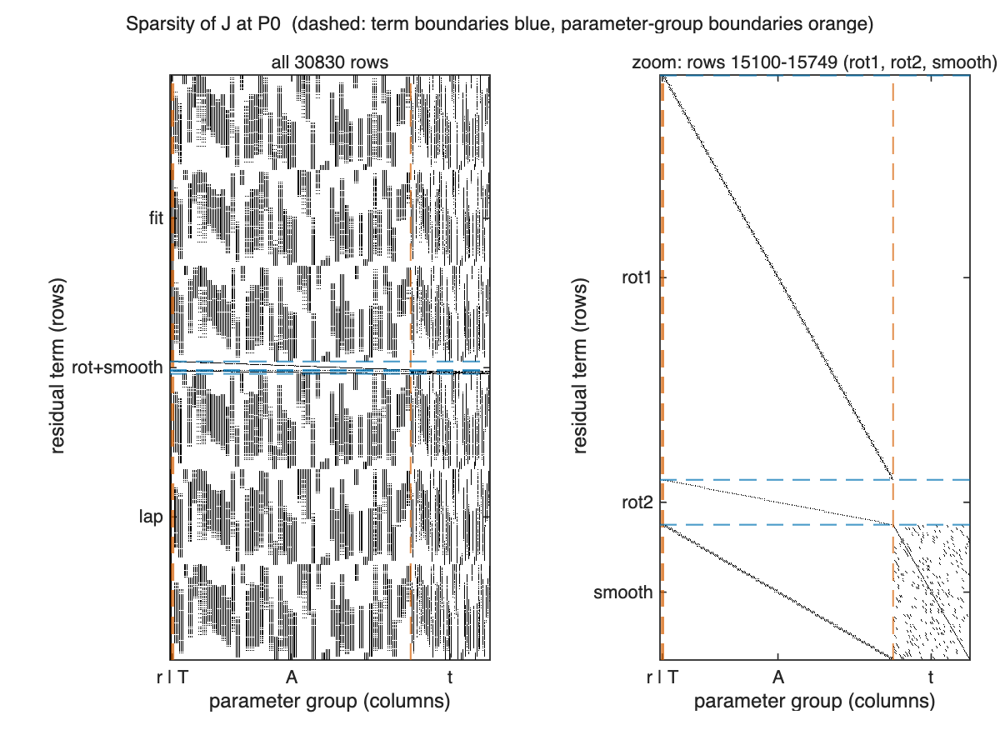
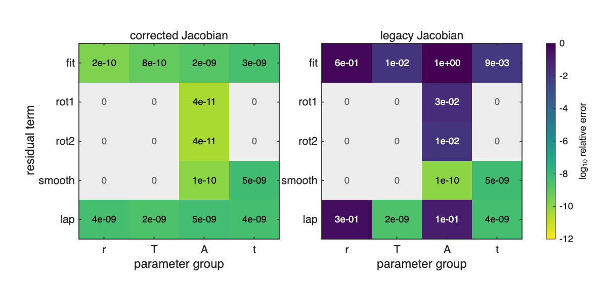
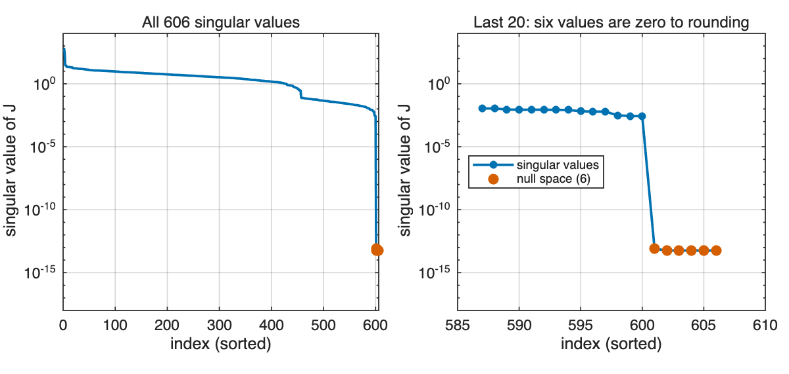

# 03. The analytic Jacobian

[한국어](03_jacobian.md) | **English**

## What you will learn

- You will see where the Jacobian $J=\partial F/\partial P$ of the residual $F$ with respect to the parameters $P$ (a 30830 x 606 sparse matrix) is nonzero, how to verify it with finite differences, and why it is rank deficient at the starting point.
- There are two key results. (1) The corrected analytic Jacobian agrees with finite differences in every block to within a maximum absolute error of 5.42e-09, whereas the legacy script's Jacobian (`legacyJacobian = true`) is off by up to 9.64 at the same point. (2) At the starting point, $J$ has singular value 0 in 6 of its 606 column directions (numerical rank 600). As a result $J^\top J$ is singular and the normal equations cannot be solved as they stand.
- Gauss–Newton (tutorial 05), LM (tutorial 06) and CG (tutorial 07) all use this $J$. If $J$ is wrong, every later result is wrong.

Script: [`tutorials/t03_jacobian.m`](../tutorials/t03_jacobian.m), log: [`tutorials/output/t03_jacobian.log`](../tutorials/output/t03_jacobian.log)

## How to run

```matlab
setup
run('tutorials/t03_jacobian.m')
```

It takes a few seconds to about ten seconds. It writes 3 figures to `docs/img/`.

## Walkthrough

### Why the Jacobian is needed

Linearizing as $F(P+d)\approx F(P)+J(P)\,d$, Gauss–Newton and LM solve the minimization problem $\|F+Jd\|^2$. Gradient descent also uses the gradient $\nabla\,\mathrm{err}=2J^\top F$. `edsm.residual` returns $J$ as a sparse matrix in its second output.

```matlab
[F, J, info] = edsm.residual(P, model);
```

The rows of $J$ are the blocks [fit; rot1; rot2; smooth; lap], in the same order as the rows of $F$. The columns are in the same order as $P$: [$r$; $T$; all of $A$; all of $t$].

### Derivatives block by block (matching the code)

All derivatives live in local functions inside `+edsm/residual.m`. The deformation formula is $\tilde v_j = R\,\ell_j + G_0 + T$, with $\ell_j=\sum_{k}w_{jk}\bigl(A_k(v_j-g_k)+g_k+t_k\bigr)-G_0$ (tutorial 01).

**Fit term.** The derivatives with respect to the deformed vertices are as follows (from the comments in `residual.m`).

$$
\frac{\partial \tilde v_{jc}}{\partial T_c}=1,\qquad
\frac{\partial \tilde v_{jc}}{\partial A_k(a,m)} = R_{ca}\,w_{jk}\,(v_j-g_k)_m ,\qquad
\frac{\partial \tilde v_{jc}}{\partial t_k(a)} = R_{ca}\,w_{jk},
$$

For $r$, $\partial R/\partial r$ (the second output of `edsm.rodrigues`) is multiplied by $\ell_j$. For each target vertex, the fit-term rows are taken from the row of the source vertex $c(m)$ it corresponds to (the correspondence is treated as a constant). Finally everything is multiplied by $1/\sqrt{M}$.

**Rotation term.** These are $\partial(A^\top A-I)/\partial A$ and $\partial\det A/\partial A$ (the cofactors). The first bug in the legacy script was in these two blocks (see below).

**Smoothness term.** Because the expression is linear in $A_i$ and $t$, this is simple: $\partial/\partial A_i(c,m)=\sum_j(g_j-g_i)_m$, $\partial/\partial t_i=+K_n$, and $\partial/\partial t_j=-1$ for each neighbor $j$ ($K_n=6$ is `size(idxNodeNeighbor, 1)`; since a node is in its own neighbor list, duplicates are summed). It does not depend on $r$ or $T$.

**Laplacian term.** Because `Lap` is a linear operator, this is the Jacobian of the deformed vertices (for each coordinate block) multiplied by `Lap`.

At the end, `residual.m` stacks the blocks, applying to each the same normalization as in $F$ (copied from the source).

```matlab
J = [Jfit ./ sqrt(n_target);
    w_rot * Jrot1 ./ sqrt(n_nodes);
    w_rot * Jrot2 ./ sqrt(n_nodes);
    w_smooth * Jsmooth ./ sqrt(3 * n_nodes);
    w_lap * Jlap ./ reshape(repmat(model.lapDiag, [3 1]), [], 1)];
```

### Handling of invalid vertices

The 9 vertices with no valid ED neighbors are pinned to their source positions in $F$ (tutorial 01). The corrected Jacobian sets the rows of these vertices to 0 (`residual.m`).

```matlab
valid = ~d.invalid(:);
keep = spdiags(repmat(double(valid), [3 1]), 0, 3 * n_verts, 3 * n_verts);
```

### Sparsity structure at the starting point

At the starting point $P_0$, `J` is 30830 x 606 with 601773 nonzero entries (3.221%). The counts per block are as follows (from the log).

```
                  r         T         A         t
  fit         30198     15099    180639     60396
  rot1            0         0       750         0
  rot2            0         0       150         0
  smooth          0         0       450       900
  lap         30096         0    212328     70767
```

The 30198 entries in the $r$ columns of the fit term equal $2\times15099$. At the identity rotation, $\partial R/\partial r_k\,\ell$ is a skew-symmetric matrix applied to $\ell$, so its $k$-th coordinate component is 0 and only two of the three coordinates are nonzero. The 15099 entries in the $T$ columns form an identity.



*Figure 1. Nonzero locations of $J$ at the starting point $P_0$. The left panel shows all 30830 rows; the right panel zooms into the rotation and smoothness blocks (rows 15100–15749). The orange dashed lines are the boundaries of the column groups ($r|T$, $A$, $t$) and the blue dashed lines are the boundaries of the row blocks. The fit and Laplacian terms have a widely spread sparse pattern, the rotation term has a diagonal shape that touches only a few columns of $A_i$ per node, and the smoothness term consists of a diagonal in the $A$ columns and scattered points in the $t$ columns.*

### Verifying with finite differences

The standard way to verify an analytic Jacobian is the central difference. `edsm.numericJacobian` (`+edsm/numericJacobian.m`) computes the following for each column.

```matlab
h = step * max(1, abs(P(k)));
Pp = P; Pp(k) = Pp(k) + h;
Pm = P; Pm(k) = Pm(k) - h;
Fp = edsm.residual(Pp, model, indices);
Fm = edsm.residual(Pm, model, indices);
col = (Fp - Fm) / (2 * h);
```

The key is `indices`. The nearest-neighbor correspondence is computed once at $P$ and frozen, and the same correspondence is used at the perturbed points. This is because the analytic Jacobian treats the correspondence as a constant; if you differenced an $F$ whose correspondence changes every time, you would pick up discontinuities where the correspondence switches. So what this check confirms is "the derivative of $F$ with the correspondence held fixed"; the effect of the correspondence changing is not what is being verified.

Near the starting point many derivatives happen to be 0, so the check uses a random point `P1 = P0 + (small random perturbation)` generated with `rng(2)` (standard deviations of 0.02 for $r$, 5 for $T$, 0.03 for $A$ and 3 for $t$). All 606 columns are checked, which takes 1212 residual evaluations and took 1.6 s in the log.

Here is the result for the corrected Jacobian (from the log; maximum absolute error per block).

```
corrected Jacobian: max |J_analytic - J_numeric| per block
                    r           T           A           t
  fit        3.27e-09    7.85e-10    4.42e-09    3.46e-09
  rot1       0.00e+00    0.00e+00    3.91e-11    0.00e+00
  rot2       0.00e+00    0.00e+00    3.61e-11    0.00e+00
  smooth     0.00e+00    0.00e+00    1.87e-09    5.42e-09
  lap        3.82e-09    2.38e-09    4.83e-09    3.74e-09
```

Every block is at or below 5.42e-09. The error size is at the level of the rounding error of the finite difference itself. Running the same check on the legacy Jacobian (`legacyJacobian = true`) gives the following.

```
legacy Jacobian: max |J_analytic - J_numeric| per block
                    r           T           A           t
  fit        9.64e+00    1.41e-02    2.63e+00    9.40e-03
  rot1       0.00e+00    0.00e+00    3.09e-02    0.00e+00
  rot2       0.00e+00    0.00e+00    1.47e-02    0.00e+00
  smooth     0.00e+00    0.00e+00    1.87e-09    5.42e-09
  lap        3.42e-01    2.38e-09    1.01e-01    3.74e-09
```



*Figure 2. Common logarithm of the relative error per block (rows: residual terms, columns: parameter groups). The left panel is the corrected Jacobian (maximum errors between 3.91e-11 and 5.42e-09), the right panel is the legacy Jacobian. The relative error is divided by the larger of 1 and the largest entry magnitude in the block, and gray cells are blocks that are zero in both. For the legacy Jacobian, the relative errors in the $r$ and $A$ columns of the fit term are 6.40e-01 and 9.97e-01 respectively, which means the values are nearly wrong, and in the $r$ and $A$ columns of the Laplacian term they are 3.42e-01 and 1.01e-01.*

### Three errors in the legacy Jacobian

Comparing the `legacy` branches in `residual.m` shows that the legacy version was wrong in three ways. The errors in the table above are not assigned one by one to the three errors; what follows is a summary, from the code, of which blocks each error touches.

1. **Column placement in the rotation blocks.** The derivatives that `jacRot1`/`jacRot2` compute are with respect to a row-major $A_i$, but $P$ stores $A_i(:)$ in column-major order. The column slots where the values are placed differ, so the result is correct only when $A_i$ is symmetric (as the identity matrix at the starting point is). The fix is this one line (copied from the source).

   ```matlab
   slots = 1:9;                                                 % legacy: row-major order, wrong for non-symmetric A_i
   if ~legacy, slots = [1 4 7 2 5 8 3 6 9]; end                 % row-major element k -> column-major slot
   ```

   The `rot1`/`rot2` $\times$ `A` cells in the table above (3.09e-02, 1.47e-02) are the effect of this. It is invisible at the starting point, so checking only near the starting point would miss it.
2. **The rotation ($r$) columns of the Laplacian block are 0.** The legacy code leaves the $r$ and $T$ columns empty, as in `Jlap = [sparse(nLap, 6), Jlap_At]`. In reality $\tilde V$ depends on $r$, so the $r$ columns are not zero (the 3.42e-01 in the `lap` $\times$ `r` cell of the table above).
3. **The 9 invalid vertices are treated as deformed.** A vertex that is pinned in $F$ is differentiated by $J$ as if it moved. If such a vertex has a correspondence in the fit term, wrong values enter the $r$, $T$, $A$ and $t$ columns alike (the large values in the `fit` row of the table above).

[Tutorial 06](06_levenberg_marquardt.en.md) compares what happens to LM when the legacy Jacobian is used.

### Rank deficiency at the starting point

Computing the singular values of a $30830\times606$ matrix directly is expensive, so the singular values are computed from the $R$ factor (606x606) of a sparse QR. The log is as follows.

```
singular values of J at P0: largest 614.7, 7th smallest 0.002663, 6 smallest: [7.92e-14 5.78e-14 5.78e-14 5.78e-14 5.78e-14 5.78e-14]
gap: sv(end-6) / sv(end-5) = 3.36e+10;  condition number of the nonzero part sv(1)/sv(end-6) = 2.31e+05
numerical rank (tol = eps*max(size(J))*sv(1) = 4.21e-09): 600 of 606
```

Of the singular values, 6 are at rounding level (5.78e-14 to 7.92e-14) and the next one is 0.002663, so the boundary is clear. The 6 directions where the singular value becomes 0 are meaningful. The null-space vectors that the script constructs by hand and verifies are as follows.

- **3 translations.** $\delta T=e_k$, $\delta t_i=-e_k$ (for all nodes). If you shift $T$ by $e_k$ and shift every node translation by $-e_k$, the vertex positions do not change (because the weights sum to 1). This is the same statement as "shifting all $t_i$ = a global $T$ shift" on tutorial 02.
- **3 rotations.** $\delta r=e_k$, $\delta A_i=-[e_k]_\times$, $\delta t_i=-[e_k]_\times(g_i-G_0)$. At the starting point, the first-order effect of a global rotation is $[e_k]_\times(\ell_j)$, and the first-order change of the local transform is $-[e_k]_\times(v_j-g_i)-[e_k]_\times(g_i-G_0)=-[e_k]_\times(v_j-G_0)$. Since $\ell_j=v_j-G_0$, the two cancel. This means a global rotation can be undone by rotating every node.

```
hand-built null directions: |J v| / |v| (compare with sv(1) = 615)
  dT = e_x, dt_i = -e_x                                1.943e-17
  dT = e_y, dt_i = -e_y                                1.943e-17
  dT = e_z, dt_i = -e_z                                1.943e-17
  dr = e_x, dA_i = -[e_x]x, dt_i = -[e_x]x(g_i-G0)     8.237e-17
  dr = e_y, ... (same with e_y)                        5.291e-17
  dr = e_z, ... (same with e_z)                        2.616e-17
angle between span(hand-built) and the 6 smallest right singular vectors: 3.98e-14 rad
```

The 6 hand-built vectors lie in the null space of $J$ (`|Jv|/|v|` is below 1e-16 for all of them), and the angle to the space spanned by the 6 smallest singular vectors is 3.98e-14 rad, so the two spaces are effectively the same.



*Figure 3. Singular values of $J$ at the starting point. The left panel shows all 606, the right panel the last 20. The orange dots are the 6 null-space directions, at 5.78e-14 to 7.92e-14, more than 10 orders of magnitude below the values before them (on the order of 1e-3). In the left panel the values drop in steps near index 450.*

What this result means:

- $J^\top J$ ($606\times606$) is singular, so `JtJ \ (-g)` has no unique solution and is unstable. This is why tutorial 05 picks the minimum-norm solution with `lsqminnorm`.
- Even among directions outside the null space, some singular values are as small as 0.002663, so the condition number is `2.31e+05`. As tutorial 05 shows, these small-singular-value directions inflate the Gauss–Newton step.
- The null space is a result at the starting point. As the deformation proceeds, $A_i\ne I$, so the null space is not preserved exactly (in the log of tutorial 05, 603 singular values are above the tolerance at iteration 3).

## Summary / Next

- $J$ is a 30830 x 606 sparse matrix stacked block by block with the same normalization as $F$ (scaled by `1/sqrt(nTar)`, `1/sqrt(n)`, `1/sqrt(3n)`, and divided by `diag(Lap)`). At the starting point, 3.221% of it is nonzero.
- The corrected analytic Jacobian agrees with the finite difference with the correspondence held fixed to within 5.42e-09. The legacy Jacobian is off by up to 9.64. The causes are three: the column placement in the rotation blocks, the $r$ columns of the Laplacian block, and the handling of invalid vertices.
- At the starting point, $J$ has rank 600 and a null space of 3 translation and 3 rotation directions.
- This check verifies only the derivative "with the correspondence held fixed".

Next page: [04. Gradient descent](04_gradient_descent.en.md) shows how the simplest optimizer fails on this problem.
