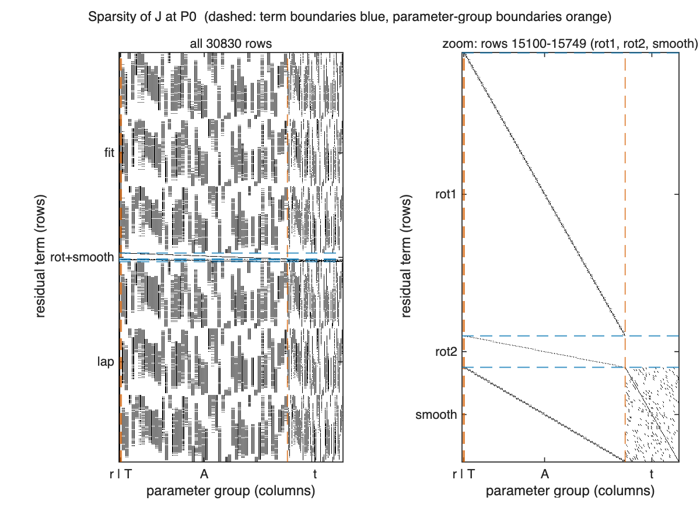
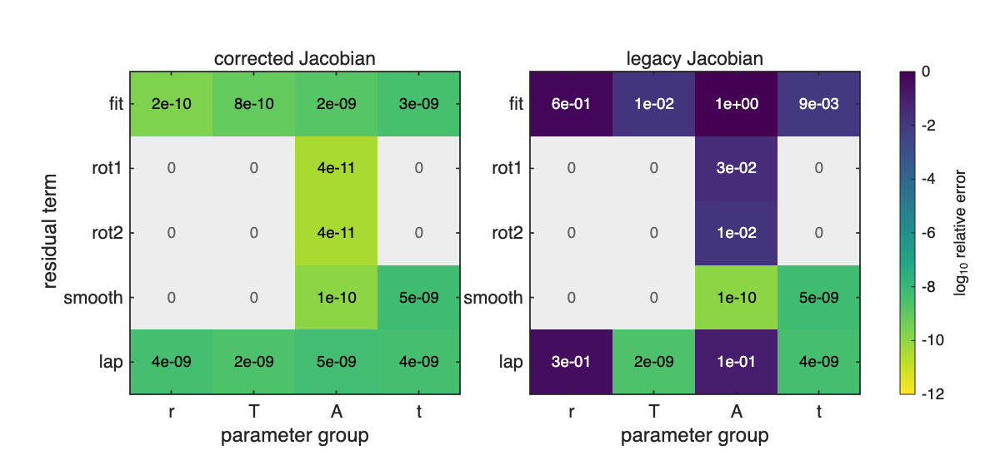
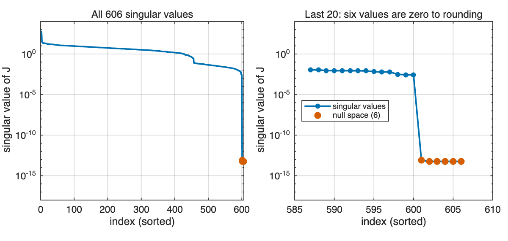

# 03. 해석적 Jacobian

**한국어** | [English](03_jacobian.en.md)

## 이 문서에서 배우는 것

- 잔차 $F$를 파라미터 $P$로 미분한 Jacobian $J=\partial F/\partial P$ (30830 x 606 희소 행렬)가 어디에서 0이 아닌지, 어떻게 유한 차분으로 검증하는지, 왜 시작점에서 랭크가 부족한지 이해합니다.
- 핵심 결과는 두 가지입니다. (1) 수정된 해석적 Jacobian은 유한 차분과 모든 블록에서 최대 절대 오차 5.42e-09 이내로 일치하지만, 원본 스크립트의 Jacobian(`legacyJacobian = true`)은 같은 점에서 최대 9.64까지 어긋납니다. (2) 시작점의 $J$는 606개 열 중 6개 방향에서 특이값이 0입니다(수치 랭크 600). 이 때문에 $J^\top J$는 특이행렬이고 정규방정식을 그대로 풀 수 없습니다.
- Gauss–Newton(05장), LM(06장), CG(07장)은 모두 이 $J$를 씁니다. 따라서 $J$가 틀리면 이후의 모든 결과가 틀립니다.

스크립트: [`tutorials/t03_jacobian.m`](../tutorials/t03_jacobian.m), 로그: [`tutorials/output/t03_jacobian.log`](../tutorials/output/t03_jacobian.log)

## 실행 방법

```matlab
setup
run('tutorials/t03_jacobian.m')
```

수 초에서 십여 초 걸립니다. 그림 3장이 `docs/img/`에 생성됩니다.

## 본문

### Jacobian이 필요한 이유

$F(P+d)\approx F(P)+J(P)\,d$ 로 선형화하면 Gauss–Newton과 LM은 $\|F+Jd\|^2$ 최소화 문제를 풉니다. 경사하강법도 기울기 $\nabla\,\mathrm{err}=2J^\top F$를 씁니다. `edsm.residual`은 두 번째 출력으로 $J$를 희소 행렬로 돌려줍니다.

```matlab
[F, J, info] = edsm.residual(P, model);
```

$J$의 행은 $F$의 행과 같은 순서로 [fit; rot1; rot2; smooth; lap] 블록이고, 열은 $P$와 같은 순서로 [$r$; $T$; $A$ 전체; $t$ 전체]입니다.

### 블록별 미분 (코드와 대응)

모든 미분은 `+edsm/residual.m` 안의 지역 함수에 있습니다. 변형식은 $\tilde v_j = R\,\ell_j + G_0 + T$, $\ell_j=\sum_{k}w_{jk}\bigl(A_k(v_j-g_k)+g_k+t_k\bigr)-G_0$입니다(01장).

**적합 항.** 변형된 정점에 대한 미분은 다음과 같습니다(`residual.m` 주석에서).

$$
\frac{\partial \tilde v_{jc}}{\partial T_c}=1,\qquad
\frac{\partial \tilde v_{jc}}{\partial A_k(a,m)} = R_{ca}\,w_{jk}\,(v_j-g_k)_m ,\qquad
\frac{\partial \tilde v_{jc}}{\partial t_k(a)} = R_{ca}\,w_{jk},
$$

그리고 $r$에 대해서는 $\partial R/\partial r$(`edsm.rodrigues`의 두 번째 출력)에 $\ell_j$를 곱합니다. 적합 항의 행은 타깃 정점마다 대응된 소스 정점 $c(m)$의 행을 골라 가져옵니다(대응을 상수로 취급). 마지막에 $1/\sqrt{M}$를 곱합니다.

**회전 항.** $\partial(A^\top A-I)/\partial A$와 $\partial\det A/\partial A$(여인수)입니다. 이 두 블록에서 원본의 첫 번째 버그가 있었습니다(아래).

**스무딩 항.** 식이 $A_i$와 $t$에 대해 선형이라 간단합니다. $\partial/\partial A_i(c,m)=\sum_j(g_j-g_i)_m$, $\partial/\partial t_i=+K_n$, 이웃 $j$마다 $\partial/\partial t_j=-1$ ($K_n=6$은 `size(idxNodeNeighbor, 1)`이고, 자기 자신이 이웃 목록에 있으므로 중복은 합산됩니다). $r$, $T$에는 의존하지 않습니다.

**Laplacian 항.** `Lap`이 선형 연산이므로 변형 정점의 Jacobian(좌표 블록마다)에 `Lap`을 곱한 것입니다.

마지막에 `residual.m`이 각 블록에 $F$와 같은 정규화를 적용해 쌓습니다(복사).

```matlab
J = [Jfit ./ sqrt(n_target);
    w_rot * Jrot1 ./ sqrt(n_nodes);
    w_rot * Jrot2 ./ sqrt(n_nodes);
    w_smooth * Jsmooth ./ sqrt(3 * n_nodes);
    w_lap * Jlap ./ reshape(repmat(model.lapDiag, [3 1]), [], 1)];
```

### 무효 정점의 처리

유효한 ED 이웃이 없는 9개 정점은 $F$에서 소스 위치에 고정됩니다(01장). 수정된 Jacobian은 이 정점들의 행을 0으로 만듭니다(`residual.m`).

```matlab
valid = ~d.invalid(:);
keep = spdiags(repmat(double(valid), [3 1]), 0, 3 * n_verts, 3 * n_verts);
```

### 시작점에서의 희소 구조

시작점 $P_0$에서 `J`는 30830 x 606이고 0이 아닌 원소가 601773개(3.221%)입니다. 블록별 개수는 다음과 같습니다(로그).

```
                  r         T         A         t
  fit         30198     15099    180639     60396
  rot1            0         0       750         0
  rot2            0         0       150         0
  smooth          0         0       450       900
  lap         30096         0    212328     70767
```

적합 항의 $r$ 열 30198개는 $2\times15099$입니다. 항등 회전에서 $\partial R/\partial r_k\,\ell$는 반대칭 행렬이 $\ell$에 곱해진 것이라 $k$번째 좌표 성분이 0이고, 세 좌표 중 둘만 0이 아니기 때문입니다. $T$ 열 15099개는 항등입니다.



*그림 1. 시작점 $P_0$에서 $J$의 0이 아닌 위치. 왼쪽은 전체 30830행, 오른쪽은 회전·스무딩 블록(행 15100–15749)의 확대입니다. 주황색 점선이 열 그룹($r|T$, $A$, $t$) 경계, 파란색 점선이 행 블록 경계입니다. 적합 항과 Laplacian 항은 넓게 퍼진 희소 패턴이고, 회전 항은 노드마다 $A_i$의 열 몇 개만 건드리는 대각선 모양이며, 스무딩 항은 $A$ 열의 대각선과 $t$ 열의 흩어진 점으로 구성됩니다.*

### 유한 차분으로 검증하기

해석적 Jacobian을 검증하는 표준 방법은 중심 차분입니다. `edsm.numericJacobian`(`+edsm/numericJacobian.m`)은 열마다 다음을 계산합니다.

```matlab
h = step * max(1, abs(P(k)));
Pp = P; Pp(k) = Pp(k) + h;
Pm = P; Pm(k) = Pm(k) - h;
Fp = edsm.residual(Pp, model, indices);
Fm = edsm.residual(Pm, model, indices);
col = (Fp - Fm) / (2 * h);
```

핵심은 `indices`입니다. 최근접 대응을 $P$에서 한 번만 계산해 고정하고 섭동한 점에서도 같은 대응을 씁니다. 해석적 Jacobian이 대응을 상수로 보기 때문이며, 대응이 매번 바뀌는 $F$를 그대로 차분하면 대응이 바뀌는 지점에서 불연속이 섞여 들어옵니다. 따라서 이 검증이 확인하는 것은 "대응을 고정한 $F$의 미분"이고, 대응이 바뀌는 효과는 검증 대상이 아닙니다.

시작점 근처에서는 많은 미분이 우연히 0이므로 검증용으로 `rng(2)`로 만든 난수 점 `P1 = P0 + (작은 난수)`를 씁니다($r$에 0.02, $T$에 5, $A$에 0.03, $t$에 3의 표준편차). 606개 열 전체를 검사하며 잔차 평가가 1212번 필요하고 로그에서 1.6 s 걸렸습니다.

수정된 Jacobian의 결과입니다(로그, 블록별 최대 절대 오차).

```
corrected Jacobian: max |J_analytic - J_numeric| per block
                    r           T           A           t
  fit        3.27e-09    7.85e-10    4.42e-09    3.46e-09
  rot1       0.00e+00    0.00e+00    3.91e-11    0.00e+00
  rot2       0.00e+00    0.00e+00    3.61e-11    0.00e+00
  smooth     0.00e+00    0.00e+00    1.87e-09    5.42e-09
  lap        3.82e-09    2.38e-09    4.83e-09    3.74e-09
```

모든 블록이 5.42e-09 이하입니다. 오차 크기는 유한 차분 자체의 반올림 수준입니다. 같은 검사를 원본의 Jacobian(`legacyJacobian = true`)에 하면 다음과 같습니다.

```
legacy Jacobian: max |J_analytic - J_numeric| per block
                    r           T           A           t
  fit        9.64e+00    1.41e-02    2.63e+00    9.40e-03
  rot1       0.00e+00    0.00e+00    3.09e-02    0.00e+00
  rot2       0.00e+00    0.00e+00    1.47e-02    0.00e+00
  smooth     0.00e+00    0.00e+00    1.87e-09    5.42e-09
  lap        3.42e-01    2.38e-09    1.01e-01    3.74e-09
```



*그림 2. 블록(행: 잔차 항, 열: 파라미터 그룹)별 상대 오차의 상용로그. 왼쪽이 수정된 Jacobian(최대 오차는 3.91e-11에서 5.42e-09 사이), 오른쪽이 원본 Jacobian입니다. 상대 오차는 블록 안의 최대 원소 크기와 1 중 큰 값으로 나눈 것이고, 회색 칸은 두 쪽 모두 0인 블록입니다. 원본은 적합 항의 $r$, $A$ 열에서 상대 오차가 각각 6.40e-01, 9.97e-01로 거의 틀린 값이고, Laplacian 항의 $r$, $A$ 열에서 3.42e-01, 1.01e-01입니다.*

### 원본 Jacobian의 세 가지 오류

`residual.m`의 `legacy` 분기를 비교하면 원본은 세 가지가 틀렸습니다. 위 표의 오차를 세 오류에 하나씩 나눠 배정한 것이 아니라, 각 오류가 어느 블록을 건드리는지 코드에서 정리한 것입니다.

1. **회전 블록의 열 배치.** `jacRot1`/`jacRot2`가 계산하는 미분은 행 우선(row-major) $A_i$ 기준인데 $P$는 $A_i(:)$를 열 우선으로 저장합니다. 값을 놓는 열 슬롯이 달라서 $A_i$가 대칭일 때만 맞습니다(시작점의 항등 행렬이 그런 경우). 수정은 다음 한 줄입니다(복사).

   ```matlab
   slots = 1:9;                                                 % legacy: row-major order, wrong for non-symmetric A_i
   if ~legacy, slots = [1 4 7 2 5 8 3 6 9]; end                 % row-major element k -> column-major slot
   ```

   위 표의 `rot1`/`rot2` $\times$ `A` 칸(3.09e-02, 1.47e-02)이 이 영향입니다. 시작점에서는 보이지 않으므로 시작점 근처만 검사해서는 놓칩니다.
2. **Laplacian 블록의 회전($r$) 열이 0.** 원본은 `Jlap = [sparse(nLap, 6), Jlap_At]`처럼 $r$, $T$ 열을 비워 둡니다. 실제로는 $\tilde V$가 $r$에 의존하므로 $r$ 열이 0이 아닙니다(위 표 `lap` $\times$ `r`의 3.42e-01).
3. **무효 정점 9개를 변형된 것으로 취급.** $F$에서는 고정된 정점을 $J$가 움직이는 것으로 보고 미분합니다. 이 정점이 적합 항에서 대응되면 $r$, $T$, $A$, $t$ 열 모두에 잘못된 값이 들어갑니다(위 표 `fit` 행의 큰 값들).

원본 Jacobian을 쓰면 LM이 어떻게 되는지는 [06장](06_levenberg_marquardt.md)에서 비교합니다.

### 시작점에서의 랭크 부족

$30830\times606$ 행렬의 특이값을 직접 구하는 것은 부담스러우므로 희소 QR의 $R$ 인자(606x606)에서 특이값을 계산합니다. 로그는 다음과 같습니다.

```
singular values of J at P0: largest 614.7, 7th smallest 0.002663, 6 smallest: [7.92e-14 5.78e-14 5.78e-14 5.78e-14 5.78e-14 5.78e-14]
gap: sv(end-6) / sv(end-5) = 3.36e+10;  condition number of the nonzero part sv(1)/sv(end-6) = 2.31e+05
numerical rank (tol = eps*max(size(J))*sv(1) = 4.21e-09): 600 of 606
```

특이값 6개가 반올림 수준(5.78e-14~7.92e-14)이고 그다음 값은 0.002663이라 경계가 분명합니다. 0이 되는 6개 방향은 의미가 있습니다. 스크립트가 손으로 만들어 검증한 영공간 벡터는 다음과 같습니다.

- **이동 3개.** $\delta T=e_k$, $\delta t_i=-e_k$ (모든 노드). $T$를 $e_k$만큼 옮기고 모든 노드 이동을 $-e_k$만큼 옮기면 정점 위치가 변하지 않습니다(가중치 합이 1이므로). 02장의 "모든 $t_i$ 이동 = 전역 $T$ 이동"과 같은 이야기입니다.
- **회전 3개.** $\delta r=e_k$, $\delta A_i=-[e_k]_\times$, $\delta t_i=-[e_k]_\times(g_i-G_0)$. 시작점에서 전역 회전의 1차 효과는 $[e_k]_\times(\ell_j)$이고, 지역 변환의 1차 변화는 $-[e_k]_\times(v_j-g_i)-[e_k]_\times(g_i-G_0)=-[e_k]_\times(v_j-G_0)$입니다. $\ell_j=v_j-G_0$이므로 둘이 상쇄됩니다. 전역 회전을 모든 노드의 회전으로 되돌릴 수 있다는 뜻입니다.

```
hand-built null directions: |J v| / |v| (compare with sv(1) = 615)
  dT = e_x, dt_i = -e_x                                1.943e-17
  dT = e_y, dt_i = -e_y                                1.943e-17
  dT = e_z, dt_i = -e_z                                1.943e-17
  dr = e_x, dA_i = -[e_x]x, dt_i = -[e_x]x(g_i-G0)     8.237e-17
  dr = e_y, ... (same with e_y)                        5.291e-17
  dr = e_z, ... (same with e_z)                        2.616e-17
angle between span(hand-built) and the 6 smallest right singular vectors: 3.98e-14 rad
```

손으로 만든 6개 벡터가 $J$의 영공간이고(`|Jv|/|v|`가 모두 1e-16보다 작음), 6개 최소 특이벡터가 만드는 공간과의 각도가 3.98e-14 rad이므로 두 공간이 사실상 같습니다.



*그림 3. 시작점 $J$의 특이값. 왼쪽은 606개 전체, 오른쪽은 마지막 20개입니다. 주황색 점이 영공간 6개이며 5.78e-14~7.92e-14에 있고, 그 앞의 값(약 1e-3 수준)과 10 자릿수 이상 떨어져 있습니다. 왼쪽 그림에서는 450번째 부근에서 값이 계단식으로 내려갑니다.*

이 결과의 의미는 다음과 같습니다.

- $J^\top J$ ($606\times606$)는 특이행렬이므로 `JtJ \ (-g)`는 유일한 해가 없고 불안정합니다. 05장에서 `lsqminnorm`으로 최소 노름 해를 택하는 이유입니다.
- 영공간이 아닌 방향 중에도 특이값이 0.002663까지 작은 방향이 있어 조건수가 `2.31e+05`입니다. 05장이 보여 주듯 이 작은 특이값 방향이 Gauss–Newton의 단계를 키웁니다.
- 영공간은 시작점에서의 결과입니다. 변형이 진행되면 $A_i\ne I$이므로 영공간이 정확히 유지되지 않습니다(05장 로그의 3번째 반복에서 특이값 603개가 허용치보다 큽니다).

## 정리 / 다음 단계

- $J$는 $F$와 같은 정규화(`1/sqrt(nTar)`, `1/sqrt(n)`, `1/sqrt(3n)`, `diag(Lap)`로 나눔)를 적용해 블록별로 쌓은 30830 x 606 희소 행렬입니다. 시작점에서 3.221%가 0이 아닙니다.
- 수정된 해석적 Jacobian은 대응을 고정한 유한 차분과 5.42e-09 이내로 일치합니다. 원본 Jacobian은 최대 9.64까지 어긋납니다. 원인은 회전 블록의 열 배치, Laplacian 블록의 $r$ 열, 무효 정점 처리 세 가지입니다.
- 시작점의 $J$는 랭크가 600이고 이동 3개, 회전 3개 방향의 영공간을 가집니다.
- 이 검증은 "대응을 고정한" 미분만 확인합니다.

다음 문서: [04. 경사하강법](04_gradient_descent.md)에서 가장 단순한 최적화기가 이 문제에서 어떻게 실패하는지 봅니다.
