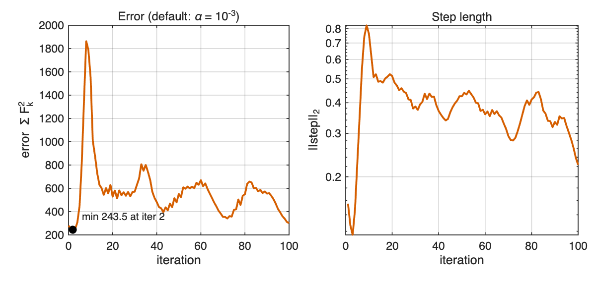
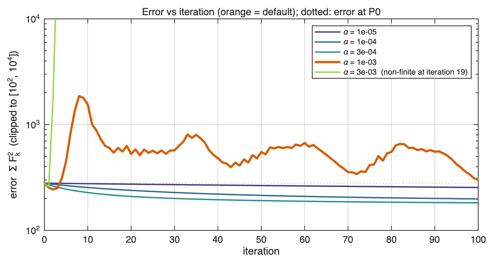
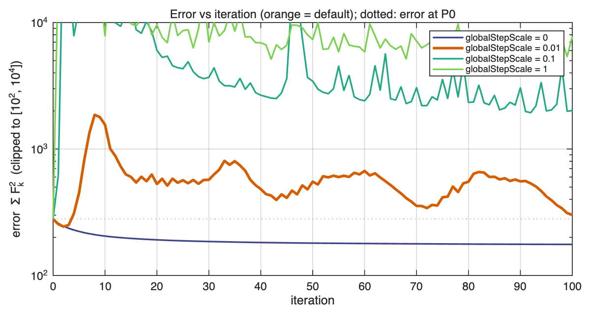

# 04. Gradient descent

[한국어](04_gradient_descent.md) | **English**

## What you will learn

- You will see how the simplest optimizer, fixed-step gradient descent (GD), behaves on this problem, and why a single kind of step size does not work well.
- The key result is that with the default settings (`stepSize = 1e-3`, `globalStepScale = 0.01`), 100 iterations take `err` from 279.6781 down to a minimum of 243.5140 (at iteration 2), then back up, ending at 301.7615 (larger than the starting value). In 40 of the 100 iterations the error increases.
- The cause is explained by the **stability condition** computed at the starting point. The default step size of 1e-3 is about 4 times the stability limit of 2.52e-4.

Script: [`tutorials/t04_gradient_descent.m`](../tutorials/t04_gradient_descent.m), log: [`tutorials/output/t04_gradient_descent.log`](../tutorials/output/t04_gradient_descent.log)

## How to run

```matlab
setup
run('tutorials/t04_gradient_descent.m')
```

The script runs 100 iterations several times, so it is one of the slowest in this series (the `finished in` line of the log shows about 40 seconds). It produces 3 figures.

## Walkthrough

### The algorithm and the code

The gradient of $\mathrm{err}(P)=\|F(P)\|^2$ is $g=2J^\top F$. GD moves a fixed distance in the direction opposite to the gradient.

$$
P \leftarrow P-\alpha\,S\,g,\qquad g=2J(P)^\top F(P).
$$

The iteration in `edsm.solvers.gradientDescent` (`+edsm/+solvers/gradientDescent.m`) is as follows (copied from the source).

```matlab
scale = [o.globalStepScale * ones(6, 1); ones(numel(P) - 6, 1)];
for k = 1:o.maxIter
    g = 2 * (J' * F);
    step = -o.stepSize * scale .* g;
    P = P + step;
```

Textbook GD uses the same step size $\alpha$ for every variable. This code uses a diagonal matrix $S$, so that **the 6 global parameters ($r$, $T$) get $\alpha\cdot$`globalStepScale` and the other 600 ($A_i$, $t_i$) get $\alpha$ (`stepSize`)**. The defaults are `stepSize = 1e-3` and `globalStepScale = 0.01`, which are the values in the legacy script. There is no line search and no convergence test. There are only two reasons to stop: `maxIter` (default 100), or the error becoming non-finite (`nonFinite`). The correspondences are recomputed at every iteration.

### The stability condition: how large can the step size be

Assume $F$ is linear. Then $\mathrm{err}(P+d)\approx\|F+Jd\|^2$ and the gradient is $2J^\top(F+Jd)$. The GD iteration takes the form $d\leftarrow(I-2\alpha SJ^\top J)\,d$. Letting $\lambda_{\max}$ be the largest eigenvalue of $S^{1/2}J^\top JS^{1/2}$, the error decreases only when $2\alpha\lambda_{\max}<2$, that is,

$$
\alpha<\alpha_{\max}=\frac{1}{\lambda_{\max}\!\left(S^{1/2}J^\top J\,S^{1/2}\right)}
$$

The script computes this limit at the starting point $P_0$. Because the limit is computed from $J$ at $P_0$, it changes if $J$ changes during the iteration (the log carries the same caution).

Values from the log:

```
err(P0) = 279.6781, |grad| = 944.2
gradient norm by parameter group: r 931.3 | T 5.725 | A 155.2 | t 1.716
lambda_max(J'J) = 3.778e+05
  globalStepScale 0     : lambda_max =      861.3   alpha_max = 0.00116
  globalStepScale 0.01  : lambda_max =       3970   alpha_max = 0.000252
  globalStepScale 0.1   : lambda_max =  3.794e+04   alpha_max = 2.64e-05
  globalStepScale 1     : lambda_max =  3.778e+05   alpha_max = 2.65e-06
```

- The gradient is largest in the rotation-vector $r$ component (931.3 in the 2-norm, out of 944.2 in total).
- More important is the curvature. Excluding the global parameters (`globalStepScale 0`), $\lambda_{\max}=861.3$, but using the same step for all of them (`globalStepScale 1`) gives $3.778\times10^5$. That is $3.778\times10^5/861.3\approx 439$ times larger, which means this large curvature comes from the global parameters ($r$, $T$). Using the same step for all parameters makes $\alpha_{\max}=2.65\times10^{-6}$, which is very small. That is why only the global parameters get a separate small coefficient.
- The limit for the default setting (`globalStepScale = 0.01`) is `0.000252` in the log, that is, $2.52\times10^{-4}$, and the default step size $10^{-3}$ is about 4 times that.

## Results

### Default run

```
default run: err 279.6781 -> minimum 243.5140 at iteration 2 -> final 301.7615 after 100 iterations (5.6 s)
iterations with an INCREASE of the error: 40 of 100 (first at iteration 3)
iter  err        |step|
   0   279.6781
   1   254.4104  0.155
   2   243.5140  0.127
   5   449.6176  0.227
  10  1555.0935  0.763
  20   528.5393  0.514
  40   482.1326  0.37
  60   671.0922  0.359
  80   550.8132  0.413
 100   301.7615  0.224
|grad| at the final iterate = 4976 (it was 944.2 at P0)
```



*Figure 1. 100 iterations of GD with the default settings. The left panel is the objective: it decreases for the first 2 iterations (the black dot is the minimum, 243.5 at iteration 2), then shoots up (the log value at iteration 10 is 1555.0935) and keeps rising and falling (at iterations 20, 40, 60 and 80 the values are 528.5393, 482.1326, 671.0922 and 550.8132). The right panel is the step length (log axis); the step length also grows when the error shoots up (0.763 at iteration 10).*

This behavior is not "converging, but slowly"; it is **oscillation caused by a step beyond the stability limit**. In the first two steps the error decreases, but along the direction of largest curvature $|1-2\alpha\lambda|>1$, so the error in that direction grows with every iteration. As the error grows, the gradient grows too (the gradient norm at the last point is 4976 against 944.2 at the starting point), so the step length grows as well. The iteration does not diverge to infinity because of nonlinearity (when the step grows, the correspondences change and the curvature changes). This process repeats and the error keeps rising and falling. The 301.7615 at iteration 100 is the value where the run happened to stop on a descending stretch; if you iterate further, there is no guarantee that it rises and none that it falls.

### Effect of the step size

Keep `globalStepScale = 0.01` and vary only `stepSize` (from the log).

```
  alpha     iters    final err      min err   argmin stop      
  1e-05       100       254.58       254.58      100 maxIter   
  1e-04       100       198.51       198.51      100 maxIter   
  3e-04       100       182.24       182.24      100 maxIter   
  1e-03       100       301.76       243.51        2 maxIter   
  3e-03        19          Inf       257.69        1 nonFinite 
```



*Figure 2. Error curves for each `stepSize` (the y axis is clipped to $10^2$–$10^4$; the dashed line is the starting value). 1e-05, 1e-04 and 3e-04 decrease monotonically, but are still decreasing at iteration 100 (`argmin` is 100). The thick orange line is the default of 1e-03, which oscillates, and 3e-03 stops at iteration 19 because the error becomes non-finite (`nonFinite`).*

- With 1e-05 and 1e-04, which are below the stability limit of 2.52e-4, the error decreases monotonically but very slowly. With 1e-05, after 100 iterations the error has come down only a little, to 254.58, from the starting value of 279.6781.
- 3e-04 is slightly above the limit (2.52e-4), yet it decreases monotonically over 100 iterations to 182.24. This seems to be because the stability limit was computed at the starting point and the curvature along this path became smaller than at the starting point, but the script does not check this. The stability limit is **a reference value, not a guarantee.**
- 1e-03 is about 4 times the limit and oscillates. 3e-03 diverges.
- Either way, the lowest error after 100 iterations (182.24) is far higher than the 150.7190 that LM reaches in 30 iterations ([tutorial 00](00_quickstart.en.md)).

### Effect of the global-parameter coefficient

Keep `stepSize = 1e-3` and vary `globalStepScale` (from the log).

```
  scale     iters    final err      min err   argmin stop      
  0           100       176.08       176.08      100 maxIter   
  0.01        100       301.76       243.51        2 maxIter   
  0.1         100       2012.5       279.68        0 maxIter   
  1           100       7761.3       279.68        0 maxIter   
```



*Figure 3. Error curves for each `globalStepScale`. 0 (blue line, global parameters frozen) decreases monotonically, 0.01 (orange) oscillates, and 0.1 and 1 swing widely above the starting value (dashed line).*

- With `globalStepScale = 0`, $r$ and $T$ do not move and the limit is $\alpha_{\max}=0.00116$, so $\alpha=10^{-3}$ is within the limit and the error decreases stably (176.08; `argmin` is 100, so it is still going down).
- For 0.1 and 1 the limits are $2.64\times10^{-5}$ and $2.65\times10^{-6}$, far smaller than $10^{-3}$, so they are unstable from the start, and since `argmin` is 0 they never get below the starting value even once.
- Freezing the global parameters is stable, but the whole-body rotation and translation cannot be used, so there is a limit on the final performance. This script did not measure where that limit lies.

In other words, in GD the step size has to match the scale of curvature each parameter needs (here, a difference of about 440 times), and one hand-set coefficient (`globalStepScale`) plays that role. Solving this problem requires adjusting the step using curvature information, and the first step in that direction is Gauss–Newton on the next page.

## Summary / Next

- GD is a fixed-step method that uses `stepSize*globalStepScale` for `P(1:6)` and `stepSize` for the rest, and it has no convergence test.
- With the default settings, the 100 iterations start from a minimum of 243.5140 (at iteration 2) and end at 301.7615, and in 40 iterations the error increases. This is because the default step of 1e-3 exceeds the stability limit of 2.52e-4 computed at the starting point by about 4 times.
- Steps below the limit (1e-05 to 3e-04) are stable, but even 100 iterations only reach 182.24. The stability limit is a value at the starting point, so it can be slightly off along the path.

Next page: [05. Gauss–Newton](05_gauss_newton.en.md) uses curvature to cut the first step down sharply, but then diverges.
