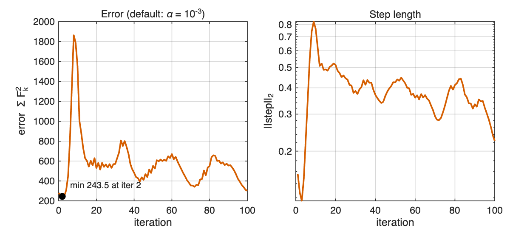
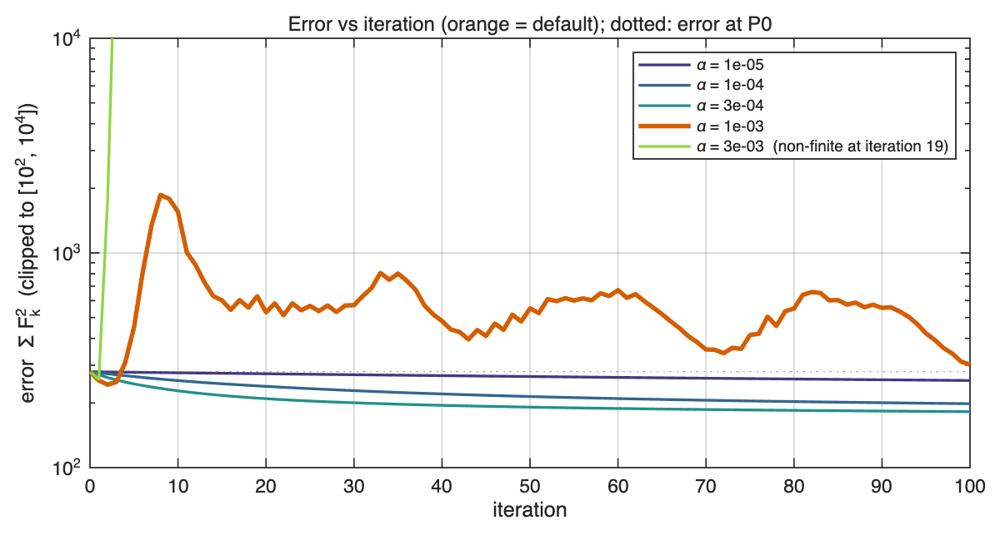
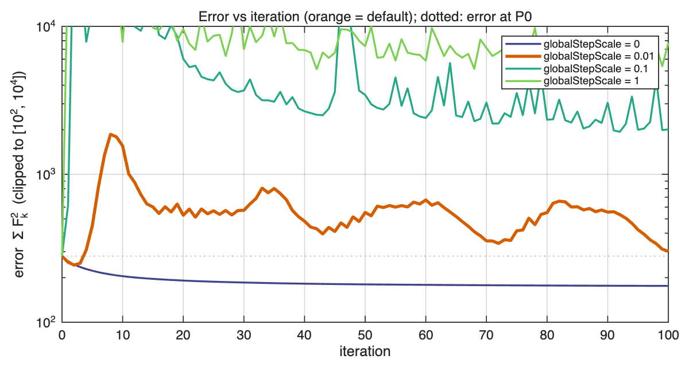

# 04. 경사하강법

**한국어** | [English](04_gradient_descent.en.md)

## 이 문서에서 배우는 것

- 가장 단순한 최적화기인 고정 스텝 경사하강법(gradient descent, GD)이 이 문제에서 어떻게 움직이는지, 그리고 왜 한 종류의 스텝 크기로는 잘 안 되는지 이해합니다.
- 핵심 결과는 기본 설정(`stepSize = 1e-3`, `globalStepScale = 0.01`)의 100회 반복이 `err` 279.6781에서 최솟값 243.5140(2번째 반복)까지 내려갔다가 다시 올라, 최종 301.7615(시작값보다 큼)에서 끝난다는 것입니다. 100번 중 40번은 오차가 늘어납니다.
- 원인은 시작점에서 계산한 **안정 조건**으로 설명됩니다. 기본 설정의 스텝 크기 1e-3은 안정 한계 2.52e-4의 약 4배입니다.

스크립트: [`tutorials/t04_gradient_descent.m`](../tutorials/t04_gradient_descent.m), 로그: [`tutorials/output/t04_gradient_descent.log`](../tutorials/output/t04_gradient_descent.log)

## 실행 방법

```matlab
setup
run('tutorials/t04_gradient_descent.m')
```

100회 반복 실행을 여러 번 하므로 이 시리즈에서 가장 오래 걸리는 편이며(로그의 `finished in` 줄은 약 40초), 그림 3장이 생성됩니다.

## 본문

### 알고리즘과 코드

$\mathrm{err}(P)=\|F(P)\|^2$의 기울기는 $g=2J^\top F$입니다. GD는 기울기 반대 방향으로 고정된 크기만큼 움직입니다.

$$
P \leftarrow P-\alpha\,S\,g,\qquad g=2J(P)^\top F(P).
$$

`edsm.solvers.gradientDescent`(`+edsm/+solvers/gradientDescent.m`)의 반복은 다음과 같습니다(복사).

```matlab
scale = [o.globalStepScale * ones(6, 1); ones(numel(P) - 6, 1)];
for k = 1:o.maxIter
    g = 2 * (J' * F);
    step = -o.stepSize * scale .* g;
    P = P + step;
```

교과서의 GD는 모든 변수에 같은 스텝 크기 $\alpha$를 씁니다. 이 코드는 대각 행렬 $S$를 써서 **전역 파라미터 6개($r$, $T$)에는 $\alpha\cdot$`globalStepScale`, 나머지 600개($A_i$, $t_i$)에는 $\alpha$(`stepSize`)** 를 씁니다. 기본값은 `stepSize = 1e-3`, `globalStepScale = 0.01`이며 원본 스크립트의 값입니다. 라인 서치가 없고 수렴 판정도 없습니다. 종료 이유는 `maxIter`(기본 100) 또는 오차가 유한하지 않게 된 경우(`nonFinite`) 둘뿐이고, 대응은 반복마다 다시 계산됩니다.

### 안정 조건: 스텝 크기는 얼마까지 가능한가

$F$가 선형이라고 가정하면 $\mathrm{err}(P+d)\approx\|F+Jd\|^2$이고 기울기는 $2J^\top(F+Jd)$입니다. GD 반복은 $d\leftarrow(I-2\alpha SJ^\top J)\,d$ 꼴이 되어, $S^{1/2}J^\top JS^{1/2}$의 가장 큰 고유값을 $\lambda_{\max}$라 할 때 $2\alpha\lambda_{\max}<2$, 즉

$$
\alpha<\alpha_{\max}=\frac{1}{\lambda_{\max}\!\left(S^{1/2}J^\top J\,S^{1/2}\right)}
$$

일 때만 오차가 줄어듭니다. 스크립트는 시작점 $P_0$에서 이 한계를 계산합니다. 이 한계는 $P_0$에서의 $J$로 계산한 값이므로, 반복 중에 $J$가 변하면 달라집니다(로그에도 같은 주의가 있습니다).

로그의 값입니다.

```
err(P0) = 279.6781, |grad| = 944.2
gradient norm by parameter group: r 931.3 | T 5.725 | A 155.2 | t 1.716
lambda_max(J'J) = 3.778e+05
  globalStepScale 0     : lambda_max =      861.3   alpha_max = 0.00116
  globalStepScale 0.01  : lambda_max =       3970   alpha_max = 0.000252
  globalStepScale 0.1   : lambda_max =  3.794e+04   alpha_max = 2.64e-05
  globalStepScale 1     : lambda_max =  3.778e+05   alpha_max = 2.65e-06
```

- 기울기는 회전 벡터 $r$ 성분에서 가장 큽니다(2-노름 기준 931.3, 전체 944.2).
- 더 중요한 것은 곡률입니다. 전역 파라미터를 제외하면(`globalStepScale 0`) $\lambda_{\max}=861.3$인데, 모두 같은 스텝으로 쓰면(`globalStepScale 1`) $3.778\times10^5$입니다. $3.778\times10^5/861.3\approx 439$배이며, 이 큰 곡률이 전역 파라미터($r$, $T$)에서 온다는 뜻입니다. 모든 파라미터에 같은 스텝을 쓰면 $\alpha_{\max}=2.65\times10^{-6}$으로 매우 작아집니다. 그래서 전역 파라미터에만 작은 계수를 따로 주는 것입니다.
- 기본 설정(`globalStepScale = 0.01`)의 한계는 로그의 `0.000252`, 곧 $2.52\times10^{-4}$이고, 기본 스텝 크기 $10^{-3}$은 그 약 4배입니다.

## 결과

### 기본 실행

```
default run: err 279.6781 -> minimum 243.5140 at iteration 2 -> final 301.7615 after 100 iterations (5.6 s)
iterations with an INCREASE of the error: 40 of 100 (first at iteration 3)
iter  err        |step|
   0   279.6781
   1   254.4104  0.155
   2   243.5140  0.127
   5   449.6176  0.227
  10  1555.0935  0.763
  20   528.5393  0.514
  40   482.1326  0.37
  60   671.0922  0.359
  80   550.8132  0.413
 100   301.7615  0.224
|grad| at the final iterate = 4976 (it was 944.2 at P0)
```



*그림 1. 기본 설정 GD의 100회 반복. 왼쪽은 목적함수로, 처음 2번은 줄다가(검은 점이 최솟값 243.5, 반복 2) 이후 치솟고(10번째 반복의 로그 값 1555.0935) 다시 오르내립니다(20, 40, 60, 80번째 반복은 각각 528.5393, 482.1326, 671.0922, 550.8132). 오른쪽은 단계 길이(로그 축)로, 오차가 치솟는 시점에 단계 길이도 커집니다(10번째 반복에서 0.763).*

이 거동은 "수렴 중인데 느린 것"이 아니라 **안정 한계를 넘은 스텝으로 인한 진동**입니다. 처음 두 단계에서는 오차가 줄지만, 가장 곡률이 큰 방향에서 $|1-2\alpha\lambda|>1$이므로 그 방향의 오차가 반복마다 커집니다. 오차가 커질수록 기울기도 커져서(마지막 점의 기울기 노름 4976 대 시작점 944.2) 단계 길이도 커집니다. 발산해서 무한대로 가지 않는 것은 비선형성 때문입니다(스텝이 커지면 대응이 바뀌고 곡률이 달라집니다). 이 과정이 반복되며 오차가 계속 오르내립니다. 100번째 반복의 301.7615는 우연히 내려오던 구간에서 멈춘 값이고, 반복을 더 하면 오른다는 보장도 내린다는 보장도 없습니다.

### 스텝 크기의 영향

`globalStepScale = 0.01`로 두고 `stepSize`만 바꿉니다(로그).

```
  alpha     iters    final err      min err   argmin stop      
  1e-05       100       254.58       254.58      100 maxIter   
  1e-04       100       198.51       198.51      100 maxIter   
  3e-04       100       182.24       182.24      100 maxIter   
  1e-03       100       301.76       243.51        2 maxIter   
  3e-03        19          Inf       257.69        1 nonFinite 
```



*그림 2. `stepSize`별 오차 곡선(y축은 $10^2$~$10^4$로 잘림, 점선은 시작값). 1e-05, 1e-04, 3e-04는 단조롭게 내려가지만 100번째에도 계속 내려가는 중입니다(`argmin`이 100). 주황색 굵은 선이 기본값 1e-03으로 진동하고, 3e-03은 19번째 반복에서 오차가 유한하지 않게 되어(`nonFinite`) 중단합니다.*

- 안정 한계 2.52e-4보다 작은 1e-05, 1e-04는 오차가 단조 감소하지만 매우 느립니다. 1e-05는 100회 후에도 254.58로 시작값 279.6781에서 조금 내려왔을 뿐입니다.
- 3e-04는 한계(2.52e-4)를 약간 넘었는데도 100회 동안 182.24까지 단조 감소합니다. 안정 한계는 시작점에서 계산한 값이고 이 경로에서는 곡률이 시작점보다 작아졌기 때문으로 보이지만, 스크립트는 이를 확인하지 않습니다. 안정 한계는 **참고값이지 보장이 아닙니다.**
- 1e-03은 한계의 약 4배이고 진동합니다. 3e-03은 발산합니다.
- 어느 쪽이든 100회 후 최저 오차(182.24)는 LM이 30회에 도달한 150.7190([00장](00_quickstart.md))보다 한참 높습니다.

### 전역 파라미터 계수의 영향

`stepSize = 1e-3`으로 두고 `globalStepScale`을 바꿉니다(로그).

```
  scale     iters    final err      min err   argmin stop      
  0           100       176.08       176.08      100 maxIter   
  0.01        100       301.76       243.51        2 maxIter   
  0.1         100       2012.5       279.68        0 maxIter   
  1           100       7761.3       279.68        0 maxIter   
```



*그림 3. `globalStepScale`별 오차 곡선. 0(파란 선, 전역 파라미터를 고정)은 단조 감소하고, 0.01(주황)은 진동하며, 0.1과 1은 시작값(점선) 위에서 크게 흔들립니다.*

- `globalStepScale = 0`이면 $r$, $T$가 움직이지 않고 한계가 $\alpha_{\max}=0.00116$이므로 $\alpha=10^{-3}$이 한계 안에 있어 안정하게 감소합니다(176.08, `argmin`이 100이라 아직 내려가는 중).
- 0.1과 1은 한계가 각각 $2.64\times10^{-5}$, $2.65\times10^{-6}$으로 $10^{-3}$보다 훨씬 작으므로 처음부터 불안정하고, `argmin`이 0이라 한 번도 시작값 아래로 내려가지 못합니다.
- 전역 파라미터를 고정하면 안정하지만 몸 전체의 회전과 이동을 쓰지 못하므로 최종 성능의 한계가 있습니다. 이 스크립트는 그 한계가 어디인지까지는 측정하지 않았습니다.

즉 GD에서는 스텝 크기가 파라미터마다 필요한 곡률의 규모(여기서는 약 440배 차이)에 맞아야 하고, 손으로 둔 계수 하나(`globalStepScale`)가 그 역할을 합니다. 이 문제를 풀려면 곡률 정보를 써서 스텝을 조정해야 하며 그 첫 단계가 다음 문서의 Gauss–Newton입니다.

## 정리 / 다음 단계

- GD는 `P(1:6)`에 `stepSize*globalStepScale`, 나머지에 `stepSize`를 쓰는 고정 스텝 방법이고 수렴 판정이 없습니다.
- 기본 설정의 100회는 최솟값 243.5140(2번째)에서 시작해 301.7615로 끝나며 40번은 오차가 늘어납니다. 시작점에서 구한 안정 한계 2.52e-4를 기본 스텝 1e-3이 약 4배 넘기 때문입니다.
- 한계 아래의 스텝(1e-05 ~ 3e-04)은 안정하지만 100회로도 182.24에 그칩니다. 안정 한계는 시작점 값이라 경로에서는 약간 어긋날 수 있습니다.

다음 문서: [05. Gauss–Newton](05_gauss_newton.md)에서 곡률을 써서 첫 단계를 크게 줄이지만, 이어서 발산하는 것을 봅니다.
