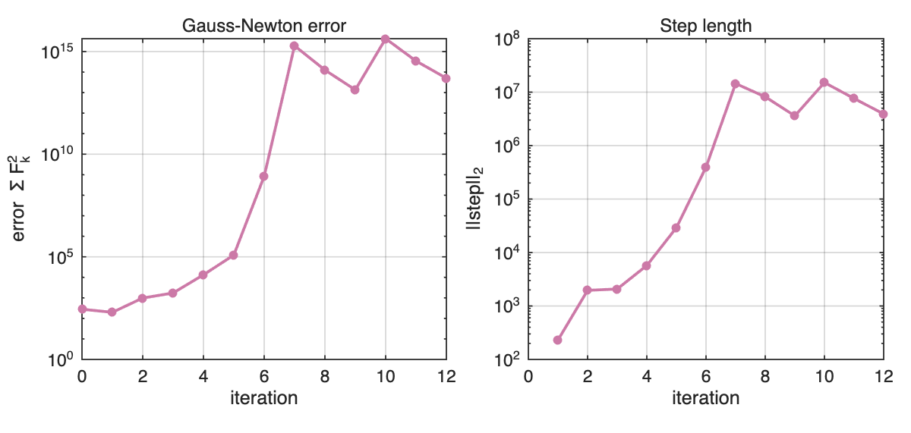
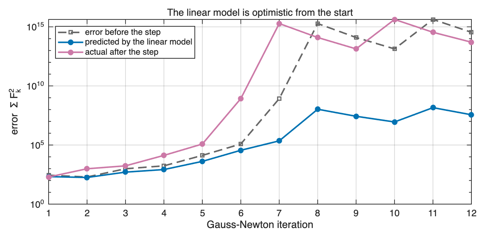
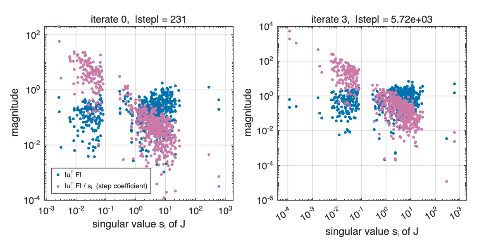
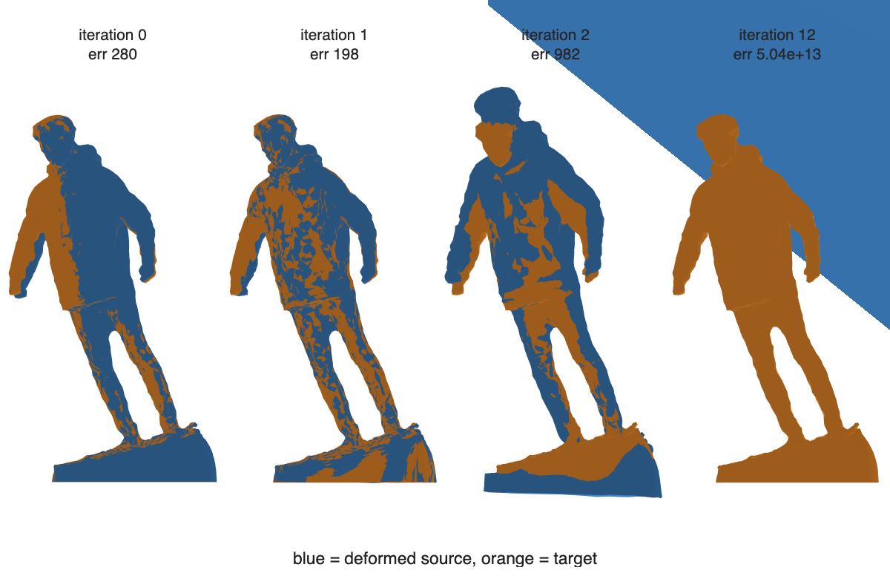

# 05. Gauss–Newton: an excellent first step, then divergence

[한국어](05_gauss_newton.md) | **English**

## What you will learn

- You will implement Gauss–Newton (GN), which linearizes the residual and solves a least-squares problem, and see how good the first step is when curvature information is used, and why it diverges immediately when there is no step control.
- The key result is that the first step reduces `err` from 279.678 to 197.532 (better than the linear model's prediction of 212.642), while the second step gives 982.197 and by iteration 12 the error has grown to 5.04318e+13.
- As the log shows, the cause is the **directions with small singular values**. The step is $-\sum_i (u_i^\top F/s_i)\,v_i$, and the coefficients for directions with small $s_i$ become large. In the first step, the directions of the 10 smallest singular values account for 85.8% of $\|d\|^2$, and at the third iterate they account for 99.2%.

Script: [`tutorials/t05_gauss_newton.m`](../tutorials/t05_gauss_newton.m), log: [`tutorials/output/t05_gauss_newton.log`](../tutorials/output/t05_gauss_newton.log)

## How to run

```matlab
setup
run('tutorials/t05_gauss_newton.m')
```

It finishes in about ten seconds and produces 4 figures.

## Walkthrough

### The algorithm

At the current point $P$, linearize as $F(P+d)\approx F+Jd$ and find the $d$ that minimizes $\|F+Jd\|^2$. The normal equations are

$$
J^\top J\,d=-J^\top F .
$$

Whereas gradient descent uses only the gradient $2J^\top F$, GN also uses curvature (an approximation of second-order information) through $J^\top J$. In this problem, however, $J^\top J$ is singular (tutorial 03: rank 600 of 606 at the starting point). So instead of the normal equations, `edsm.solvers.gaussNewton` (`+edsm/+solvers/gaussNewton.m`) computes the **minimum-norm least-squares solution** with `lsqminnorm` and adds it as is (copied from the source).

```matlab
    if isempty(o.rankTol), delta = lsqminnorm(J, -F); else, delta = lsqminnorm(J, -F, o.rankTol); end
    P = P + delta;
```

The absence of step control (damping, line search) is the key difference between GD and LM. The stopping conditions are `norm(delta, inf) < stepTol` (default `1e-3`), `maxIter` (default 100), and the error becoming non-finite (`nonFinite`). If you change the option `jacobian` to `'numeric'`, a finite-difference Jacobian is used (you must cut the noise singular values with `rankTol`; see the header).

Taking the singular value decomposition $J=U\Sigma V^\top$, the minimum-norm solution is

$$
d=-\sum_{i:\,s_i>\text{tol}}\frac{u_i^\top F}{s_i}\,v_i .
$$

For a direction with a small singular value $s_i$, that is, a parameter combination that is only weakly reflected in the objective, the coefficient becomes very large because of $1/s_i$ unless $u_i^\top F$ is small. This is the key to the results below.

### 1. At the starting point: `\`, `lsqminnorm`, `pinv`

At the starting point, $d$ is computed in four ways and compared (from the log).

```
JtJ \ (-g): MATLAB warning: (none issued) 
rcond(JtJ) = 1.289e-23

step d at P0            |d|           ||F+Jd||^2 (model)   err(P0 + d) (actual)
  JtJ \ (-g)             236.6         212.642             197.48
  lsqminnorm(J, -F)      230.9         212.642             197.532
  lsqminnorm(JtJ, -g)    230.9         212.642             197.532
  pinv(JtJ, tol) * (-g)  68.28         213.571             194.748

|dMinNormJ - dMinNormN| / |dMinNormJ| = 5.67e-10
|dMinNormJ - dPinv| / |dMinNormJ|     = 9.55e-01
err(P0) = 279.678134;  linear model predicts err = 212.642035 after the minimum-norm step
```

- `JtJ \ (-g)` **issues no warning** (`none issued`) even though `rcond` is 1.289e-23. It returns a solution, but the values at a singular matrix cannot be trusted. Solving the normal equations directly is not safe.
- `lsqminnorm(J, -F)` (the method the solver uses) and `lsqminnorm(JtJ, -g)` are the same solution, with a relative difference of 5.67e-10.
- The pseudoinverse that cuts off small-singular-value directions (`pinv`, with tolerance `1e-9 * max(eig(JtJ))`) gives a much shorter step (68.28 versus 230.9) and an actual error that is in fact lower (194.748 versus 197.532). This is the first piece of evidence that the minimum-norm step contains a lot of components in small-singular-value directions.
- For the minimum-norm step, the linear model predicted 212.642 but the actual value is a better 197.532. Because the correspondences are recomputed, the linear model can be off, and on this first step it was off in the good direction.

### 2. Running GN for 12 iterations

The run uses `maxIter = 12`, saving $P$ at every iteration with a callback.

```
Gauss-Newton: 12 iterations, stop reason "maxIter"
iter  err               |step|         
   0  279.678         
   1  197.532           230.9
   2  982.197           1960
   3  1731.55           2077
   4  13285.3           5718
   5  122004            2.918e+04
   6  8.46685e+08       3.955e+05
   7  1.90927e+15       1.447e+07
   8  1.25856e+14       8.17e+06
   9  1.36549e+13       3.601e+06
  10  4.24324e+15       1.512e+07
  11  3.46559e+14       7.608e+06
  12  5.04318e+13       3.905e+06
```



*Figure 1. The left panel is GN's `err` (log axis), the right panel is the step length (log axis). After a slight decrease in the first step, the error and step length grow together, reaching the $10^{15}$ level at iteration 7, and afterwards fluctuate between $10^{13}$ and $10^{15}$.*

Iteration 1 (230.9) is more than 3 times longer than LM's first step (tutorial 06, length 72.44, `err` 193.96), and at iteration 2 the step grows to 1960. If you move the mesh by this much, the linearization no longer holds.

### 3. Predicted versus actual

At each iterate $P_k$, the error $\|F_k+J_kd\|^2$ predicted by the linear model is compared with the actual error after the iteration. The ratio of the actual decrease to the predicted decrease is defined as

$$
\rho=\frac{\mathrm{err}_k-\mathrm{err}_{\text{actual}}}{\mathrm{err}_k-\mathrm{err}_{\text{pred}}}
$$

($\rho=1$ means the model is exact, and $\rho\le 0$ means the error did not decrease). The log:

```
iter   err_before        predicted        actual           rho
   1   279.678           212.642          197.532          1.225
   2   197.532           180.161          982.197          -45.17
   3   982.197           509.88           1731.55          -1.587
   4   1731.55           840.751          13285.3          -12.97
   5   13285.3           4139.65          122004           -11.89
   6   122004            35950.4          8.46685e+08      -9838
   7   8.46685e+08       225216           1.90927e+15      -2.256e+06
   8   1.90927e+15       1.07141e+08      1.25856e+14      0.9341
   9   1.25856e+14       2.70784e+07      1.36549e+13      0.8915
  10   1.36549e+13       8.96262e+06      4.24324e+15      -309.7
  11   4.24324e+15       1.45699e+08      3.46559e+14      0.9183
  12   3.46559e+14       3.6428e+07       5.04318e+13      0.8545
```



*Figure 2. For each iteration, the error before the step (gray dashed line), the linear model's prediction (blue), and the actual error after the step (pink). At iteration 1 the actual value is lower than the prediction, but from iteration 2 on the actual error far exceeds the prediction and the gap grows. The phrase "optimistic from the start" in the figure title does not fit iteration 1 ($\rho=1.225$ in the table above); it fits from iteration 2 on.*

- At iteration 1 the linear model was conservative ($\rho=1.225$). From iteration 2 on, the model predicts a decrease in error (for example, from 197.532 to 180.161) but the actual error increases to 982.197 ($\rho=-45.17$).
- At iterations 8, 9, 11 and 12, $\rho$ is 0.85 to 0.93, so the actual decrease was 85 to 93% of the predicted decrease, but at those points the errors are all 1.36549e+13 or more, a region far larger than the starting value of 279.678. Iteration 10 is again $\rho=-309.7$. This is not meaningful convergence.

### 4. Why the step grows: small singular values

The coefficients $|u_i^\top F|/s_i$ of the SVD formula above are computed at the starting point and at iterate 3 (from the log).

```
iterate 0: err 279.678, 600 of 606 singular values above rank tolerance, smallest kept 2.663e-03, largest 6.147e+02
  |step| from SVD formula = 230.9, from lsqminnorm = 230.9
  largest coefficient 202.6 belongs to s = 2.663e-03 (|u'F| = 5.395e-01); share of |step|^2 from the 10 smallest s: 85.8%

iterate 3: err 1731.55, 603 of 606 singular values above rank tolerance, smallest kept 1.168e-04, largest 6.102e+02
  |step| from SVD formula = 5718, from lsqminnorm = 5718
  largest coefficient 5241 belongs to s = 1.168e-04 (|u'F| = 6.122e-01); share of |step|^2 from the 10 smallest s: 99.2%
```



*Figure 3. $|u_i^\top F|$ (blue dots) and the step coefficient $|u_i^\top F|/s_i$ (pink dots) against the singular value $s_i$ (horizontal, log scale). The left panel is the starting point and the right panel is iterate 3. $|u_i^\top F|$ is of roughly similar size regardless of the singular value, but in directions with small $s_i$ the division raises the coefficient sharply and it dominates the step (the largest coefficients reported in the log are 202.6 at the starting point and 5241 at iterate 3). In the right panel the smallest singular value is even smaller than at the starting point.*

- The step length computed with the SVD formula equals the `lsqminnorm` result (230.9, 5718). So the formula above is an exact description of what the solver does.
- Already at the starting point, the 10 smallest singular values account for 85.8% of $\|d\|^2$. At iterate 3 the smallest singular value becomes even smaller, 1.168e-04, and the share is 99.2%.
- In the direction that produces the largest coefficient, $|u_i^\top F|$ is not small: 0.5395 (starting point) and 0.6122 (iterate 3). That is, the residual has components even in small-$s_i$ directions, so the step becomes very large in order to remove them in one go. That moving far in those directions does not reduce the error by as much means that $J$ is valid in those directions only within a very small neighborhood.

Because a step obtained this way exceeds the range in which the linearization is valid, the prediction is wrong and the error grows (possible causes include the recomputation of correspondences and the nonlinearity of the rotation term, but the script did not measure these separately). The larger error makes $F$ larger at the next step, so the step grows with it (the right panel of Figure 1).



*Figure 4. The deformed source (blue) and the target (orange) at iterations 0, 1, 2 and 12. At iteration 1 (`err 198`), the blue and orange are more fragmentedly mixed (overlapping) on the torso and legs than at the starting point; at iteration 2 (`err 982`) the shape is badly misaligned; and at iteration 12 (`err 5.04e+13`) most of the source has flown off the screen and a large blue region remains in the upper right. The display range is fixed to the region of the two input meshes, so anything that has gone outside is clipped.*

### With the default settings

The experiment above was cut off at `maxIter = 12`. In the comparison on tutorial 08, GN is run from the same starting point with `maxIter = 30`, giving a final error of 9.65389e+17 (the minimum error is 197.532 at the first step), and the stop reason is `maxIter`.

## Summary / Next

- GN is a minimum-norm least-squares step with no step control. The first step is the best (`err` 279.678 → 197.532) and it diverges afterwards.
- The cause is the small-singular-value directions (10 directions account for 85.8% of $\|d\|^2$ at the starting point and 99.2% at iterate 3), and from iteration 2 the linear model predicts a decrease in error while the actual error increases.
- `JtJ \ (-g)` issues no warning even for a singular $J^\top J$, so it cannot be trusted.
- Limiting the step in small-singular-value directions (the `pinv` example: step 68.28, actual error 194.748) gives a better result. The way to adjust that limit continuously is damping.

Next page: [06. Levenberg–Marquardt](06_levenberg_marquardt.en.md) adds damping to $J^\top J$ to control the step length.
