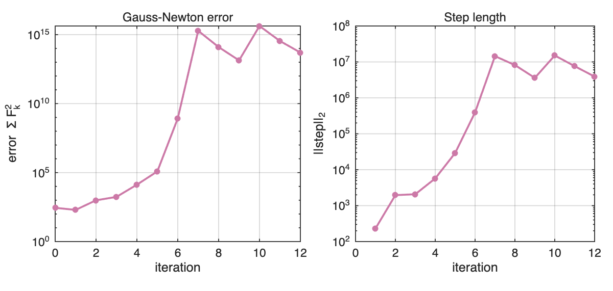
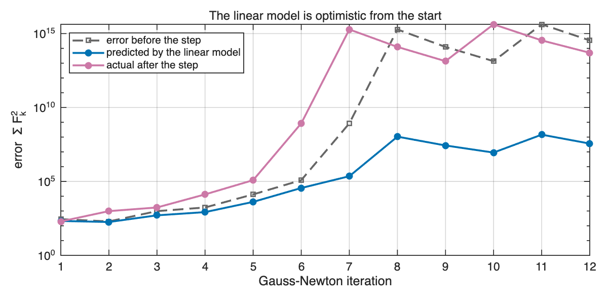
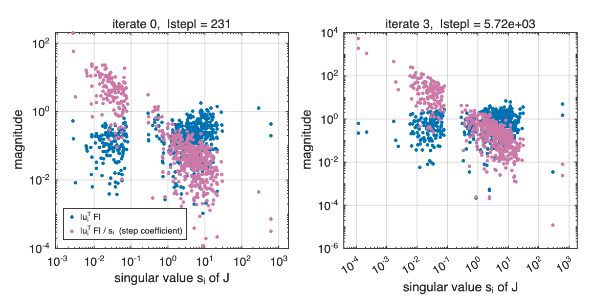
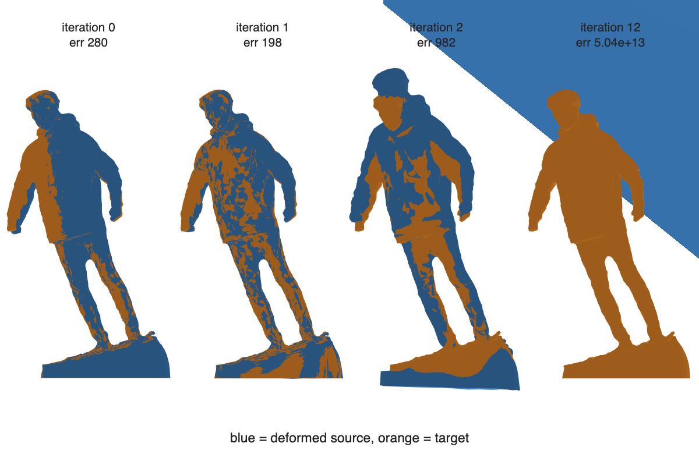

# 05. Gauss–Newton: 훌륭한 첫 걸음, 그다음 발산

**한국어** | [English](05_gauss_newton.en.md)

## 이 문서에서 배우는 것

- 잔차를 선형화해 최소제곱 문제로 푸는 Gauss–Newton(GN)을 구현하고, 곡률 정보를 쓰면 첫 단계가 얼마나 좋은지, 단계 제어가 없으면 왜 곧바로 발산하는지 확인합니다.
- 핵심 결과는 첫 단계가 `err`을 279.678에서 197.532로 줄이는 반면(선형 모델의 예측 212.642보다 좋음), 둘째 단계는 982.197로, 12번째 반복에서는 5.04318e+13까지 커진다는 것입니다.
- 원인은 로그가 보여 주는 대로 **특이값이 작은 방향**입니다. 단계는 $-\sum_i (u_i^\top F/s_i)\,v_i$이고, 작은 $s_i$ 방향의 계수가 커집니다. 첫 단계에서 가장 작은 10개 특이값 방향이 $\|d\|^2$의 85.8%를, 세 번째 반복점에서는 99.2%를 차지합니다.

스크립트: [`tutorials/t05_gauss_newton.m`](../tutorials/t05_gauss_newton.m), 로그: [`tutorials/output/t05_gauss_newton.log`](../tutorials/output/t05_gauss_newton.log)

## 실행 방법

```matlab
setup
run('tutorials/t05_gauss_newton.m')
```

십 초 안팎으로 끝나며 그림 4장이 생성됩니다.

## 본문

### 알고리즘

현재 점 $P$에서 $F(P+d)\approx F+Jd$로 선형화하고 $\|F+Jd\|^2$를 최소화하는 $d$를 구합니다. 정규방정식은 다음과 같습니다.

$$
J^\top J\,d=-J^\top F .
$$

경사하강법이 기울기 $2J^\top F$만 쓰는 반면, GN은 $J^\top J$로 곡률(2차 정보의 근사)까지 씁니다. 그러나 이 문제에서는 $J^\top J$가 특이행렬입니다(03장: 시작점에서 랭크 600/606). 그래서 `edsm.solvers.gaussNewton`(`+edsm/+solvers/gaussNewton.m`)은 정규방정식 대신 **최소 노름 최소제곱 해**를 `lsqminnorm`으로 구하고 그대로 더합니다(복사).

```matlab
    if isempty(o.rankTol), delta = lsqminnorm(J, -F); else, delta = lsqminnorm(J, -F, o.rankTol); end
    P = P + delta;
```

단계 제어(감쇠, 라인 서치)가 없다는 점이 GD와 LM 사이의 핵심 차이입니다. 종료 조건은 `norm(delta, inf) < stepTol`(기본 `1e-3`), `maxIter`(기본 100), 오차가 유한하지 않게 됨(`nonFinite`)입니다. 옵션 `jacobian`을 `'numeric'`으로 바꾸면 유한 차분 Jacobian을 씁니다(`rankTol`로 잡음 특이값을 잘라야 합니다, 헤더 참고).

$J=U\Sigma V^\top$로 특이값 분해하면 최소 노름 해는 다음과 같습니다.

$$
d=-\sum_{i:\,s_i>\text{tol}}\frac{u_i^\top F}{s_i}\,v_i .
$$

특이값 $s_i$가 작은 방향, 곧 파라미터 조합이 목적함수에 약하게만 반영되는 방향은 $u_i^\top F$가 작지 않으면 $1/s_i$ 때문에 계수가 매우 커집니다. 이것이 아래 결과의 핵심입니다.

### 1. 시작점에서: `\`, `lsqminnorm`, `pinv`

시작점에서 네 가지 방식으로 $d$를 구해 비교합니다(로그).

```
JtJ \ (-g): MATLAB warning: (none issued) 
rcond(JtJ) = 1.289e-23

step d at P0            |d|           ||F+Jd||^2 (model)   err(P0 + d) (actual)
  JtJ \ (-g)             236.6         212.642             197.48
  lsqminnorm(J, -F)      230.9         212.642             197.532
  lsqminnorm(JtJ, -g)    230.9         212.642             197.532
  pinv(JtJ, tol) * (-g)  68.28         213.571             194.748

|dMinNormJ - dMinNormN| / |dMinNormJ| = 5.67e-10
|dMinNormJ - dPinv| / |dMinNormJ|     = 9.55e-01
err(P0) = 279.678134;  linear model predicts err = 212.642035 after the minimum-norm step
```

- `JtJ \ (-g)`는 `rcond`가 1.289e-23인데도 **경고가 나오지 않습니다**(`none issued`). 해를 돌려주지만 특이행렬에서의 값은 믿을 수 없습니다. 정규방정식을 직접 푸는 것은 안전하지 않습니다.
- `lsqminnorm(J, -F)`(솔버가 쓰는 방식)와 `lsqminnorm(JtJ, -g)`는 상대 차이 5.67e-10으로 같은 해입니다.
- 특이값이 작은 방향을 잘라낸 의사역행렬(`pinv`, 허용치는 `1e-9 * max(eig(JtJ))`)은 단계가 훨씬 짧고(68.28 대 230.9) 실제 오차는 오히려 더 낮습니다(194.748 대 197.532). 최소 노름 단계 안에 작은 특이값 방향의 성분이 많이 들어 있다는 첫 번째 증거입니다.
- 최소 노름 단계는 선형 모델이 212.642를 예측했는데 실제로는 197.532로 더 좋습니다. 대응이 다시 계산되기 때문에 선형 모델이 어긋날 수 있고, 이 첫 단계에서는 좋은 쪽으로 어긋났습니다.

### 2. GN 12회 실행

콜백으로 매 반복의 $P$를 저장하며 `maxIter = 12`로 실행합니다.

```
Gauss-Newton: 12 iterations, stop reason "maxIter"
iter  err               |step|         
   0  279.678         
   1  197.532           230.9
   2  982.197           1960
   3  1731.55           2077
   4  13285.3           5718
   5  122004            2.918e+04
   6  8.46685e+08       3.955e+05
   7  1.90927e+15       1.447e+07
   8  1.25856e+14       8.17e+06
   9  1.36549e+13       3.601e+06
  10  4.24324e+15       1.512e+07
  11  3.46559e+14       7.608e+06
  12  5.04318e+13       3.905e+06
```



*그림 1. 왼쪽은 GN의 `err`(로그 축), 오른쪽은 단계 길이(로그 축)입니다. 첫 단계에서 약간 내려간 뒤 오차와 단계 길이가 함께 커져 7번째 반복에서 $10^{15}$ 수준까지 올라가고 이후 $10^{13}$~$10^{15}$ 사이를 오갑니다.*

반복 1(230.9)은 LM의 첫 단계(06장, 길이 72.44, `err` 193.96)보다 3배 이상 길고, 반복 2에서는 단계가 1960으로 커집니다. 메쉬를 이 크기로 움직이면 선형화가 더는 맞지 않습니다.

### 3. 예측과 실제

각 반복점 $P_k$에서 선형 모델이 예측한 오차 $\|F_k+J_kd\|^2$를 실제 반복 후의 오차와 비교합니다. 예측된 감소량 대비 실제 감소량의 비율을

$$
\rho=\frac{\mathrm{err}_k-\mathrm{err}_{\text{actual}}}{\mathrm{err}_k-\mathrm{err}_{\text{pred}}}
$$

로 정의합니다($\rho=1$이면 모델이 정확, $\rho\le 0$이면 오차가 줄지 않음). 로그입니다.

```
iter   err_before        predicted        actual           rho
   1   279.678           212.642          197.532          1.225
   2   197.532           180.161          982.197          -45.17
   3   982.197           509.88           1731.55          -1.587
   4   1731.55           840.751          13285.3          -12.97
   5   13285.3           4139.65          122004           -11.89
   6   122004            35950.4          8.46685e+08      -9838
   7   8.46685e+08       225216           1.90927e+15      -2.256e+06
   8   1.90927e+15       1.07141e+08      1.25856e+14      0.9341
   9   1.25856e+14       2.70784e+07      1.36549e+13      0.8915
  10   1.36549e+13       8.96262e+06      4.24324e+15      -309.7
  11   4.24324e+15       1.45699e+08      3.46559e+14      0.9183
  12   3.46559e+14       3.6428e+07       5.04318e+13      0.8545
```



*그림 2. 반복마다 단계 전의 오차(회색 점선), 선형 모델의 예측(파란색), 실제 단계 후 오차(분홍색). 1번째 반복에서는 실제가 예측보다 낮지만, 2번째 반복부터 실제 오차가 예측을 크게 웃돌고 그 격차가 커집니다. 그림 제목의 "optimistic from the start"는 반복 1에는 맞지 않고(위 표의 $\rho=1.225$), 반복 2부터 맞습니다.*

- 반복 1에서 선형 모델은 보수적이었습니다($\rho=1.225$). 반복 2부터는 모델이 오차 감소를 예측하는데(예: 197.532에서 180.161) 실제 오차는 982.197로 오히려 증가합니다($\rho=-45.17$).
- 반복 8, 9, 11, 12에서는 $\rho$가 0.85~0.93이어서 실제 감소가 예측 감소의 85~93%였지만, 이때의 오차는 모두 1.36549e+13 이상으로 시작값 279.678보다 훨씬 큰 영역입니다. 반복 10은 다시 $\rho=-309.7$입니다. 의미 있는 수렴이 아닙니다.

### 4. 단계가 커지는 이유: 작은 특이값

위 SVD 식의 계수 $|u_i^\top F|/s_i$를 시작점과 3번째 반복점에서 계산합니다(로그).

```
iterate 0: err 279.678, 600 of 606 singular values above rank tolerance, smallest kept 2.663e-03, largest 6.147e+02
  |step| from SVD formula = 230.9, from lsqminnorm = 230.9
  largest coefficient 202.6 belongs to s = 2.663e-03 (|u'F| = 5.395e-01); share of |step|^2 from the 10 smallest s: 85.8%

iterate 3: err 1731.55, 603 of 606 singular values above rank tolerance, smallest kept 1.168e-04, largest 6.102e+02
  |step| from SVD formula = 5718, from lsqminnorm = 5718
  largest coefficient 5241 belongs to s = 1.168e-04 (|u'F| = 6.122e-01); share of |step|^2 from the 10 smallest s: 99.2%
```



*그림 3. 특이값 $s_i$(가로, 로그)에 대한 $|u_i^\top F|$(파란 점)와 단계 계수 $|u_i^\top F|/s_i$(분홍 점). 왼쪽은 시작점, 오른쪽은 3번째 반복점입니다. $|u_i^\top F|$는 특이값에 상관없이 대체로 비슷한 크기인데, $s_i$가 작은 방향에서는 나누기 때문에 계수가 크게 올라가 단계를 지배합니다(로그가 보고하는 가장 큰 계수는 시작점 202.6, 3번째 반복점 5241). 오른쪽은 가장 작은 특이값이 시작점보다 더 작습니다.*

- SVD 공식으로 계산한 단계 길이가 `lsqminnorm`의 결과와 같습니다(230.9, 5718). 즉 위 식이 솔버가 하는 일의 정확한 설명입니다.
- 시작점에서 이미 가장 작은 10개 특이값이 $\|d\|^2$의 85.8%를 차지합니다. 3번째 반복점에서는 가장 작은 특이값이 1.168e-04로 더 작아지고 점유율이 99.2%입니다.
- 가장 큰 계수가 나오는 방향에서 $|u_i^\top F|$는 0.5395(시작점), 0.6122(3번째 반복점)로 작지 않습니다. 즉 작은 $s_i$ 방향에도 잔차 성분이 있으므로, 그것을 한 번에 없애려고 단계가 매우 커집니다. 그 방향으로 크게 움직여도 오차가 그만큼 줄지 않는다는 것은 $J$가 그 방향에서는 아주 가까운 범위에서만 맞는다는 뜻입니다.

이렇게 얻은 단계가 선형화가 유효한 범위를 넘으므로 예측이 틀리고 오차가 커집니다(원인으로 대응 재계산과 회전 항의 비선형성 등이 가능하지만 스크립트가 이를 따로 측정하지는 않았습니다). 커진 오차가 다음 단계의 $F$를 키우므로 단계도 함께 커집니다(그림 1의 오른쪽).



*그림 4. 반복 0, 1, 2, 12에서의 변형된 소스(파란색)와 타깃(주황색). 반복 1(`err 198`)은 시작점보다 몸통과 다리에서 파란색과 주황색이 더 조각조각 섞여(겹쳐) 있고, 반복 2(`err 982`)는 형상이 크게 어긋나며, 반복 12(`err 5.04e+13`)에서는 소스의 대부분이 화면 밖으로 날아가고 오른쪽 위에 큰 파란 영역이 남습니다. 표시 범위는 두 입력 메쉬의 영역으로 고정되어 있어 밖으로 나간 부분은 잘립니다.*

### 기본 설정에서는

위의 실험은 `maxIter = 12`로 잘랐습니다. 08장의 비교에서는 `maxIter = 30`으로 같은 시작점에서 GN을 돌리며 최종 오차 9.65389e+17(최소 오차는 첫 단계의 197.532), 종료 이유는 `maxIter`입니다.

## 정리 / 다음 단계

- GN은 단계 제어가 없는 최소 노름 최소제곱 단계입니다. 첫 단계가 가장 좋고(`err` 279.678 → 197.532) 이후 발산합니다.
- 원인은 작은 특이값 방향이며(시작점에서 10개 방향이 $\|d\|^2$의 85.8%, 3번째 반복점에서 99.2%), 선형 모델은 반복 2부터 오차 감소를 예측하는데 실제로는 증가합니다.
- `JtJ \ (-g)`는 특이한 $J^\top J$에서도 경고를 내지 않으므로 믿을 수 없습니다.
- 작은 특이값 방향의 단계를 제한하면(`pinv` 예: 단계 68.28, 실제 오차 194.748) 더 나은 결과가 나옵니다. 그 제한을 연속적으로 조절하는 방법이 감쇠입니다.

다음 문서: [06. Levenberg–Marquardt](06_levenberg_marquardt.md)에서 $J^\top J$에 감쇠를 더해 단계 길이를 제어합니다.
