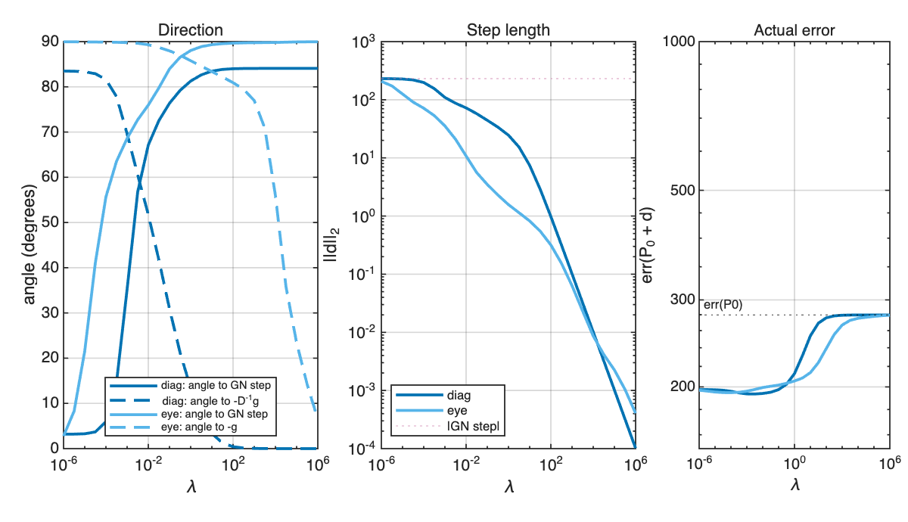
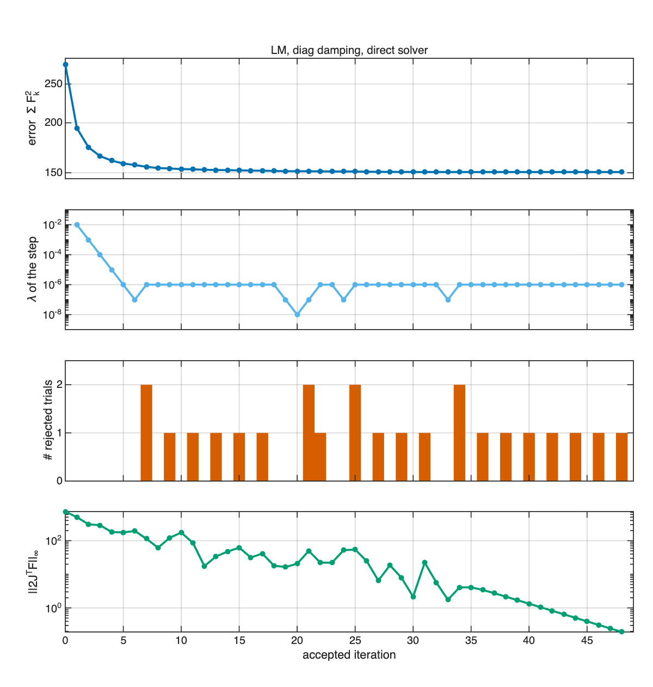
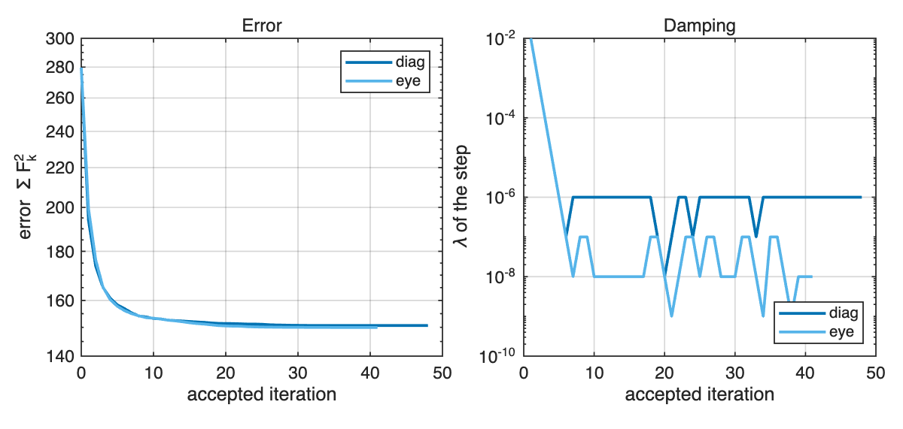
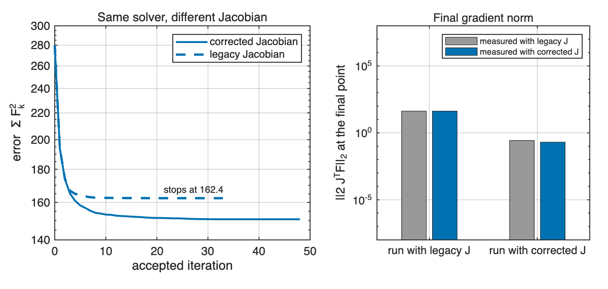

# 06. Levenberg–Marquardt: Damping between Gauss–Newton and gradient descent

[한국어](06_levenberg_marquardt.md) | **English**

## What you will learn

- How Levenberg–Marquardt (LM), which adds a damping term $\lambda D$ to the Gauss–Newton normal equations, bridges GN and gradient descent, and how `levenbergMarquardt` adjusts $\lambda$.
- The main result: from the same starting point as the GN run in tutorial 05, LM with default settings lowers `err` stably from 279.6781 to 150.6621 in 48 iterations. In total, 24 trial steps were rejected along the way.
- You also see how harmful the Jacobian bug from tutorial 03 really is. With the legacy Jacobian, the same LM stops at `err` 162.4137 (`lambdaMax`). The gradient norm there (2-norm) is 42.33, so it is not a stationary point.

Script: [`tutorials/t06_levenberg_marquardt.m`](../tutorials/t06_levenberg_marquardt.m), log: [`tutorials/output/t06_levenberg_marquardt.log`](../tutorials/output/t06_levenberg_marquardt.log)

## How to run

```matlab
setup
run('tutorials/t06_levenberg_marquardt.m')
```

LM is run three times, so this takes tens of seconds (the `finished in` line of the log reads 30.9 s). 4 figures are produced.

## Walkthrough

### The algorithm

At every iteration, LM solves a damped normal equation.

$$
\bigl(J^\top J+\lambda D\bigr)\,d=-J^\top F,\qquad P\leftarrow P+d .
$$

$D$ is the damping matrix, chosen with the option `damping` (`+edsm/+solvers/levenbergMarquardt.m`).

| `damping` | $D$ | Name |
|---|---|---|
| `'diag'` (default) | $\mathrm{diag}(\mathrm{diag}(J^\top J))$ | Marquardt |
| `'eye'` | $I$ | Levenberg |
| `'none'` | no damping ($\lambda$ has no effect) | GN |

```matlab
        A = JtJ + lambda * spdiags(diag(JtJ), 0, n, n);
```
(the `'diag'` branch, `dampedMatrix` in the code)

When $\lambda$ is small, $d$ is close to the GN step; when it is large, it becomes a short step along the negative gradient direction scaled by $D^{-1}$. In this problem the parameters differ enormously in scale (`diag(J'J)` ranges from a minimum of 4.119e-03 to a maximum of 3.698e+05, with no zero entries), so `'diag'`, which scales the damping per parameter, is the natural choice.

### $\lambda$ control: the rule in this code

Textbook LM usually updates $\lambda$ using a gain ratio $\rho$. This code uses a simpler **accept/reject rule** (exactly as stated in the header).

1. Build $A$ with the current $\lambda$, solve for $d$, and compute the trial point $P+d$.
2. If `err` **strictly decreases**, accept the step. Otherwise reject it and retry with $\lambda\leftarrow10\lambda$ (the Jacobian is not recomputed; only $A$ is rebuilt with the new $\lambda$ and solved again).
3. When a step is accepted: if it was accepted on the first try (no rejections), set $\lambda\leftarrow\lambda/10$; if there was at least one rejection, leave $\lambda$ at the raised value.

```matlab
        lambda = lambda * 10;
        if lambda > o.lambdaMax
            hist.stopReason = 'lambdaMax';
            break
        end
```
```matlab
    if nReject == 0, lambda = lambda / 10; end
```

The defaults are `lambda0 = 0.01` and `lambdaMax = 1e5`. A notable consequence of this rule is that $\lambda$ rises at every rejection and falls only when acceptances come back to back, so in the converged phase "one rejection, one acceptance" can alternate (iterations 7 to 11 in the table below).

**Stopping conditions.** They are checked in this order after each accepted iteration (from the header).

| Stop reason | Condition |
|---|---|
| `gradTol` | $\|2J^\top F\|_\infty\le$ `gradTol` $\times$ (the same quantity at the starting point). Default `1e-6`. It is relative to the starting point. |
| `funTol` | The decrease in `err` is below `funTol*(1 + err_new)` for **3 consecutive** accepted steps. Default `1e-8`. |
| `maxIter` | `maxIter` accepted iterations (default 100) |
| `lambdaMax` | If $\lambda>$ `lambdaMax` after a rejection, stop at the last accepted point |
| `rejectedNoDamping` | A step was rejected with `damping = 'none'` |

`hist.gradNorm` is the **infinity norm of $2J^\top F$** ($\|\cdot\|_\infty$). It differs from the value (a 2-norm) printed by some logs; this page always states which norm is meant.

### 1. $\lambda$ is a bridge: damped steps at the starting point

At the starting point, we sweep $\lambda$ from $10^{-6}$ to $10^{6}$, solve for the damped step $d(\lambda)$, and compare it with the GN step (`lsqminnorm`) in terms of its angle to the negative gradient direction, its length, and the actual error (excerpt from the log; angles in degrees).

```
lambda      | diag: angle to GN  |step|   err(P0+d) | eye: angle to GN  angle to -g  |step|   err(P0+d)
 1.00e-06   |           3.19      230.8      197.5 |          2.80        89.96      207.2      196.9
 1.00e-04   |           5.95      197.9        196 |         55.68        89.89      71.47      194.7
 1.00e-02   |          67.14      72.44        194 |         75.96        89.31      10.78      199.4
 1.00e+00   |          81.27      24.55      212.8 |         88.03        85.77      1.569      205.6
 1.00e+02   |          84.00     0.9797        276 |         89.66        80.93      0.318      239.2
 1.00e+04   |          84.08    0.01017      279.6 |         89.81        55.95   0.008653      275.3
 1.00e+06   |          84.08  0.0001017      279.7 |         89.96         6.48  0.0004057      279.3
GN step: |d| = 230.9, err(P0 + dGN) = 197.5;  err(P0) = 279.7
best lambda on this grid (diag damping): 3.16e-03 with err 193.5
```



*Figure 1. How the step depends on $\lambda$ (light blue is `eye`, dark blue is `diag`). Left: the direction, as the angle to the GN step (solid) and the angle to the damping-scaled negative gradient (dotted). Middle: step length. Right: the actual error `err(P0 + d)`. When $\lambda$ is small the step coincides with the GN step (an angle of about 3 degrees; for `diag` at $10^{-6}$ it is 3.19 degrees with length 230.8, equal to the GN length of 230.9). As $\lambda$ grows the step moves away from GN and its length shrinks in inverse proportion to $\lambda$ (in the log, 0.01017 at $10^{4}$ and 0.0001017 at $10^{6}$). In the right panel, for large $\lambda$ the actual error returns to the starting value, 279.7.*

- For `diag` at $\lambda=10^{-6}$, the step is the same as the GN step (3.19 degrees, length 230.8, error 197.5). When tutorial 05 used this step as is, the following step diverged.
- Raising $\lambda$ a little shortens the step and lowers the error further. The best $\lambda$ on the grid is 3.16e-03 (`diag`), with `err` 193.5, which is lower than the GN step's 197.5. LM's first accepted step ($\lambda=0.01$, length 72.44) has `err` 193.96208.
- If it is too large ($\ge10^{2}$), the step effectively cannot move. The step length drops to 0.9797 or less, and the error stays near the starting value (276, 279.6).
- The large-$\lambda$ limit for `diag` is the damping-scaled negative gradient ($-D^{-1}g$) direction, and the limit for `eye` is the negative gradient direction itself (the dotted line in the figure converges to 0 degrees). For `diag`, the angle to GN stops at 84.08 degrees rather than 90 because the GN step and the scaled gradient direction are about 84 degrees apart.

### 2. LM run with default settings

The result of running with the default settings (`damping = 'diag'`, `linearSolver = 'direct'`, `maxIter = 100`).

```
LM default (damping diag, direct): 48 accepted iterations, stop reason "funTol", 8.4 s
err: 279.6781 -> 150.6621;  hist.gradNorm available: 1
rejected trial steps in total: 24; accepted iterations that needed rejections: 20 of 48
lambda used: min 1.00e-08, max 1.00e-02
iter  err         lambda    nReject  lambdaNext  |step|
   1  193.96208   1.0e-02   0        1.0e-03     72.44
   2  173.68822   1.0e-03   0        1.0e-04     107.2
   3  165.11376   1.0e-04   0        1.0e-05     53.23
   4  160.87702   1.0e-05   0        1.0e-06     40.99
   5  158.28545   1.0e-06   0        1.0e-07     67.52
   6  156.86053   1.0e-07   0        1.0e-08     207.9
   7  155.26966   1.0e-06   2        1.0e-06     145.2
   8  154.15027   1.0e-06   0        1.0e-07     87.17
   9  153.77001   1.0e-06   1        1.0e-06     138.2
  10  153.22694   1.0e-06   0        1.0e-07     120.6
  11  153.06616   1.0e-06   1        1.0e-06     130.5
  12  152.62481   1.0e-06   0        1.0e-07     32.42
  48  150.66209   1.0e-06   1        1.0e-06     4.802
gradient inf-norm ||2 J'F||_inf (hist.gradNorm): start 733.1, final 0.1926
```



*Figure 2. History of the default LM. From the top: the error, the $\lambda$ that produced the step (log axis), the number of rejected trials per iteration, and `hist.gradNorm` ($\|2J^\top F\|_\infty$, log axis). The error drops sharply in the first few iterations and then slowly, reaching 150.6621 at iteration 48. $\lambda$ falls by a factor of 10 per iteration up to iteration 6 and then stays around `1e-06`, and rejections keep appearing after iteration 7. The infinity norm of the gradient decreases from 733.1 to 0.1926, though not monotonically.*

- This is the same starting point as the GN run in tutorial 05, yet LM descends stably. The step lengths in the iterations shown in the table lie between 4.802 and 207.9 (GN was already at 1960 in iteration 2), and any trial that does not reduce the error is rejected by raising $\lambda$.
- Up to iteration 6, $\lambda$ falls from `1e-02` to `1e-07`. In iteration 7, two trials are rejected and the step is accepted at `1e-06`. After that the pattern alternates: `1e-07` is tried and rejected, then `1e-06` is accepted (iterations 9 and 11). In other words, the damping this problem needs is $\lambda\approx10^{-6}$ (for `diag`).
- The stop reason is `funTol`, meaning the decrease in `err` was smaller than `1e-8*(1 + err)` 3 times in a row. At this point `hist.gradNorm` is 0.1926, about $2.6\times10^{-4}$ times the starting value (733.1) ($0.1926/733.1$). This is far from the default `gradTol = 1e-6`, so `gradTol` did not trigger.
- There were 24 rejections in total, spread over 20 iterations (out of 48), and the range of $\lambda$ used is `1e-08` to `1e-02`.

> **A note on norms.** The 0.1926 above is $\|2J^\top F\|_\infty$. The 2-norm at the same point is 0.2019 (table below, the "LM with corrected Jacobian" row under "corrected J").

### 3. Damping matrix: `diag` versus `eye`

Only the damping matrix is changed, from the same starting point (log).

```
LM damping eye : 41 iterations, stop "funTol", err 149.9616, 6.8 s, rejected trials 21
LM damping diag: 48 iterations, stop "funTol", err 150.6621, 8.4 s, rejected trials 24
error after 10 / 20 / 40 iterations: diag 153.227 / 151.380 / 150.662 ; eye 153.325 / 150.512 / 149.962
```



*Figure 3. The error (left) and the $\lambda$ used (right) for `diag` and `eye`. The two error curves almost overlap, and the ranges of $\lambda$ differ (`diag` moves up and down around `1e-06`, `eye` around `1e-08`). The scale of $\lambda$ depends on $D$, so the two values cannot be compared directly.*

The errors of the two variants are nearly the same up to iteration 10 (153.227 versus 153.325), after which `eye` ends slightly lower (149.9616 versus 150.6621). However, the two runs ended by `funTol` at different points (iteration 41 versus 48), so this difference should not be read as one method being better. As tutorial 02 explained, the objective is piecewise smooth because the correspondences change every time, so different paths stop at slightly different values.

### 4. Running LM with the legacy Jacobian

The same LM is run on a model built with `cfg.legacyJacobian = true`. $F$ is the same, so the errors are comparable, but the gradient the solver sees is different (log).

```
LM, legacy Jacobian: 33 iterations, stop "lambdaMax", err 162.4137, 5.3 s

||2 J'F|| at the final point of each run:
  run                                  legacy J        corrected J
  LM with legacy Jacobian                 42.33              42.46
  LM with corrected Jacobian             0.2664             0.2019
err at the final points: legacy-J run 162.4137, corrected-J run 150.6621 (difference 11.75)
hist.gradNorm (inf-norm) final: legacy run 33.22, corrected run 0.1926
```

The values in the table are 2-norms. The columns are the Jacobian used to compute the gradient (`legacy J` is what the solver believed; `corrected J` is the actual gradient).



*Figure 4. Left: the error of the same LM; with the corrected Jacobian (solid) it reaches 150.6621, while with the legacy Jacobian (dotted) it stops at 162.4137 at iteration 33. Right: $\|2J^\top F\|_2$ (log axis) measured at the final point of each run, with gray computed from the legacy $J$ and blue from the corrected $J$. At the point where the legacy-Jacobian run ended, both computations give a large value of around 42.*

- The legacy-Jacobian run ends with `lambdaMax`. This means that only steps that fail to reduce the error were produced, whatever $\lambda$ was.
- The true gradient norm at that point, computed with the **corrected** $J$, is large at 42.46. So it is not a stationary point; the $J$ the solver used disagrees with the gradient of $\mathrm{err}$, and the solver could not find a direction that would reduce the error further. At the point reached with the corrected $J$ (`err` 150.6621), the same norm is 0.2019.
- The difference in error is 11.75 (162.4137 versus 150.6621).
- This is why `gradTol` does not trigger with the legacy Jacobian: the gradient does not go to zero (the header of `levenbergMarquardt` gives the same explanation).

## Summary / Next

- LM solves $(J^\top J+\lambda D)d=-J^\top F$, and in this code $\lambda$ is adjusted by acceptance ($/10$ if on the first try) and rejection ($\times10$). A small $\lambda$ gives GN; a large one gives a short gradient step.
- Default LM lowers `err` stably to 150.6621 from the same starting point where GN in tutorial 05 diverged (48 iterations, stopped by `funTol`, 24 rejections).
- The legacy Jacobian makes LM stop at 162.4137. The corrected Jacobian really does matter.
- `hist.gradNorm` is an infinity norm and its values differ from the 2-norm.

Next: [07. CG and PCG](07_cg_pcg.en.md) shows how to solve LM's linear system with the conjugate gradient method instead of solving it directly.
