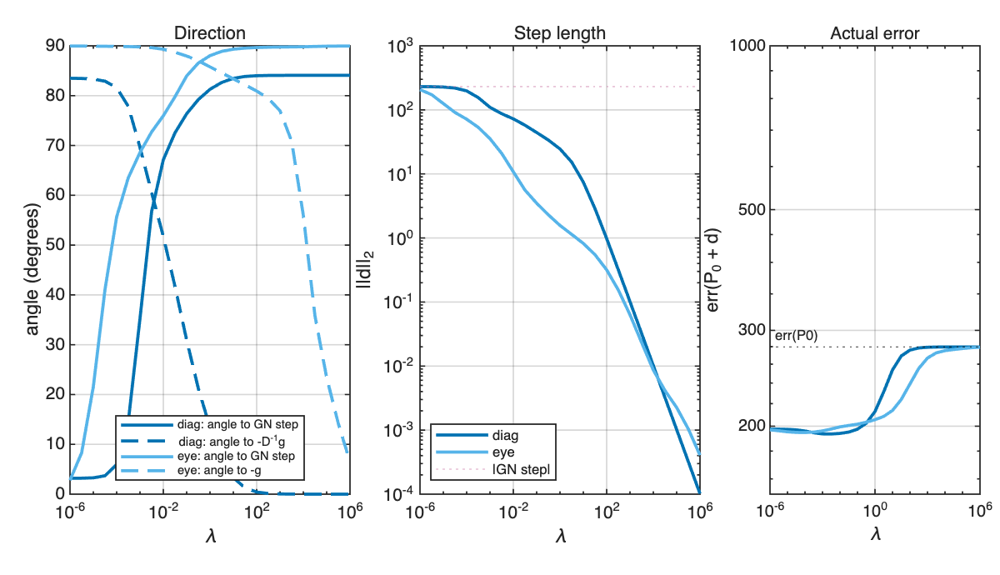
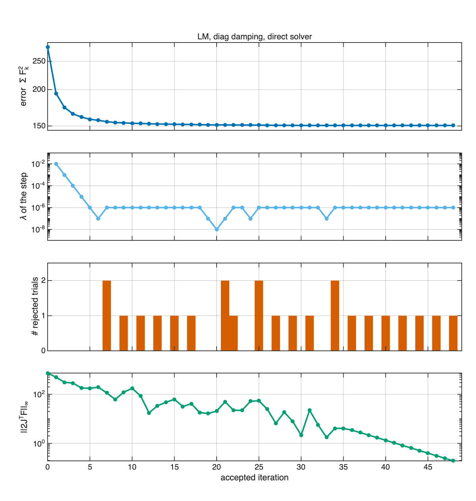
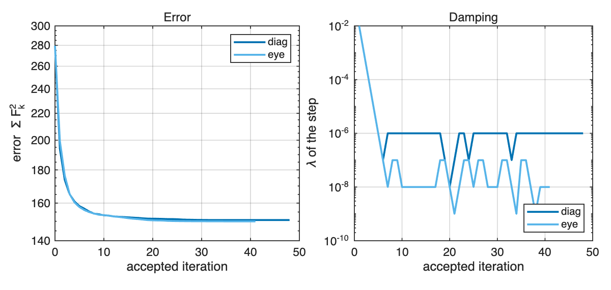
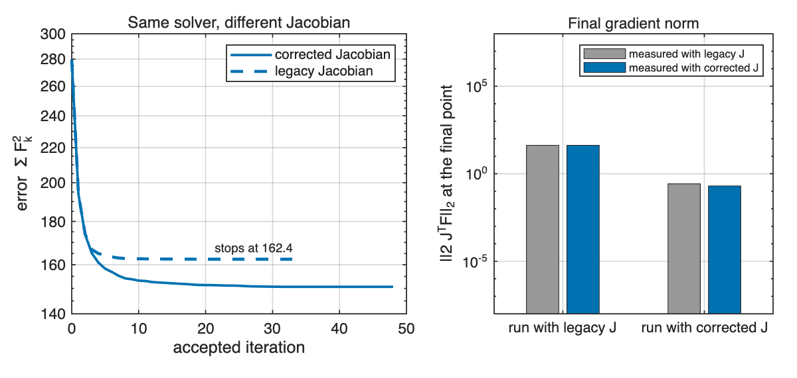

# 06. Levenberg–Marquardt: Gauss–Newton과 경사하강법 사이의 감쇠

**한국어** | [English](06_levenberg_marquardt.en.md)

## 이 문서에서 배우는 것

- Gauss–Newton의 정규방정식에 감쇠항 $\lambda D$를 더한 Levenberg–Marquardt(LM)가 어떻게 GN과 경사하강법 사이를 잇는지, 그리고 `levenbergMarquardt`가 $\lambda$를 어떻게 조절하는지 이해합니다.
- 핵심 결과는 기본 설정의 LM이 05장의 GN과 같은 시작점에서 `err`을 279.6781에서 150.6621까지 48번의 반복으로 안정하게 줄인다는 것입니다. 반복 중 거절된 시도는 모두 24번입니다.
- 03장의 Jacobian 오류가 실제로 얼마나 해로운지도 확인합니다. 원본 Jacobian을 쓰면 같은 LM이 `err` 162.4137에서 멈춥니다(`lambdaMax`). 이때의 기울기 노름(2-노름)은 42.33으로 정지점이 아닙니다.

스크립트: [`tutorials/t06_levenberg_marquardt.m`](../tutorials/t06_levenberg_marquardt.m), 로그: [`tutorials/output/t06_levenberg_marquardt.log`](../tutorials/output/t06_levenberg_marquardt.log)

## 실행 방법

```matlab
setup
run('tutorials/t06_levenberg_marquardt.m')
```

LM을 세 번 실행하므로 수십 초 걸립니다(로그의 `finished in` 줄은 30.9 s). 그림 4장이 생성됩니다.

## 본문

### 알고리즘

LM은 매 반복에서 감쇠된 정규방정식을 풉니다.

$$
\bigl(J^\top J+\lambda D\bigr)\,d=-J^\top F,\qquad P\leftarrow P+d .
$$

$D$는 감쇠 행렬로, 옵션 `damping`으로 고릅니다(`+edsm/+solvers/levenbergMarquardt.m`).

| `damping` | $D$ | 이름 |
|---|---|---|
| `'diag'`(기본) | $\mathrm{diag}(\mathrm{diag}(J^\top J))$ | Marquardt |
| `'eye'` | $I$ | Levenberg |
| `'none'` | 감쇠 없음($\lambda$ 효과 없음) | GN |

```matlab
        A = JtJ + lambda * spdiags(diag(JtJ), 0, n, n);
```
(`'diag'` 분기, 코드의 `dampedMatrix`)

$\lambda$가 작으면 $d$는 GN 단계에 가깝고, 크면 $D^{-1}$로 스케일된 음의 기울기 방향의 짧은 단계가 됩니다. 이 문제에서는 파라미터의 크기가 매우 달라서(`diag(J'J)`가 최소 4.119e-03에서 최대 3.698e+05, 0인 원소는 없음) 파라미터별로 감쇠를 스케일하는 `'diag'`가 자연스럽습니다.

### $\lambda$ 제어: 이 코드의 규칙

교과서의 LM은 보통 이득 비율 $\rho$로 $\lambda$를 갱신합니다. 이 코드는 더 단순한 **수락/거절 규칙**을 씁니다(헤더에 있는 그대로입니다).

1. 현재 $\lambda$로 $A$를 만들고 $d$를 구해 시험점 $P+d$를 계산합니다.
2. `err`이 **엄격히 감소하면** 수락합니다. 아니면 거절하고 $\lambda\leftarrow10\lambda$로 다시 시도합니다(Jacobian은 다시 계산하지 않고, $A$만 새 $\lambda$로 다시 만들어 풉니다).
3. 수락했을 때 첫 시도에서 수락되었으면(거절이 없었으면) $\lambda\leftarrow\lambda/10$, 한 번이라도 거절되었으면 $\lambda$를 올린 값 그대로 둡니다.

```matlab
        lambda = lambda * 10;
        if lambda > o.lambdaMax
            hist.stopReason = 'lambdaMax';
            break
        end
```
```matlab
    if nReject == 0, lambda = lambda / 10; end
```

기본 `lambda0 = 0.01`, `lambdaMax = 1e5`입니다. 이 규칙에서 눈에 띄는 점은 $\lambda$가 거절이 있을 때마다 올라가고 수락이 연속될 때만 내려가므로, 수렴 단계에서는 "거절 한 번, 수락 한 번"이 번갈아 나올 수 있다는 것입니다(아래 표의 7~11번 반복).

**종료 조건.** 수락된 반복마다 순서대로 검사합니다(헤더).

| 종료 이유 | 조건 |
|---|---|
| `gradTol` | $\|2J^\top F\|_\infty\le$ `gradTol` $\times$ (시작점의 같은 값). 기본 `1e-6`. 시작점 대비 상대값입니다. |
| `funTol` | 수락된 단계 **3번 연속**으로 `err` 감소량이 `funTol*(1 + err_new)` 미만. 기본 `1e-8`. |
| `maxIter` | 수락된 반복 `maxIter`번(기본 100) |
| `lambdaMax` | 거절 후 $\lambda>$ `lambdaMax`이면 마지막 수락점에서 중단 |
| `rejectedNoDamping` | `damping = 'none'`에서 거절된 경우 |

`hist.gradNorm`은 **$2J^\top F$의 무한 노름**($\|\cdot\|_\infty$)입니다. 일부 로그가 출력하는 값(2-노름)과 다르며, 이 문서에서는 어느 노름인지 항상 표시합니다.

### 1. $\lambda$는 다리입니다: 시작점에서의 감쇠 단계

시작점에서 $\lambda$를 $10^{-6}$에서 $10^{6}$까지 바꿔 가며 감쇠된 단계 $d(\lambda)$를 풀고, GN 단계(`lsqminnorm`)와 음의 기울기 방향에 대한 각도, 단계 길이, 실제 오차를 비교합니다(로그에서 발췌, 각도는 도).

```
lambda      | diag: angle to GN  |step|   err(P0+d) | eye: angle to GN  angle to -g  |step|   err(P0+d)
 1.00e-06   |           3.19      230.8      197.5 |          2.80        89.96      207.2      196.9
 1.00e-04   |           5.95      197.9        196 |         55.68        89.89      71.47      194.7
 1.00e-02   |          67.14      72.44        194 |         75.96        89.31      10.78      199.4
 1.00e+00   |          81.27      24.55      212.8 |         88.03        85.77      1.569      205.6
 1.00e+02   |          84.00     0.9797        276 |         89.66        80.93      0.318      239.2
 1.00e+04   |          84.08    0.01017      279.6 |         89.81        55.95   0.008653      275.3
 1.00e+06   |          84.08  0.0001017      279.7 |         89.96         6.48  0.0004057      279.3
GN step: |d| = 230.9, err(P0 + dGN) = 197.5;  err(P0) = 279.7
best lambda on this grid (diag damping): 3.16e-03 with err 193.5
```



*그림 1. $\lambda$에 대한 단계의 성질(밝은 파랑이 `eye`, 진한 파랑이 `diag`). 왼쪽은 방향으로 GN 단계와의 각도(실선)와 감쇠 스케일된 음의 기울기와의 각도(점선), 가운데는 단계 길이, 오른쪽은 실제 오차 `err(P0 + d)`입니다. $\lambda$가 작으면 GN 단계에 겹치고(각도 3도 안팎, `diag`에서 $10^{-6}$일 때 3.19도, 길이 230.8로 GN의 230.9와 같음), $\lambda$가 커지면 GN과 멀어지며 단계 길이가 $\lambda$에 반비례해 줄어듭니다(로그에서 $10^{4}$일 때 0.01017, $10^{6}$일 때 0.0001017). 오른쪽에서 실제 오차는 $\lambda$가 크면 시작값 279.7로 돌아갑니다.*

- `diag`에서 $\lambda=10^{-6}$의 단계는 GN과 같습니다(3.19도, 길이 230.8, 오차 197.5). 이 단계를 05장에서 그대로 썼을 때 다음 단계가 발산했습니다.
- $\lambda$를 조금 키우면 단계가 짧아지고 오차가 더 낮아집니다. 격자에서 최선의 $\lambda$는 3.16e-03(`diag`)이고 `err` 193.5로 GN 단계의 197.5보다 낮습니다. LM의 첫 수락 단계($\lambda=0.01$, 길이 72.44)는 `err` 193.96208입니다.
- 너무 크면($\ge10^{2}$) 사실상 움직이지 못합니다. 단계 길이가 0.9797 이하로 줄고 오차는 시작값 근처(276, 279.6)입니다.
- `diag`의 큰 $\lambda$ 극한은 감쇠 스케일된 음의 기울기($-D^{-1}g$) 방향이고, `eye`의 극한은 음의 기울기 방향 자체입니다(그림의 점선이 0도로 수렴). `diag`에서 GN과의 각도가 90도가 아니라 84.08도에서 멈추는 것은 GN 단계와 스케일된 기울기 방향이 서로 약 84도 떨어져 있기 때문입니다.

### 2. 기본 설정의 LM 실행

기본 설정(`damping = 'diag'`, `linearSolver = 'direct'`, `maxIter = 100`)으로 실행한 결과입니다.

```
LM default (damping diag, direct): 48 accepted iterations, stop reason "funTol", 8.4 s
err: 279.6781 -> 150.6621;  hist.gradNorm available: 1
rejected trial steps in total: 24; accepted iterations that needed rejections: 20 of 48
lambda used: min 1.00e-08, max 1.00e-02
iter  err         lambda    nReject  lambdaNext  |step|
   1  193.96208   1.0e-02   0        1.0e-03     72.44
   2  173.68822   1.0e-03   0        1.0e-04     107.2
   3  165.11376   1.0e-04   0        1.0e-05     53.23
   4  160.87702   1.0e-05   0        1.0e-06     40.99
   5  158.28545   1.0e-06   0        1.0e-07     67.52
   6  156.86053   1.0e-07   0        1.0e-08     207.9
   7  155.26966   1.0e-06   2        1.0e-06     145.2
   8  154.15027   1.0e-06   0        1.0e-07     87.17
   9  153.77001   1.0e-06   1        1.0e-06     138.2
  10  153.22694   1.0e-06   0        1.0e-07     120.6
  11  153.06616   1.0e-06   1        1.0e-06     130.5
  12  152.62481   1.0e-06   0        1.0e-07     32.42
  48  150.66209   1.0e-06   1        1.0e-06     4.802
gradient inf-norm ||2 J'F||_inf (hist.gradNorm): start 733.1, final 0.1926
```



*그림 2. 기본 LM의 이력. 위에서부터 오차, 단계를 만든 $\lambda$(로그 축), 반복마다 거절된 시도 수, `hist.gradNorm`($\|2J^\top F\|_\infty$, 로그 축)입니다. 오차는 처음 몇 번에 크게 줄고 이후 천천히 줄어 48번째 반복에서 150.6621이 됩니다. $\lambda$는 반복 6까지 10배씩 줄었다가 `1e-06` 주변에 머무르고, 거절은 7번 반복 이후 계속 나타납니다. 기울기의 무한 노름은 733.1에서 0.1926으로 단조롭지는 않지만 줄어듭니다.*

- 05장의 GN과 같은 시작점인데 LM은 안정하게 내려갑니다. 표에 나온 반복의 단계 길이가 4.802~207.9 범위이고(GN은 반복 2에서 이미 1960), 오차가 줄지 않는 시도는 $\lambda$를 올려 거절하기 때문입니다.
- 반복 6까지 $\lambda$는 `1e-02`에서 `1e-07`로 내려갑니다. 7번 반복에서는 시도 두 번이 거절되고 `1e-06`에서 수락됩니다. 이후에는 `1e-07`을 시도해 거절되면 `1e-06`을 수락하는 패턴이 번갈아 나옵니다(9, 11번 반복). 즉 이 문제에서 필요한 감쇠는 $\lambda\approx10^{-6}$(`diag` 기준)입니다.
- 종료 이유는 `funTol`이며, 3번 연속으로 `err` 감소량이 `1e-8*(1 + err)`보다 작았다는 뜻입니다. 이 시점의 `hist.gradNorm`은 0.1926으로 시작값(733.1)의 약 $2.6\times10^{-4}$배입니다($0.1926/733.1$). 기본 `gradTol = 1e-6`에는 한참 못 미치므로 `gradTol`은 작동하지 않았습니다.
- 거절은 반복 20번(48번 중)에서 합계 24번 있었고 $\lambda$ 사용 범위는 `1e-08`~`1e-02`입니다.

> **노름 주의.** 위의 0.1926은 $\|2J^\top F\|_\infty$입니다. 같은 점에서 2-노름은 0.2019입니다(아래 표, "corrected J"의 "LM with corrected Jacobian" 행).

### 3. 감쇠 행렬: `diag` 대 `eye`

같은 시작점에서 감쇠 행렬만 바꿔 비교합니다(로그).

```
LM damping eye : 41 iterations, stop "funTol", err 149.9616, 6.8 s, rejected trials 21
LM damping diag: 48 iterations, stop "funTol", err 150.6621, 8.4 s, rejected trials 24
error after 10 / 20 / 40 iterations: diag 153.227 / 151.380 / 150.662 ; eye 153.325 / 150.512 / 149.962
```



*그림 3. `diag`와 `eye`의 오차(왼쪽)와 사용한 $\lambda$(오른쪽). 두 오차 곡선은 거의 겹치고, $\lambda$ 값의 범위가 다릅니다(`diag`는 `1e-06` 부근, `eye`는 `1e-08` 부근에서 오르내림). $\lambda$의 척도는 $D$에 따라 달라서 두 값을 직접 비교할 수 없습니다.*

두 방식의 오차는 10번째 반복까지 거의 같고(153.227 대 153.325), 이후 `eye`가 약간 낮게 끝납니다(149.9616 대 150.6621). 다만 둘 다 `funTol`로 종료한 지점이 서로 달라(41번 대 48번 반복) 이 차이를 방법의 우열로 읽으면 안 됩니다. 02장에서 말했듯 대응이 매번 바뀌는 구간별 매끄러운 목적함수라서 서로 다른 경로가 약간 다른 값에서 멈춥니다.

### 4. 원본 Jacobian으로 LM을 돌리면

`cfg.legacyJacobian = true`로 만든 모델에서 같은 LM을 실행합니다. $F$는 같으므로 오차는 비교할 수 있지만 솔버가 보는 기울기는 다릅니다(로그).

```
LM, legacy Jacobian: 33 iterations, stop "lambdaMax", err 162.4137, 5.3 s

||2 J'F|| at the final point of each run:
  run                                  legacy J        corrected J
  LM with legacy Jacobian                 42.33              42.46
  LM with corrected Jacobian             0.2664             0.2019
err at the final points: legacy-J run 162.4137, corrected-J run 150.6621 (difference 11.75)
hist.gradNorm (inf-norm) final: legacy run 33.22, corrected run 0.1926
```

표의 값은 2-노름입니다. 열은 기울기를 계산한 Jacobian(`legacy J`는 솔버가 믿던 값, `corrected J`는 실제 기울기)입니다.



*그림 4. 왼쪽은 같은 LM의 오차로, 수정된 Jacobian(실선)은 150.6621까지, 원본 Jacobian(점선)은 33번째 반복에서 162.4137에 멈춥니다. 오른쪽은 각 실행의 마지막 점에서 잰 $\|2J^\top F\|_2$(로그 축)로, 회색이 원본 $J$로, 파란색이 수정된 $J$로 계산한 값입니다. 원본 Jacobian으로 끝난 점에서는 두 계산 모두 42 안팎으로 큽니다.*

- 원본 Jacobian의 실행은 `lambdaMax`로 끝납니다. 어떤 $\lambda$에서도 오차가 줄지 않는 단계만 나왔다는 뜻입니다.
- 그 점에서 **수정된** $J$로 계산한 진짜 기울기 노름이 42.46으로 큽니다. 즉 정지점이 아니며, 솔버가 쓴 $J$가 $\mathrm{err}$의 기울기와 어긋나 있어서 더 줄일 수 있는 방향을 찾지 못한 것입니다. 수정된 $J$로 도달한 점(`err` 150.6621)에서는 같은 노름이 0.2019입니다.
- 오차 차이는 11.75입니다(162.4137 대 150.6621).
- 그래서 `gradTol`은 원본 Jacobian에서는 작동하지 않습니다. 기울기가 0으로 가지 않기 때문입니다(`levenbergMarquardt` 헤더에 같은 설명이 있습니다).

## 정리 / 다음 단계

- LM은 $(J^\top J+\lambda D)d=-J^\top F$를 풀고, 이 코드에서 $\lambda$는 수락(첫 시도면 $/10$)과 거절($\times10$)로 조절됩니다. $\lambda$가 작으면 GN, 크면 짧은 기울기 단계입니다.
- 기본 LM은 05장의 GN이 발산한 같은 시작점에서 `err`을 150.6621까지 안정하게 줄입니다(48번, `funTol`로 종료, 거절 24번).
- 원본 Jacobian은 LM을 162.4137에서 멈추게 합니다. 수정된 Jacobian이 실제로 영향을 줍니다.
- `hist.gradNorm`은 무한 노름이며 2-노름과 값이 다릅니다.

다음 문서: [07. CG와 PCG](07_cg_pcg.md)에서 LM의 선형 시스템을 직접 풀지 않고 켤레기울기법으로 푸는 방법을 봅니다.
