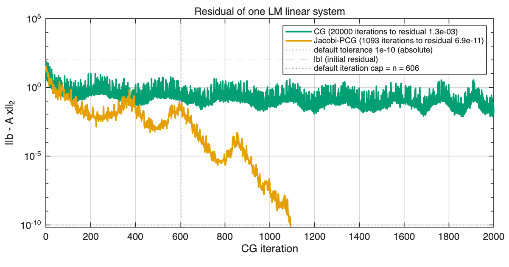
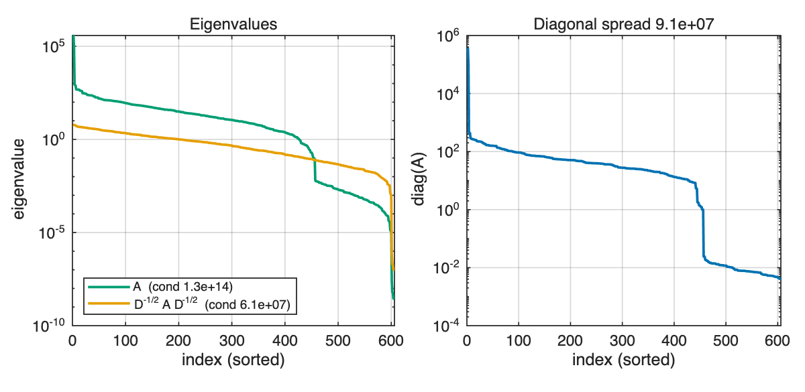
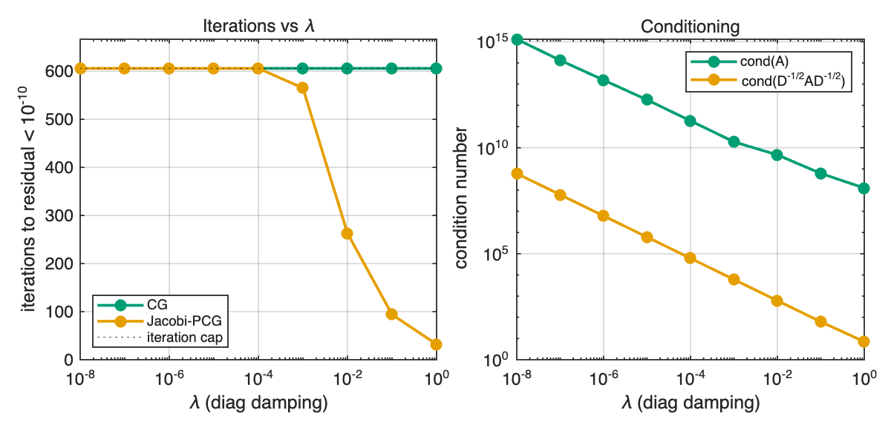
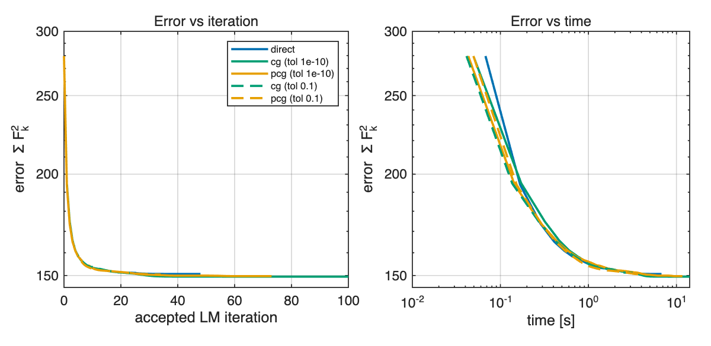
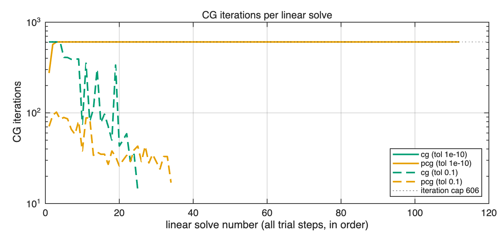

# 07. CG and PCG: solving LM's linear system iteratively

[한국어](07_cg_pcg.md) | **English**

## What you will learn

- Each LM iteration solves a $606\times606$ symmetric positive definite linear system $A d=b$. You learn how to solve it with the conjugate gradient method (CG) or Jacobi-preconditioned CG (PCG) instead of `A \ b` (direct), and why this is hard for this problem.
- The main result: with the default tolerance (absolute residual `1e-10`) and the default iteration cap (606), **plain CG hits the cap and barely solves the linear system**. On the real system from LM iteration 5, CG ends after 606 iterations with a residual of 8.789e-01 and a relative error of 9.980e-01 against the direct solution. Even with the cap raised to 20000 the residual is 1.313e-03. PCG needs 1093 iterations.
- The evidence is the condition number. This system has a condition number of 1.339e+14, and still 6.087e+07 after Jacobi preconditioning.

Script: [`tutorials/t07_cg_pcg.m`](../tutorials/t07_cg_pcg.m), log: [`tutorials/output/t07_cg_pcg.log`](../tutorials/output/t07_cg_pcg.log)

## How to run

```matlab
setup
run('tutorials/t07_cg_pcg.m')
```

It contains 5 LM runs, which makes it one of the slowest scripts in this series (the `finished in` line of the log reads 52.0 s). 5 figures are produced.

## Walkthrough

### What kind of system is it?

LM's system is $A=J^\top J+\lambda\,\mathrm{diag}(J^\top J)$, $b=-J^\top F$, of size $606\times606$. The system built right after LM iteration 5 is as follows (log).

```
System from LM iteration 5 (err 158.2854): lambda = 1.0e-07, n = 606, nnz(A) = 124538 (33.9% dense), |b| = 99.51
direct A\b : 0.0025 s, residual |b - A x| = 9.233e-12
```

33.9% of the entries of $A$ are nonzero. For a problem as small as 606 x 606, `A \ b` finishes in 0.0025 s with a residual of 9.233e-12. Iterative methods have no advantage at this size; the purpose of this page is to see how they behave and where they get stuck.

### Code: `conjGrad`

`edsm.solvers.conjGrad` (`+edsm/+solvers/conjGrad.m`) implements CG and preconditioned CG in one function. One iteration looks like this (copied).

```matlab
    Ap = A * p;
    pAp = p' * Ap;
    if pAp <= 0, break, end
    alpha = rz / pAp;
    x = x + alpha * p;
    r = r - alpha * Ap;
    rn = sqrt(r' * r);
```

The options are `precond` (`'none'` or `'jacobi'`), `tol` (default `1e-10`), and `maxIter` (default `numel(b)`). The code differs from the textbook in the following ways.

- **Absolute tolerance.** The stopping condition is $\|r\|<\mathrm{tol}$ (not the relative form $\|r\|<\mathrm{tol}\,\|b\|$), where $r$ is the updated residual $b-Ax$. For the system above, $\|b\|=99.51$, so `1e-10` corresponds to a relative value of about $1.0\times10^{-12}$ ($1\mathrm{e}{-10}/99.51$). That is quite strict.
- **The iteration cap is $n$.** In exact arithmetic CG finishes within $n$ iterations, but in floating point this does not hold when the condition number is large (see the results below).
- The Jacobi preconditioner is $M=\mathrm{diag}(A)$, with entries that are zero or less replaced by 1. It is applied as the elementwise division `z = r ./ dg`.
- If $p^\top Ap\le0$, the code concludes that $A$ is not positive definite and stops iterating.

In `levenbergMarquardt`, when the option `linearSolver` is `'cg'` the function above is called with `precond = 'none'`, and when it is `'pcg'` with `'jacobi'`; `cgTol` (default `1e-10`) and `cgMaxIter` (default `numel(P0)`) are passed through as they are. The iteration counts are recorded in `hist.linIters`.

## Results

### 1. Comparison on a single system

```
cg   (precond none  ):  606 iterations, 0.0385 s, final residual 8.789e-01, relative error vs direct 9.980e-01
pcg  (precond jacobi):  606 iterations, 0.0328 s, final residual 9.527e-02, relative error vs direct 5.554e-02
cg   with cap 20000: 20000 iterations, final residual 1.313e-03, relative error vs direct 6.261e-01
pcg  with cap 20000: 1093 iterations, final residual 6.872e-11, relative error vs direct 1.158e-09
first iteration with residual < 1e-10  : cg never, pcg 1093
first iteration with residual < 1e-06  : cg never, pcg 923
first iteration with residual < 0.001  : cg 5437, pcg 466
first iteration with residual < 0.1    : cg 138, pcg 114
first iteration with residual < 1      : cg 23, pcg 32
```

- At the default cap of 606 iterations, CG returns a solution whose relative error against the direct solution is 9.980e-01, that is, almost 100% wrong. PCG's is 5.554e-02. Neither is good enough.
- Even with the cap raised to 20000, CG does not bring the residual below `1e-10` (1.313e-03), and its solution differs from the direct one by 6.261e-01. PCG gets below `1e-10` at iteration 1093 (6.872e-11), with a relative error of 1.158e-09. Both go beyond the $n=606$ iterations of exact arithmetic. The accepted explanation is that at condition numbers like this, floating-point errors destroy conjugacy, but the script did not verify this directly.
- In the early iterations CG is actually faster. Getting the residual below 1 takes 23 iterations for CG and 32 for PCG. The order reverses for 0.1 (138 versus 114), and for below `1e-3` PCG wins by a wide margin (5437 versus 466).
- In time, the direct solve takes 0.0025 s, CG 0.0385 s and PCG 0.0328 s, so at this size the direct solve is much faster (these values depend on the machine and are only a rough comparison).



*Figure 1. The residual $\|b-Ax\|_2$ (log axis) of CG (green) and Jacobi-PCG (orange) on this linear system. The horizontal dotted line is the default tolerance `1e-10`, the horizontal dashed line is $\|b\|$ (the initial residual), and the vertical dotted line is the default iteration cap, 606. The CG residual does not decrease much and fluctuates, while the PCG residual fluctuates but gradually comes down and reaches the tolerance at iteration 1093 (the horizontal axis of the figure stops at 2000; CG was actually run for 20000 iterations). Neither curve is monotonic.*

### 2. Why: the eigenvalue distribution and the spread of the diagonal

The number of CG iterations is smaller when the eigenvalues are clustered and grows with the condition number. Jacobi-PCG is equivalent to applying CG to $D^{-1/2}AD^{-1/2}$ with $D=\mathrm{diag}(A)$, which makes every diagonal entry 1. The log:

```
diag(A): min 4.087e-03, max 3.703e+05, spread max/min = 9.061e+07
eigenvalues of A       : max 3.7766e+05, min 2.8203e-09, cond = 1.339e+14
eigenvalues of D^-1/2AD^-1/2: max 6.0870e+00, min 1.0000e-07, cond = 6.087e+07
smallest eigenvalue of the scaled matrix 1.0000e-07 vs lambda 1.0e-07 (null directions of J'J are only lifted by the damping)
eigenvalues below 1e-3 * largest: A 588, scaled 17
eigenvalues below 1e-6 * largest: A 163, scaled 6
```

- The diagonal entries differ by a factor of $9.061\times10^{7}$. This means the parameters have very different scales, and this spread is what Jacobi preconditioning targets.
- The condition number improves from 1.339e+14 to 6.087e+07, by a factor of about $2.2\times10^{6}$ ($1.339\times10^{14}/6.087\times10^{7}$). Still, 6.087e+07 is very large.
- The smallest eigenvalue of the scaled matrix, 1.0000e-07, equals $\lambda=10^{-7}$. This is because the directions in the null space of $J^\top J$ (tutorial 03) are lifted to positive values **only by the damping term**.
- Before scaling, 588 eigenvalues are smaller than `1e-3` times the largest one; after scaling, 17 are. The preconditioner clusters the eigenvalues, but a tail at the small end remains.



*Figure 2. Left: the sorted eigenvalues of $A$ (green) and of $D^{-1/2}AD^{-1/2}$ (orange), log axis. Right: the sorted values of $\mathrm{diag}(A)$. After preconditioning the eigenvalues gather in a much narrower range, but both spectra have a tail in which the last few values drop sharply. The diagonal descends in a step around index 450.*

### 3. Dependence on $\lambda$

LM decreases $\lambda$ as it converges, so $A$ gets progressively worse. We change only $\lambda$ for the same $J$ and compare iteration counts and condition numbers (`diag` damping, log).

```
lambda      cond(A)     cond(scaled)   CG iters   PCG iters   (cap 606)
   1e-08   1.319e+15     6.087e+08       606        606
   1e-07   1.339e+14     6.087e+07       606        606
   1e-06   1.554e+13     6.087e+06       606        606
   1e-05   1.819e+12     6.087e+05       606        606
   1e-04   1.867e+11     6.087e+04       606        606
   1e-03   1.899e+10     6.088e+03       606        565
   1e-02   4.605e+09     6.097e+02       606        263
   1e-01   6.164e+08     6.187e+01       606         94
   1e+00   1.261e+08     7.087e+00       606         32
```



*Figure 3. Left: the number of iterations needed to get the residual below $10^{-10}$ (CG green, PCG orange, dotted line is the cap of 606). Right: the condition numbers (log axis). CG hits the cap for every $\lambda$ tested (1e-08 to 1). PCG comes below the cap only from $\lambda\ge10^{-3}$ and reaches 32 iterations at $\lambda=1$. The scaled condition number is almost inversely proportional to $\lambda$ (from `6.087e+08` to `7.087e+00`).*

The $\lambda$ that LM actually uses is, according to the table in tutorial 06, mostly around `1e-06` after iteration 5 (the minimum is `1e-08`; it starts at `1e-02` but soon comes down), so the upper rows of this table are the realistic conditions. There, PCG also hits the cap of 606. PCG is faster at large $\lambda$, but that is the regime of heavy damping, that is, of short steps.

### 4. Full LM runs

With the same LM settings (`diag`, `maxIter = 100`, default stopping conditions), only the linear solver is changed. The `cgTol = 0.1` variants are inexact LM, which solves the linear system only roughly. The log:

```
solver            iter stop        final err     |grad|_2  time [s]       solves mean CG it  max CG it
direct              48 funTol       150.6621       0.2019      6.77           72          -          -
cg (tol 1e-10)     100 maxIter      149.5043      0.01294     14.13          100      606.0        606
pcg (tol 1e-10)     73 funTol       149.7331       0.1988     11.69          112      602.7        606
cg (tol 0.1)        25 lambdaMax    151.1579        0.198      3.19           57      108.8        606
pcg (tol 0.1)       34 lambdaMax    150.4086       0.1961      4.16           75       22.1        102
(solves = linear solves incl. rejected trials; mean/max CG iterations per solve; - = direct)
```

`solves` is the number of linear solves including rejected trials, and `|grad|_2` is $\|2J^\top F\|_2$ recomputed at the final point.



*Figure 4. The LM error for each linear solver. Left: against iterations; right: against time (log axis). Solid lines are `tol 1e-10` (direct blue, CG green, PCG orange) and dotted lines are `tol 0.1`. All curves almost overlap and come down to around 150. On the time axis the `tol 0.1` variants start slightly further left and come down quickly, but end early.*

- **Plain CG (`tol 1e-10`) hits the cap of 606 in every solve** (mean 606.0, maximum 606). So this is an inexact LM that does not solve the linear system exactly. Even so, it goes down to `err` 149.5043, the lowest in this table. However, its stop reason is `maxIter` (100 iterations) whereas direct ended at iteration 48 by `funTol`, so comparing these values is not a ranking of the methods.
- PCG (`tol 1e-10`) also averages 602.7 iterations, so most solves are near the cap (73 iterations, 112 solves).
- With `tol 0.1` the number of iterations per solve falls sharply (CG mean 108.8, PCG mean 22.1). But both end early with `lambdaMax` (at iterations 25 and 34). The failure mode is that roughly solved steps are easily rejected, so $\lambda$ keeps rising. This script did not print the number of rejections separately, so the exact course of events is not visible.
- In time, direct (6.77 s) is shorter than CG (14.13 s) or PCG (11.69 s). The time values vary with machine load (the same run in tutorial 08 gives different values), so treat them only as a rough comparison.



*Figure 5. The number of CG iterations (log axis) by linear-solve index (rejected trials included). The solid lines (`tol 1e-10`) stick to the cap of 606 in almost every solve for both CG and PCG (PCG is lower only for the first one or two solves). For the dotted lines (`tol 0.1`), CG starts at 606 and gradually falls, while PCG is lower from the start, at around 100.*

The legacy CG/PCG scripts did not rebuild the damping matrix after a rejection, so raising `lambda` did not change the system, and they therefore stopped after only 3 to 4 iterations. `levenbergMarquardt` fixed this by rebuilding `A` with the new $\lambda$ each time ([what changed from the legacy code](legacy_changes.en.md)).

## Summary / Next

- The LM system of this problem is very ill-conditioned, with a condition number of 1.339e+14, and 6.087e+07 even with Jacobi preconditioning. With the default tolerance (absolute `1e-10`) and the cap of 606, CG cannot finish the solve and PCG also mostly reaches the cap.
- LM still brings `err` down to between 149.5 (CG) and 150.7 (direct) with approximate solves. The differences in final error cannot be read as a ranking because the stop reasons differ.
- Loosening the tolerance to `0.1` cuts the number of iterations per solve sharply, but LM then stops early at `lambdaMax`.
- At this size ($n=606$, 33.9% nonzero), the direct solve is the fastest. CG/PCG are, in general, methods for problems with much larger $n$ and a sparser $A$.

Next: [08. Comparing all solvers](08_compare.en.md) puts the solvers so far side by side from the same starting point.
