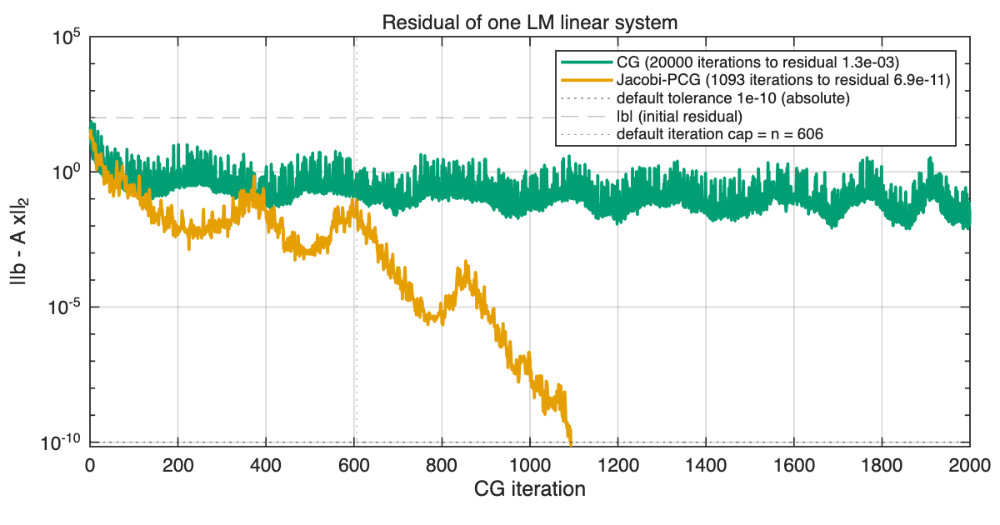
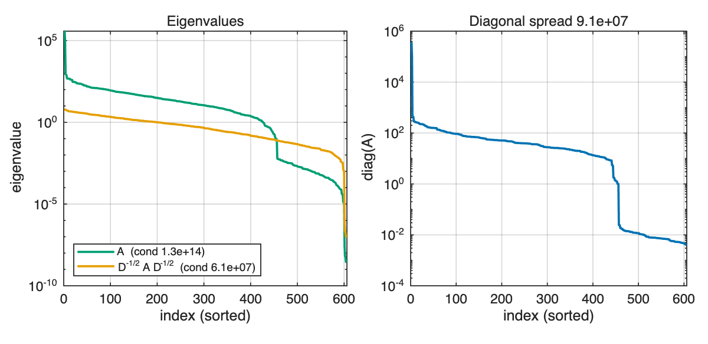
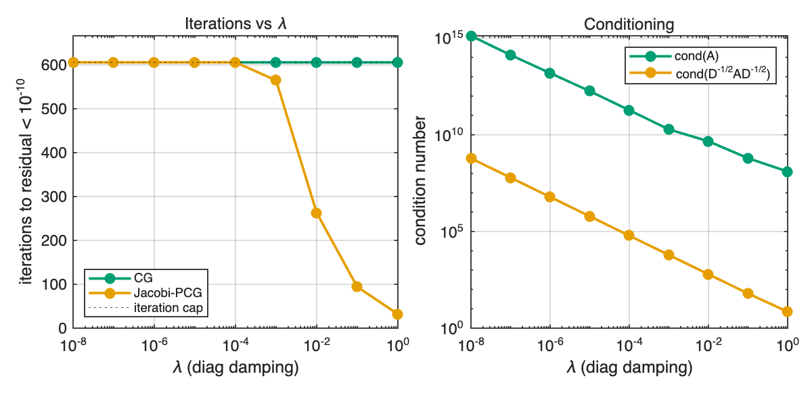
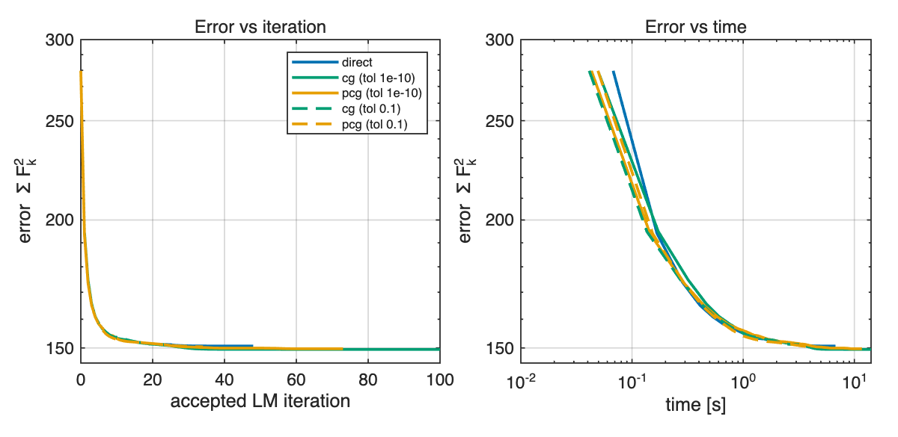
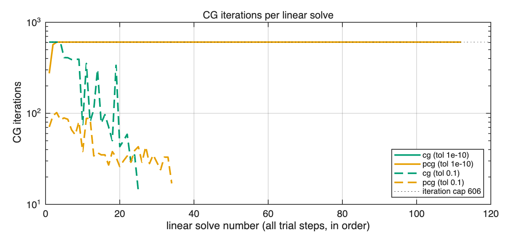

# 07. CG와 PCG: LM의 선형 시스템을 반복법으로 풀기

**한국어** | [English](07_cg_pcg.en.md)

## 이 문서에서 배우는 것

- LM의 매 반복은 $606\times606$ 대칭 양의 정부호 선형 시스템 $A d=b$를 풉니다. 이것을 `A \ b`(direct) 대신 켤레기울기법(conjugate gradient, CG)이나 Jacobi 전처리 CG(PCG)로 푸는 방법과, 이 문제에서 그것이 왜 어려운지를 이해합니다.
- 핵심 결과는 기본 허용치(절대 잔차 `1e-10`)와 기본 반복 상한(606)에서 **일반 CG는 상한에 걸려 선형 시스템을 거의 풀지 못한다**는 것입니다. LM 반복 5회째의 실제 시스템에서 CG는 606번 반복 후 잔차 8.789e-01, 직접 해와의 상대 오차 9.980e-01로 끝납니다. 상한을 20000으로 올려도 잔차 1.313e-03입니다. PCG는 1093번이 필요합니다.
- 증거는 조건수입니다. 이 시스템의 조건수는 1.339e+14이고, Jacobi 전처리 후에도 6.087e+07입니다.

스크립트: [`tutorials/t07_cg_pcg.m`](../tutorials/t07_cg_pcg.m), 로그: [`tutorials/output/t07_cg_pcg.log`](../tutorials/output/t07_cg_pcg.log)

## 실행 방법

```matlab
setup
run('tutorials/t07_cg_pcg.m')
```

5개의 LM 실행이 포함되어 있어 이 시리즈에서 가장 오래 걸리는 스크립트 중 하나입니다(로그의 `finished in` 줄은 52.0 s). 그림 5장이 생성됩니다.

## 본문

### 어떤 시스템인가

LM의 시스템은 $A=J^\top J+\lambda\,\mathrm{diag}(J^\top J)$, $b=-J^\top F$이고 크기는 $606\times606$입니다. LM 반복 5회째 직후에 만든 시스템은 다음과 같습니다(로그).

```
System from LM iteration 5 (err 158.2854): lambda = 1.0e-07, n = 606, nnz(A) = 124538 (33.9% dense), |b| = 99.51
direct A\b : 0.0025 s, residual |b - A x| = 9.233e-12
```

$A$의 33.9%가 0이 아닙니다. 606 x 606의 작은 문제여서 `A \ b`는 0.0025 s로 끝나고 잔차가 9.233e-12입니다. 반복법은 이 크기에서는 이점이 없고, 이 문서의 목적은 반복법이 어떻게 동작하고 어디서 막히는지를 보는 것입니다.

### 코드: `conjGrad`

`edsm.solvers.conjGrad`(`+edsm/+solvers/conjGrad.m`)는 CG와 전처리 CG를 하나의 함수로 구현합니다. 한 반복은 다음과 같습니다(복사).

```matlab
    Ap = A * p;
    pAp = p' * Ap;
    if pAp <= 0, break, end
    alpha = rz / pAp;
    x = x + alpha * p;
    r = r - alpha * Ap;
    rn = sqrt(r' * r);
```

옵션은 `precond`(`'none'` 또는 `'jacobi'`), `tol`(기본 `1e-10`), `maxIter`(기본 `numel(b)`)입니다. 코드가 교과서와 다른 점은 다음과 같습니다.

- **절대 허용치.** 종료 조건은 $\|r\|<\mathrm{tol}$이고(상대값 $\|r\|<\mathrm{tol}\,\|b\|$이 아님), $r$은 갱신된 잔차 $b-Ax$입니다. 위 시스템에서는 $\|b\|=99.51$이므로 `1e-10`은 상대값으로 약 $1.0\times10^{-12}$($1\mathrm{e}{-10}/99.51$)에 해당합니다. 꽤 엄격합니다.
- **반복 상한이 $n$.** 정확 산술에서 CG는 $n$번 안에 끝나지만, 부동소수점에서는 조건수가 크면 그렇지 않습니다(아래 결과).
- Jacobi 전처리는 $M=\mathrm{diag}(A)$이며 0 이하인 원소는 1로 바꿉니다. 적용은 `z = r ./ dg`로 원소별 나누기입니다.
- $p^\top Ap\le0$이면 $A$가 양의 정부호가 아니라고 보고 반복을 중단합니다.

`levenbergMarquardt`에서는 옵션 `linearSolver`가 `'cg'`이면 `precond = 'none'`, `'pcg'`이면 `'jacobi'`로 위 함수를 부르고 `cgTol`(기본 `1e-10`), `cgMaxIter`(기본 `numel(P0)`)가 그대로 전달됩니다. 반복 횟수는 `hist.linIters`에 기록됩니다.

## 결과

### 1. 시스템 하나에서의 비교

```
cg   (precond none  ):  606 iterations, 0.0385 s, final residual 8.789e-01, relative error vs direct 9.980e-01
pcg  (precond jacobi):  606 iterations, 0.0328 s, final residual 9.527e-02, relative error vs direct 5.554e-02
cg   with cap 20000: 20000 iterations, final residual 1.313e-03, relative error vs direct 6.261e-01
pcg  with cap 20000: 1093 iterations, final residual 6.872e-11, relative error vs direct 1.158e-09
first iteration with residual < 1e-10  : cg never, pcg 1093
first iteration with residual < 1e-06  : cg never, pcg 923
first iteration with residual < 0.001  : cg 5437, pcg 466
first iteration with residual < 0.1    : cg 138, pcg 114
first iteration with residual < 1      : cg 23, pcg 32
```

- 기본 상한 606번에서 CG는 직접 해와 상대 오차가 9.980e-01, 즉 거의 100% 틀린 해를 돌려줍니다. PCG는 5.554e-02입니다. 둘 다 충분하지 않습니다.
- 상한을 20000으로 올려도 CG는 잔차를 `1e-10` 아래로 내리지 못하고(1.313e-03), 해도 직접 해와 6.261e-01 차이입니다. PCG는 1093번에 `1e-10` 아래로 내려가며(6.872e-11) 상대 오차가 1.158e-09입니다. 둘 다 정확 산술의 $n=606$번을 넘어섭니다. 이 정도 조건수에서는 부동소수점 오차 때문에 켤레성이 깨진다는 것이 알려진 설명이지만, 스크립트는 이를 직접 검증하지는 않았습니다.
- 초반에는 CG가 오히려 빠릅니다. 잔차를 1 아래로 내리는 데 CG 23번, PCG 32번이 걸립니다. 0.1 아래는 138번 대 114번에서 역전되고, `1e-3` 아래는 5437번 대 466번으로 PCG가 압도적입니다.
- 시간은 직접 풀이가 0.0025 s, CG 0.0385 s, PCG 0.0328 s로 이 크기에서는 직접 풀이가 훨씬 빠릅니다(기계에 따라 달라지는 값이며 대략적인 비교입니다).



*그림 1. 이 선형 시스템에서 CG(초록)와 Jacobi-PCG(주황)의 잔차 $\|b-Ax\|_2$(로그 축). 가로 점선이 기본 허용치 `1e-10`, 가로 파선이 $\|b\|$(초기 잔차), 세로 점선이 기본 반복 상한 606입니다. CG의 잔차는 크게 줄지 않고 오르내리며, PCG는 오르내리면서 점차 내려가 1093번에서 허용치에 닿습니다(그림 가로축은 2000까지, CG는 실제로 20000번까지 실행했습니다). 두 곡선 모두 단조롭지 않습니다.*

### 2. 왜: 고유값 분포와 대각의 편차

CG의 반복 수는 고유값이 모여 있을수록 적고 조건수가 클수록 늘어납니다. Jacobi-PCG는 $D=\mathrm{diag}(A)$로 $D^{-1/2}AD^{-1/2}$에 CG를 적용하는 것과 같으며 대각이 모두 1이 됩니다. 로그입니다.

```
diag(A): min 4.087e-03, max 3.703e+05, spread max/min = 9.061e+07
eigenvalues of A       : max 3.7766e+05, min 2.8203e-09, cond = 1.339e+14
eigenvalues of D^-1/2AD^-1/2: max 6.0870e+00, min 1.0000e-07, cond = 6.087e+07
smallest eigenvalue of the scaled matrix 1.0000e-07 vs lambda 1.0e-07 (null directions of J'J are only lifted by the damping)
eigenvalues below 1e-3 * largest: A 588, scaled 17
eigenvalues below 1e-6 * largest: A 163, scaled 6
```

- 대각 원소의 편차가 $9.061\times10^{7}$배입니다. 파라미터마다 스케일이 크게 다르다는 뜻이고, Jacobi 전처리가 겨냥하는 것이 이 편차입니다.
- 조건수는 1.339e+14에서 6.087e+07로 약 $2.2\times10^{6}$배 개선됩니다($1.339\times10^{14}/6.087\times10^{7}$). 그러나 6.087e+07은 여전히 매우 큽니다.
- 스케일된 행렬의 최소 고유값 1.0000e-07은 $\lambda=10^{-7}$과 같습니다. $J^\top J$의 영공간(03장) 방향은 **오직 감쇠항만이** 양의 값으로 끌어올리기 때문입니다.
- 스케일 전에는 최대 고유값의 `1e-3`배보다 작은 고유값이 588개이고, 스케일 후에는 17개입니다. 전처리가 고유값을 모으지만 작은 쪽 꼬리가 남습니다.



*그림 2. 왼쪽은 $A$(초록)와 $D^{-1/2}AD^{-1/2}$(주황)의 정렬된 고유값(로그 축), 오른쪽은 $\mathrm{diag}(A)$의 정렬된 값입니다. 전처리 후 고유값이 훨씬 좁은 범위에 모이지만 마지막 몇 개가 급격히 작아지는 꼬리는 둘 다 있습니다. 대각은 450번째 부근에서 계단식으로 내려갑니다.*

### 3. $\lambda$에 대한 의존

LM은 수렴하면서 $\lambda$를 줄이므로 $A$가 점점 나빠집니다. 같은 $J$에서 $\lambda$만 바꿔 반복 수와 조건수를 비교합니다(`diag` 감쇠, 로그).

```
lambda      cond(A)     cond(scaled)   CG iters   PCG iters   (cap 606)
   1e-08   1.319e+15     6.087e+08       606        606
   1e-07   1.339e+14     6.087e+07       606        606
   1e-06   1.554e+13     6.087e+06       606        606
   1e-05   1.819e+12     6.087e+05       606        606
   1e-04   1.867e+11     6.087e+04       606        606
   1e-03   1.899e+10     6.088e+03       606        565
   1e-02   4.605e+09     6.097e+02       606        263
   1e-01   6.164e+08     6.187e+01       606         94
   1e+00   1.261e+08     7.087e+00       606         32
```



*그림 3. 왼쪽은 잔차 $10^{-10}$ 아래에 이르는 반복 수(CG 초록, PCG 주황, 점선이 상한 606), 오른쪽은 조건수(로그 축)입니다. CG는 시험한 $\lambda$(1e-08~1)에서 모두 상한에 걸립니다. PCG는 $\lambda\ge10^{-3}$에서 비로소 상한 아래로 내려오고 $\lambda=1$에서 32번이 됩니다. 스케일된 조건수는 $\lambda$에 거의 반비례합니다(`6.087e+08`에서 `7.087e+00`).*

LM이 실제로 쓰는 $\lambda$는 06장의 표에서 반복 5 이후 대부분 `1e-06` 부근이고(최소 `1e-08`, `1e-02`에서 시작하지만 곧 내려감), 이 표의 앞쪽 줄이 현실적인 조건입니다. 거기서는 PCG도 상한 606에 걸립니다. $\lambda$가 크면 PCG가 빨라지지만 그것은 감쇠가 큰, 즉 짧은 단계를 만드는 구간입니다.

### 4. 전체 LM 실행

같은 LM 설정(`diag`, `maxIter = 100`, 기본 종료 조건)에서 선형 솔버만 바꿉니다. `cgTol = 0.1` 변형은 선형 시스템을 대충 푸는 inexact LM입니다. 로그입니다.

```
solver            iter stop        final err     |grad|_2  time [s]       solves mean CG it  max CG it
direct              48 funTol       150.6621       0.2019      6.77           72          -          -
cg (tol 1e-10)     100 maxIter      149.5043      0.01294     14.13          100      606.0        606
pcg (tol 1e-10)     73 funTol       149.7331       0.1988     11.69          112      602.7        606
cg (tol 0.1)        25 lambdaMax    151.1579        0.198      3.19           57      108.8        606
pcg (tol 0.1)       34 lambdaMax    150.4086       0.1961      4.16           75       22.1        102
(solves = linear solves incl. rejected trials; mean/max CG iterations per solve; - = direct)
```

`solves`는 거절된 시도를 포함한 선형 풀이 횟수, `|grad|_2`는 마지막 점에서 다시 계산한 $\|2J^\top F\|_2$입니다.



*그림 4. 선형 솔버별 LM의 오차. 왼쪽은 반복에 대해, 오른쪽은 시간(로그 축)에 대해서입니다. 실선이 `tol 1e-10`(direct 파랑, CG 초록, PCG 주황), 점선이 `tol 0.1`입니다. 모든 곡선이 거의 겹쳐 150 부근으로 내려갑니다. 시간 축에서는 `tol 0.1` 변형이 약간 왼쪽에서 시작해 빠르게 내려오지만 일찍 끝납니다.*

- **일반 CG(`tol 1e-10`)는 풀이마다 상한 606에 걸립니다**(평균 606.0, 최대 606). 즉 선형 시스템을 정확히 풀지 않는 inexact LM입니다. 그런데도 `err` 149.5043까지 내려가며 이 표에서 가장 낮습니다. 하지만 종료 이유가 `maxIter`(100번)인 반면 direct는 48번 `funTol`로 끝났으므로 이 값의 비교는 방법의 순위가 아닙니다.
- PCG(`tol 1e-10`)도 평균 602.7번으로 대부분의 풀이가 상한 근처입니다(73번 반복, 풀이 112번).
- `tol 0.1`은 풀이당 반복이 크게 줄어듭니다(CG 평균 108.8, PCG 평균 22.1). 그러나 둘 다 `lambdaMax`로 일찍 끝납니다(25번, 34번 반복). 대충 푼 단계는 거절되기 쉬워 $\lambda$가 계속 올라가는 실패 방식입니다. 이 스크립트는 거절 횟수를 따로 출력하지 않았으므로 정확한 경과는 보이지 않습니다.
- 시간은 direct(6.77 s)가 CG(14.13 s)나 PCG(11.69 s)보다 짧습니다. 시간 값은 기계 부하에 따라 변하므로(08장의 같은 실행은 다른 값) 대략적인 비교로만 보십시오.



*그림 5. 선형 풀이 번호(거절된 시도 포함)별 CG 반복 수(로그 축). 실선(`tol 1e-10`)은 CG와 PCG 모두 거의 모든 풀이에서 상한 606에 붙어 있고(PCG는 처음 한두 번만 더 낮음), 점선(`tol 0.1`)은 CG가 606에서 시작해 점차 떨어지고 PCG는 처음부터 100 안팎에서 더 낮은 값으로 내려갑니다.*

원본 CG/PCG 스크립트는 거절 후에도 감쇠 행렬을 다시 만들지 않아 `lambda`를 올려도 시스템이 바뀌지 않았고, 그래서 반복을 3~4번만 하고 멈췄습니다. `levenbergMarquardt`는 매번 `A`를 새 $\lambda$로 다시 만들어 이를 고쳤습니다([원본 코드 대비 달라진 점](legacy_changes.md)).

## 정리 / 다음 단계

- 이 문제의 LM 시스템은 조건수 1.339e+14로 매우 나쁘고 Jacobi 전처리로도 6.087e+07입니다. 기본 허용치(절대 `1e-10`)와 상한 606에서는 CG가 풀이를 끝내지 못하고 PCG도 대부분 상한에 닿습니다.
- 그래도 LM은 근사 풀이로 `err`이 149.5(CG)~150.7(direct)까지 내려갑니다. 최종 오차 차이는 종료 이유가 서로 달라 순위로 읽을 수 없습니다.
- 허용치를 `0.1`로 느슨하게 하면 풀이당 반복 수는 크게 줄지만 `lambdaMax`로 일찍 멈춥니다.
- 이 크기($n=606$, 33.9%가 0이 아님)에서는 직접 풀이가 가장 빠릅니다. CG/PCG는 일반적으로 $n$이 훨씬 크고 $A$가 더 희소한 문제를 위한 방법입니다.

다음 문서: [08. 모든 솔버 비교](08_compare.md)에서 지금까지의 솔버를 같은 시작점에서 나란히 비교합니다.
