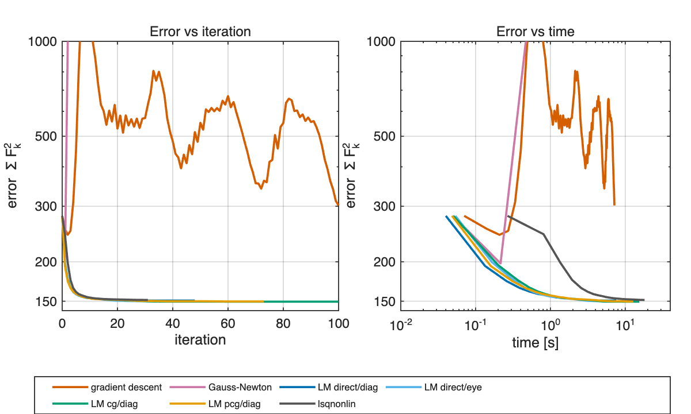
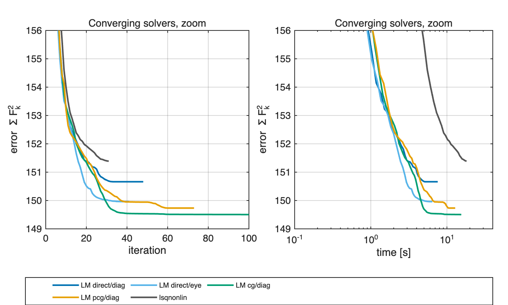
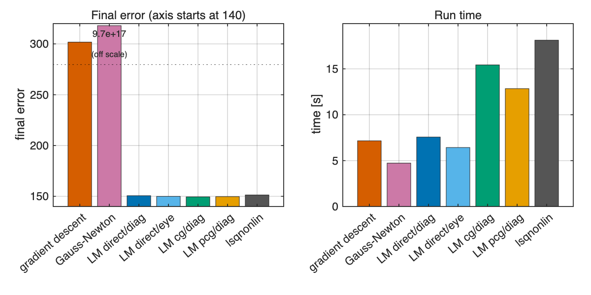
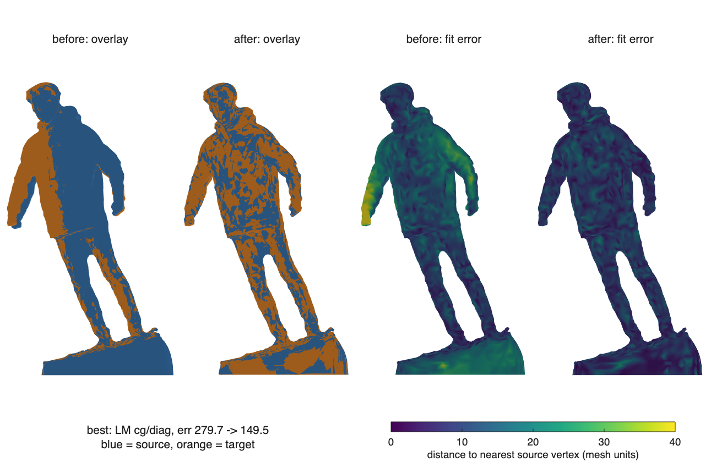

# 08. Comparing all solvers

[한국어](08_compare.md) | **English**

## What you will learn

- You compare the solvers covered so far (gradient descent, Gauss–Newton, 4 LM variants, and MATLAB's `lsqnonlin`) in one table, on the same problem from the same starting point, and learn how far the numbers can be trusted.
- The main result has two parts. Gradient descent (final 301.762) and Gauss–Newton (final 9.65389e+17) ended worse than the starting value of 279.6781, while the 4 LM variants and `lsqnonlin` all reached 149.5043 to 151.3867.
- Differences within that range are not a ranking. The solvers stopped for different reasons (`funTol`, `maxIter`), so the values were not obtained under the same conditions.

Script: [`tutorials/t08_compare.m`](../tutorials/t08_compare.m), log: [`tutorials/output/t08_compare.log`](../tutorials/output/t08_compare.log)

## How to run

```matlab
setup
run('tutorials/t08_compare.m')
```

Running all seven solvers takes a long time (tens of seconds), so the results are cached in `tutorials/output/t08_runs.mat`. If this file exists, it is read instead of rerunning (the `Loaded cached runs from ...` line of the log). To recompute, change `forceRecompute = true` near the top of the script or delete the cache file. The cache is excluded from the repository by `.gitignore`. `lsqnonlin` requires the Optimization Toolbox. 4 figures are produced.

The timings on this page are those of the run that created the cache. Timings vary a lot with machine load (they also differ from the run with the same settings in tutorial 07), so look at them only as relative magnitudes. The development environment is an Apple Silicon Mac with MATLAB R2026b.

## Walkthrough

### Comparison conditions

Every solver starts from the identity starting point of `edsm.initParam` and uses the corrected analytic Jacobian. The settings are in this part of the script (copied).

```matlab
runFun = {
    @() edsm.solvers.gradientDescent(P0, model, struct('maxIter', 100))
    @() edsm.solvers.gaussNewton(P0, model, struct('maxIter', 30))
    @() edsm.solvers.levenbergMarquardt(P0, model, struct('maxIter', 100))
    @() edsm.solvers.levenbergMarquardt(P0, model, struct('maxIter', 100, 'damping', 'eye'))
    @() edsm.solvers.levenbergMarquardt(P0, model, struct('maxIter', 100, 'linearSolver', 'cg'))
    @() edsm.solvers.levenbergMarquardt(P0, model, struct('maxIter', 100, 'linearSolver', 'pcg'))
    @() edsm.solvers.lsqnonlinBaseline(P0, model, struct('maxIter', 30))
    };
```

`lsqnonlinBaseline` (`+edsm/+solvers/lsqnonlinBaseline.m`) calls `lsqnonlin` with the options of the original `Jall_FINAL` script (analytic Jacobian supplied, the default trust-region-reflective algorithm, `FunctionTolerance = 1e-10`, `MaxIterations = 30`). `lsqnonlin` reports the limit after performing `maxIter`+1 iterations (31), which is why the iteration count in the log is 31.

The comparison metrics are `err` recomputed at the final `P` (`final err`), the minimum error over the recorded history (`min err`), $\|2J^\top F\|_2$ recomputed at the final point (`|grad|_2`, a 2-norm), and the time measured by the solver itself. `hist.gradNorm` (provided only by the LM variants, $\|2J^\top F\|_\infty$) is printed separately.

## Results

```
solver              iter stop              final err        min err     |grad|_2  time [s]
gradient descent     100 maxIter             301.762        243.514         4976      7.16
Gauss-Newton          30 maxIter         9.65389e+17        197.532    1.405e+16      4.73
LM direct/diag        48 funTol              150.662        150.662       0.2019      7.57
LM direct/eye         41 funTol              149.962        149.962     0.003984      6.43
LM cg/diag           100 maxIter             149.504        149.504      0.01294     15.43
LM pcg/diag           73 funTol              149.733        149.733       0.1988     12.85
lsqnonlin             31 maxIter             151.387        151.387        10.99     18.12
```

```
lowest final error: LM cg/diag with 149.5043 (start 279.6781)
final errors of the converging solvers (LM variants, lsqnonlin) span 149.5043 - 151.3867; differences of this size between
runs that stopped for different reasons are not a ranking of the methods.
hist.gradNorm (inf-norm) for LM direct/diag   final 0.1926
hist.gradNorm (inf-norm) for LM direct/eye    final 0.003218
hist.gradNorm (inf-norm) for LM cg/diag       final 0.00726
hist.gradNorm (inf-norm) for LM pcg/diag      final 0.1928
```



*Figure 1. Left: the error against iterations. Right: the error against time (log axis). The y axis is clipped to 140 to 1000, so gradient descent (orange) swings widely near the top and Gauss–Newton (pink) disappears off the chart after the second iteration. The other five solvers almost overlap near 150.*



*Figure 2. Only the converging solvers, with the y axis zoomed to 149 to 156. Left is against iterations, right against time. `LM direct/diag` (dark blue) flattens out and stops at about 150.7 and `LM pcg/diag` (yellow) at about 149.7, while `LM cg/diag` (green) keeps descending toward 149.5 until iteration 100. `lsqnonlin` (gray) ends at iteration 31 at about 151.4, still descending.*

### How to read the results

**The two solvers that failed.**
- Gradient descent rises from its minimum of 243.514 (iteration 2 of 100) and ends at a final 301.762, and its gradient norm (2-norm) of 4976 is far larger than at the starting point (944.2 in tutorial 04). The cause is the violation of the stability limit seen in tutorial 04.
- Gauss–Newton starts from a minimum error of 197.532 (the first step) and, after 30 iterations, reaches 9.65389e+17 with a gradient norm of 1.405e+16. The cause is the small-singular-value directions of tutorial 05.

**The five solvers that converged.** Their final errors lie in 149.5043 to 151.3867. This range must not be read as a ranking.
- The stop reasons are mixed: `funTol` (direct/diag, direct/eye, pcg) and `maxIter` (cg, lsqnonlin). `LM cg/diag` ended by hitting the cap at iteration 100 and is still descending in Figure 2, so its value was not obtained with the same stopping rule.
- `lsqnonlin` ended at iteration 31 (`maxIter`), and its gradient norm (2-norm) at the final point is 10.99, larger than the other LM variants (0.003984 to 0.2019), so it was stopped in the middle of converging.
- The objective itself is piecewise smooth (tutorial 02). Correspondences are recomputed at every evaluation, so different paths end at slightly different points, and not all of those points are strict stationary points. The large difference in gradient norm between 0.2019 (direct/diag) and 0.003984 (direct/eye) shows this.
- When quoting a gradient norm, you have to distinguish the norms. The last `hist.gradNorm` (infinity norm) of `LM direct/diag` is 0.1926, and the 2-norm recomputed at the final point is 0.2019. These are different quantities.

**Time.** Timings can only be read as a rough relative comparison. In this log the direct variants (6.43 to 7.57 s) are shorter than the CG/PCG variants (12.85 to 15.43 s) or `lsqnonlin` (18.12 s). As seen in tutorial 07, this is because at this size CG/PCG iterate close to the cap of 606 in every solve.



*Figure 3. Left: the final error per solver (the axis starts at 140; Gauss–Newton is off the axis, so its value `9.65389e+17` is shown as text (the figure itself shows the rounded `9.7e+17`)), with the dotted line at the starting value. Only gradient descent and Gauss–Newton are above the starting value, while the LM variants and `lsqnonlin` are all near 150. Right: the run time per solver.*

### The lowest-error result

The script plots the result of the solver with the lowest final error (`LM cg/diag`). The "best" in the figure does not mean that the method is better, for the reasons given above; it simply means that this run had the lowest error.

```
best result (LM cg/diag): target-to-source distance mean 13.70 -> 9.48, 95% 26.42 -> 17.29, max 57.63 -> 37.06
```



*Figure 4. The two left panels show the overlap before and after deformation (blue is the source, orange is the target), and the two right panels show the distance from each target vertex to the nearest source vertex (distances of 40 and above share one color). After deformation, blue and orange are mixed like patches over most of the torso (the surfaces overlap), and the distance map on the right becomes darker overall. It looks similar to the result of 30 LM iterations in tutorial 00 (mean distance 9.52 versus 9.48) but does not match it exactly.*

This figure is almost the same as the LM result in tutorial 00 (mean 9.52, maximum 37.23), and no solver reaches a state where "the surfaces overlap completely." As seen in tutorial 02, even after LM `Efit` remains at 109.709 and `Elap` hardly decreases. This script did not separately check why all the solvers level off near 150 (the expressiveness of the model, the regularization weights, local minima, and so on).

## Summary

- On this problem, fixed-step gradient descent and Gauss–Newton without step control fail, while the LM family, which has damping, descends stably.
- However the linear system is solved (direct, CG, PCG), LM reaches a similar `err` (149.5 to 150.7). At this size, direct is the simplest and fastest.
- Small differences in final `err`, timings, and gradient norms must be read together with the stop reason and the definition of the norm. The numbers in the logs are not a benchmark.
- The page that connects what we have covered so far to the original scripts is [what changed from the legacy code](legacy_changes.en.md).
