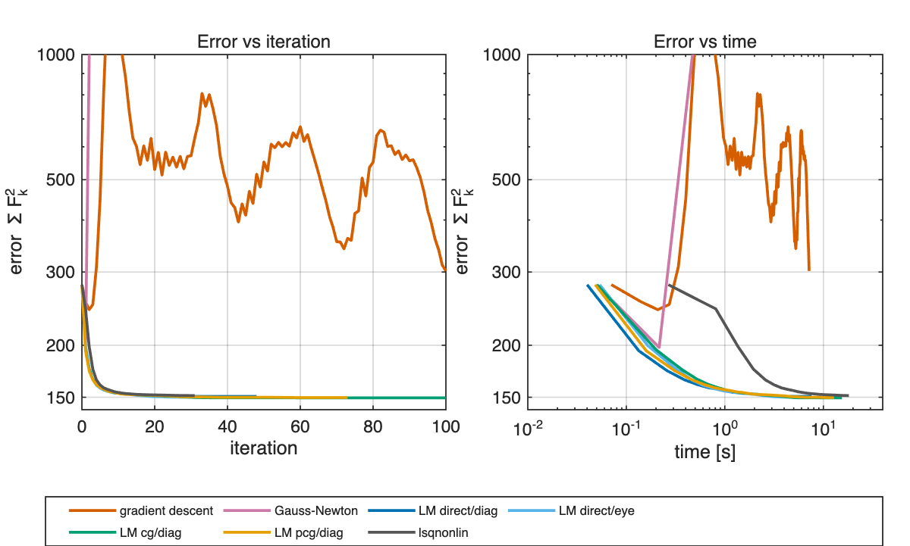
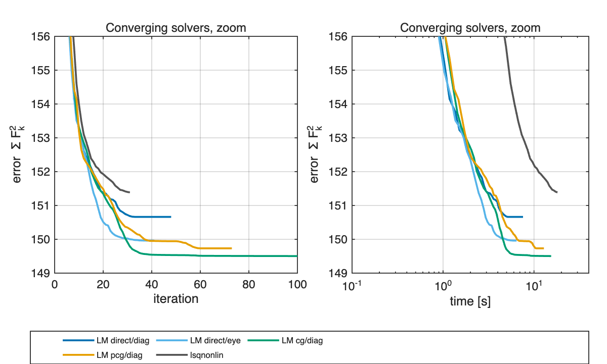
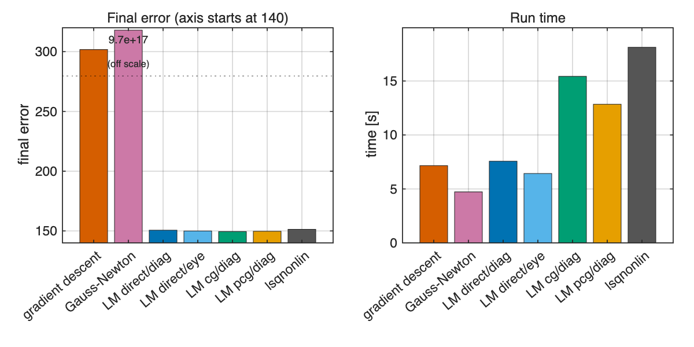
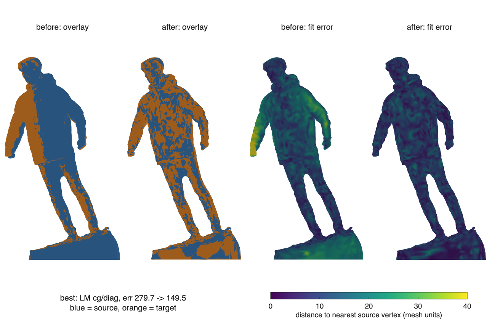

# 08. 모든 솔버 비교

**한국어** | [English](08_compare.en.md)

## 이 문서에서 배우는 것

- 지금까지 다룬 솔버(경사하강법, Gauss–Newton, LM 변형 4개, MATLAB의 `lsqnonlin`)를 같은 문제, 같은 시작점에서 한 표로 비교하고, 숫자를 어디까지 믿을 수 있는지 배웁니다.
- 핵심 결과는 두 갈래입니다. 경사하강법(최종 301.762)과 Gauss–Newton(최종 9.65389e+17)은 시작값 279.6781보다 나빠졌고, LM 변형 4개와 `lsqnonlin`은 모두 149.5043~151.3867에 도달했습니다.
- 이 범위 안의 차이는 순위가 아닙니다. 솔버마다 멈춘 이유가 달라서(`funTol`, `maxIter`) 같은 조건에서 끝난 값이 아니기 때문입니다.

스크립트: [`tutorials/t08_compare.m`](../tutorials/t08_compare.m), 로그: [`tutorials/output/t08_compare.log`](../tutorials/output/t08_compare.log)

## 실행 방법

```matlab
setup
run('tutorials/t08_compare.m')
```

일곱 솔버를 모두 돌리면 오래 걸리므로(수십 초) 결과를 `tutorials/output/t08_runs.mat`에 캐시합니다. 이 파일이 있으면 다시 돌리지 않고 읽습니다(로그의 `Loaded cached runs from ...` 줄). 새로 계산하려면 스크립트 앞부분의 `forceRecompute = true`로 바꾸거나 캐시 파일을 지웁니다. 캐시는 `.gitignore`로 저장소에서 제외됩니다. `lsqnonlin`은 Optimization Toolbox가 필요합니다. 그림 4장이 생성됩니다.

이 문서의 시간 값은 캐시를 만든 실행의 값입니다. 시간은 기계 부하에 따라 크게 달라지므로(07장의 같은 설정 실행과도 다릅니다) 상대적인 크기로만 보십시오. 개발 환경은 Apple Silicon Mac, MATLAB R2026b입니다.

## 본문

### 비교 조건

모든 솔버는 `edsm.initParam`의 항등 시작점과 수정된 해석적 Jacobian에서 출발합니다. 설정은 스크립트의 다음 부분입니다(복사).

```matlab
runFun = {
    @() edsm.solvers.gradientDescent(P0, model, struct('maxIter', 100))
    @() edsm.solvers.gaussNewton(P0, model, struct('maxIter', 30))
    @() edsm.solvers.levenbergMarquardt(P0, model, struct('maxIter', 100))
    @() edsm.solvers.levenbergMarquardt(P0, model, struct('maxIter', 100, 'damping', 'eye'))
    @() edsm.solvers.levenbergMarquardt(P0, model, struct('maxIter', 100, 'linearSolver', 'cg'))
    @() edsm.solvers.levenbergMarquardt(P0, model, struct('maxIter', 100, 'linearSolver', 'pcg'))
    @() edsm.solvers.lsqnonlinBaseline(P0, model, struct('maxIter', 30))
    };
```

`lsqnonlinBaseline`(`+edsm/+solvers/lsqnonlinBaseline.m`)은 원본 `Jall_FINAL` 스크립트의 옵션(해석적 Jacobian 제공, 기본 알고리즘인 trust-region-reflective, `FunctionTolerance = 1e-10`, `MaxIterations = 30`)으로 `lsqnonlin`을 부릅니다. `lsqnonlin`은 `maxIter`+1번(31번) 반복한 뒤 한계를 보고하기 때문에 로그의 반복 횟수가 31입니다.

비교 지표는 마지막 `P`에서 다시 계산한 `err`(`final err`), 기록 중 최솟값(`min err`), 마지막 점에서 다시 계산한 $\|2J^\top F\|_2$(`|grad|_2`, 2-노름), 솔버가 스스로 잰 시간입니다. `hist.gradNorm`(LM 변형만 제공, $\|2J^\top F\|_\infty$)은 별도로 출력합니다.

## 결과

```
solver              iter stop              final err        min err     |grad|_2  time [s]
gradient descent     100 maxIter             301.762        243.514         4976      7.16
Gauss-Newton          30 maxIter         9.65389e+17        197.532    1.405e+16      4.73
LM direct/diag        48 funTol              150.662        150.662       0.2019      7.57
LM direct/eye         41 funTol              149.962        149.962     0.003984      6.43
LM cg/diag           100 maxIter             149.504        149.504      0.01294     15.43
LM pcg/diag           73 funTol              149.733        149.733       0.1988     12.85
lsqnonlin             31 maxIter             151.387        151.387        10.99     18.12
```

```
lowest final error: LM cg/diag with 149.5043 (start 279.6781)
final errors of the converging solvers (LM variants, lsqnonlin) span 149.5043 - 151.3867; differences of this size between
runs that stopped for different reasons are not a ranking of the methods.
hist.gradNorm (inf-norm) for LM direct/diag   final 0.1926
hist.gradNorm (inf-norm) for LM direct/eye    final 0.003218
hist.gradNorm (inf-norm) for LM cg/diag       final 0.00726
hist.gradNorm (inf-norm) for LM pcg/diag      final 0.1928
```



*그림 1. 왼쪽은 반복에 대한 오차, 오른쪽은 시간(로그 축)에 대한 오차입니다. y축은 140~1000으로 잘려 있어서, 경사하강법(주황)은 위쪽에서 크게 흔들리고 Gauss–Newton(분홍)은 두 번째 반복 이후 차트 밖으로 사라집니다. 나머지 다섯 솔버는 150 근처에서 거의 겹칩니다.*



*그림 2. 수렴하는 솔버만 y축 149~156으로 확대했습니다. 왼쪽이 반복, 오른쪽이 시간입니다. `LM direct/diag`(진한 파랑)는 약 150.7에서, `LM pcg/diag`(노랑)는 약 149.7에서 평평해지며 멈추고, `LM cg/diag`(초록)는 100번째 반복까지 계속 149.5 쪽으로 내려갑니다. `lsqnonlin`(회색)은 31번째 반복에서 약 151.4로 아직 내려가는 중에 끝납니다.*

### 읽는 법

**실패한 두 솔버.**
- 경사하강법은 100번의 반복 중 최소 243.514(2번째 반복)에서 올라가 최종 301.762로 끝나고, 기울기 노름(2-노름)이 4976으로 시작점(04장의 944.2)보다 훨씬 큽니다. 원인은 04장에서 본 안정 한계 위반입니다.
- Gauss–Newton은 최소 오차 197.532(첫 단계)에서 시작해 30번 후 9.65389e+17이 되고 기울기 노름이 1.405e+16입니다. 원인은 05장의 작은 특이값 방향입니다.

**수렴한 다섯 솔버.** 최종 오차가 149.5043~151.3867에 있습니다. 이 범위는 순위로 읽으면 안 됩니다.
- 종료 이유가 `funTol`(direct/diag, direct/eye, pcg)인 것과 `maxIter`(cg, lsqnonlin)인 것이 섞여 있습니다. `LM cg/diag`는 100번째 반복에서 상한에 걸려 끝났고 그림 2에서 아직 내려가고 있으므로, 같은 종료 규칙을 쓴 값이 아닙니다.
- `lsqnonlin`은 31번째 반복(`maxIter`)에서 끝났고 마지막 점의 기울기 노름(2-노름)이 10.99로 다른 LM 변형(0.003984~0.2019)보다 크므로, 수렴 도중에 멈춘 것입니다.
- 목적함수 자체가 구간별 매끄럽습니다(02장). 대응이 매 평가마다 다시 계산되므로 경로가 다르면 조금씩 다른 점에서 끝나고, 그 점들이 모두 엄밀한 정지점은 아닙니다. 기울기 노름이 0.2019(direct/diag)와 0.003984(direct/eye)로 크게 다른 것이 이를 보여 줍니다.
- 기울기 노름을 인용할 때는 노름을 구분해야 합니다. `LM direct/diag`의 마지막 `hist.gradNorm`(무한 노름)은 0.1926이고 마지막 점에서 다시 계산한 2-노름은 0.2019입니다. 두 값은 서로 다른 양입니다.

**시간.** 시간은 대략적인 상대 비교로만 볼 수 있습니다. 이 로그에서는 direct 변형(6.43~7.57 s)이 CG/PCG 변형(12.85~15.43 s)이나 `lsqnonlin`(18.12 s)보다 짧습니다. 07장에서 본 대로 이 크기에서는 CG/PCG가 풀이마다 상한 606번에 가까이 반복하기 때문입니다.



*그림 3. 왼쪽은 솔버별 최종 오차(축이 140에서 시작, Gauss–Newton은 축 밖이라 값 `9.65389e+17`을 글자로 표시(그림에는 반올림된 `9.7e+17`)), 점선이 시작값입니다. 경사하강법과 Gauss–Newton만 시작값보다 위에 있고 LM 변형과 `lsqnonlin`은 모두 150 근처입니다. 오른쪽은 솔버별 실행 시간입니다.*

### 가장 낮은 오차의 결과

스크립트는 최종 오차가 가장 낮은 솔버(`LM cg/diag`)의 결과를 그립니다. 그림의 "best"는 위에서 말한 이유로 방법의 우열이 아니라 단순히 이 실행에서 오차가 가장 낮았다는 뜻입니다.

```
best result (LM cg/diag): target-to-source distance mean 13.70 -> 9.48, 95% 26.42 -> 17.29, max 57.63 -> 37.06
```



*그림 4. 왼쪽 두 그림은 변형 전과 후의 겹침(파랑이 소스, 주황이 타깃), 오른쪽 두 그림은 타깃 정점에서 가장 가까운 소스 정점까지의 거리(40 이상은 같은 색)입니다. 변형 후에는 몸통 대부분에서 파랑과 주황이 조각처럼 섞이고(표면이 겹침), 오른쪽 거리 지도는 전체적으로 어두워집니다. 00장의 LM 30회 결과와 비슷한 모습이며(평균 거리 9.52 대 9.48) 완전히 일치하지는 않습니다.*

이 그림은 00장의 LM 결과(평균 9.52, 최대 37.23)와 거의 같고, 어느 솔버로도 "표면이 완전히 겹치는" 값에는 도달하지 못합니다. 02장에서 보았듯 LM 후에도 `Efit`가 109.709로 남고 `Elap`는 거의 줄지 않습니다. 모든 솔버가 150 근처에서 완만해지는 이유(모델의 표현력, 정규화 가중치, 국소 최소 등)를 이 스크립트가 구분해서 확인하지는 않았습니다.

## 정리

- 이 문제에서 고정 스텝 경사하강법과 단계 제어 없는 Gauss–Newton은 실패하고, 감쇠가 있는 LM 계열이 안정하게 내려갑니다.
- 선형 시스템을 어떻게 풀든(direct, CG, PCG) LM은 비슷한 `err`(149.5~150.7)에 도달합니다. 이 크기에서는 direct가 가장 간단하고 빠릅니다.
- 최종 `err`의 작은 차이, 시간, 기울기 노름은 종료 이유와 노름의 정의를 함께 읽어야 합니다. 로그의 숫자는 벤치마크가 아닙니다.
- 지금까지의 내용을 원본 스크립트와 연결하는 문서는 [원본 코드 대비 달라진 점](legacy_changes.md)입니다.
